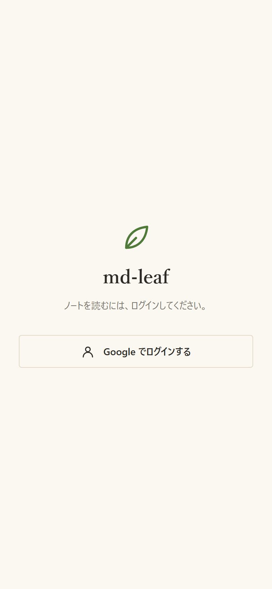
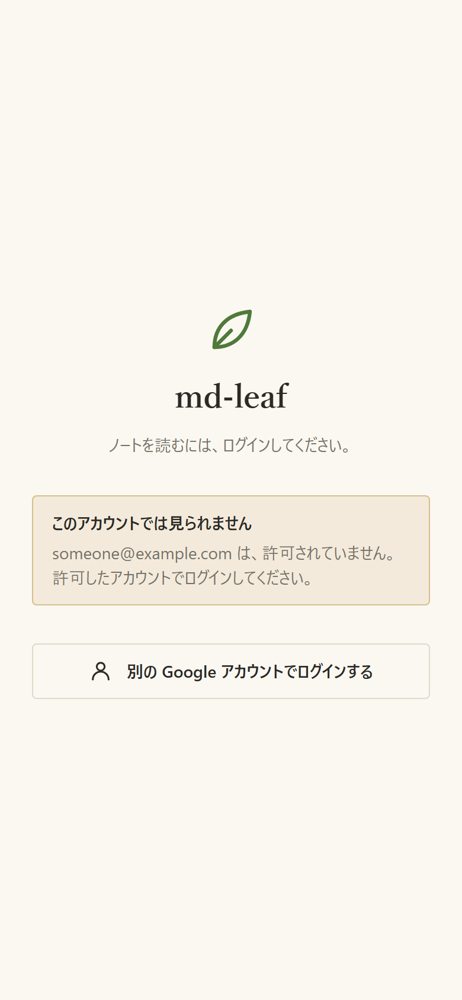
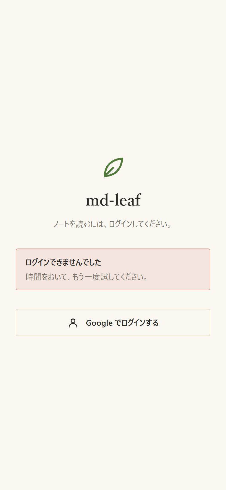
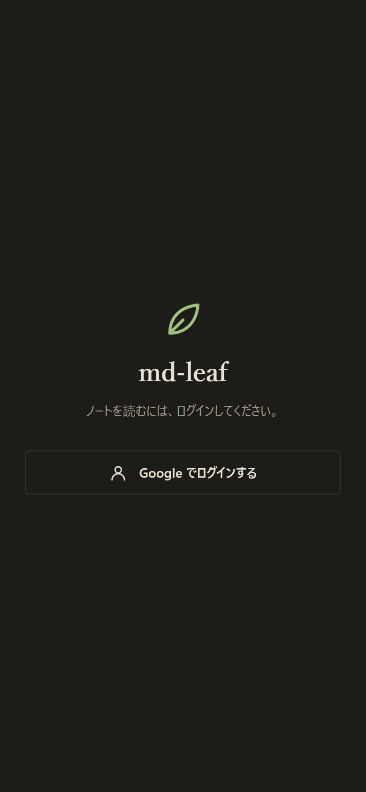
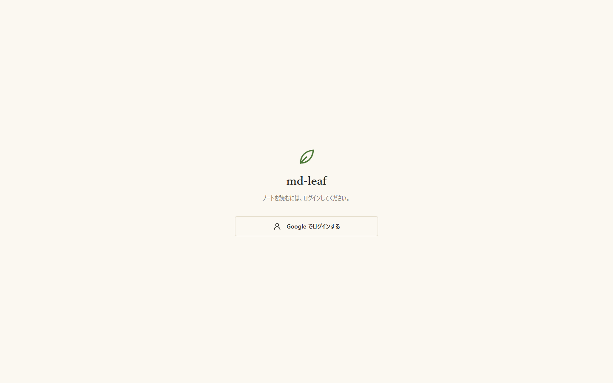
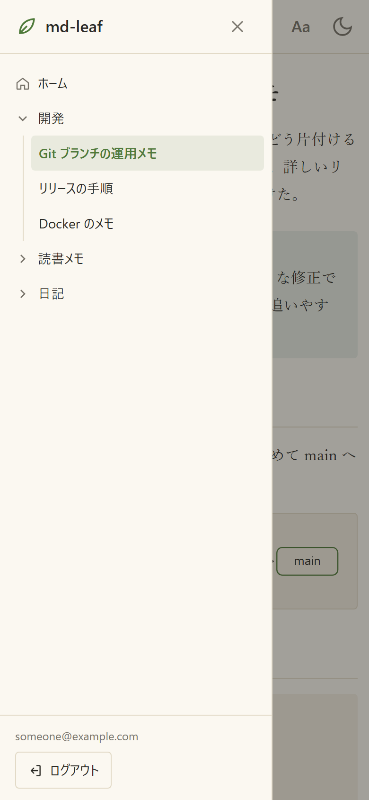
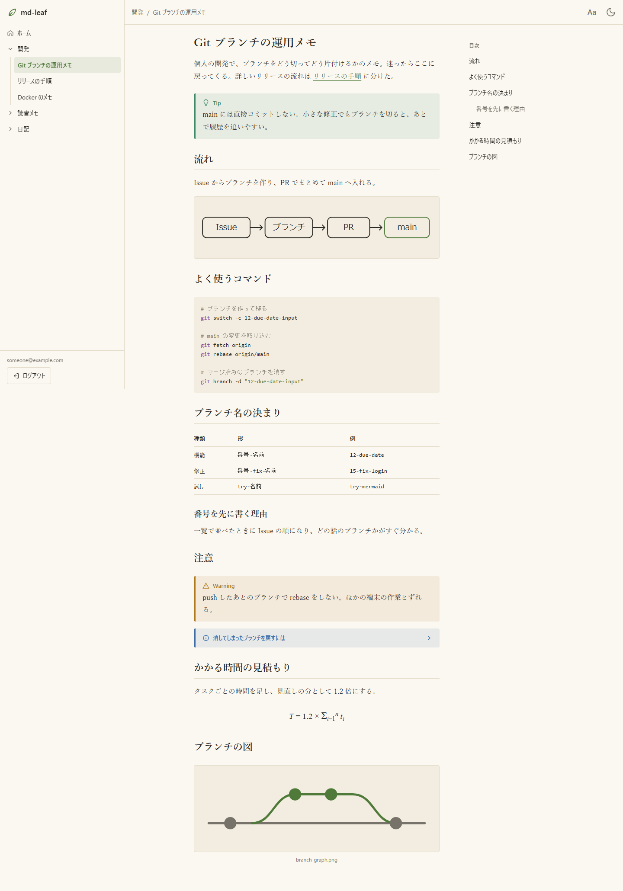

<!--
変更の仕様のひな形。コピーして docs/changes/<年-月-日>-<何をするか>.md を作る（例：2026-09-17-add-due-date.md）。
「なぜ」〜「調べたこと」は、AIが下書きし、人間がプロトタイプを触って直し、合意して決める（/dev-proto）。「画面」のスクリーンショットは、合意したときに足す。
「設計」以降はAIが書いて実装まで進め、人間は機能の PR でレビューする（/dev-build）。
スクリーンショットは、このファイルと同じ名前のフォルダに置く（例：2026-09-17-add-due-date/list-empty.png）。
-->

# 許可した Google アカウントでログイン・ログアウトできる（#2）

## なぜ

ノートは本人だけが読むもので、外部に公開しない（`docs/overview.md`）。ノートを本番（Vercel）に出す前に、許可した Google アカウントでなければ何も見られないようにする。ログインができたら、本番へのデプロイも始める。

## 影響する今の仕様

- 新規：`docs/specs/login.md`（ログイン・ログアウト）

## 使う場面

1. 許可したアドレス（本人の Gmail）の人が、スマホでブックマークしていたノートの URL を開く。ログインしていないので、ログインの画面に移る。「Google でログインする」を押し、Google でアカウントを選ぶと、最初に開こうとしたノートの URL に戻る
2. 許可していないアドレス `someone@example.com` で Google にログインした人が、ログインの画面に戻され、「このアカウントでは見られません」の帯と、そのアドレスが出る。ボタンは「別の Google アカウントでログインする」になり、押すと Google のアカウントを選ぶ画面が出る
3. ログイン中の人が、ログアウトのボタンを押すと、確認なしにログインの画面に移る。そのあとノートの URL を開いても、ログインの画面に移る

## 受け入れ条件

- ログインしていない状態で、どの URL（ホーム、ノート、まだない URL）を開いても、ログインの画面に移る。ノートの中身や一覧は、HTML にも出ない
- ログインの画面：アプリの名前「md-leaf」、「ノートを読むには、ログインしてください。」、「Google でログインする」ボタン
- 「Google でログインする」を押すと、Google のログインに進む。許可したアドレスなら、ホームへ移る。最初に開こうとした URL があれば、そこへ移る
- 許可していないアドレスなら、ログインの画面に warning の帯を出す。見出し「このアカウントでは見られません」、本文「<アドレス> は、許可されていません。許可したアカウントでログインしてください。」。ボタンは「別の Google アカウントでログインする」になり、押すと Google のアカウントを選ぶ画面が出る
- Google でのログインが失敗した、または途中でやめたときは、ログインの画面に danger の帯を出す。見出し「ログインできませんでした」、本文「時間をおいて、もう一度試してください。」。ボタンは「Google でログインする」
- 許可するアドレスは、大文字・小文字を区別しない。許可するアドレスが1つも設定されていなければ、だれもログインできない
- ログイン中にログインの画面を開くと、ホームへ移る
- ログイン中は、ログイン中のメールアドレスと「ログアウト」ボタンが出る。押すと確認なしにログアウトし、ログインの画面へ移る
- ログインの状態は、ブラウザを閉じても続く。最後に開いてから30日たつと、もう一度ログインが要る（開くたびに30日に延びる）
- 許可するアドレスから外して再デプロイすると、そのアドレスでログイン中の人も、次に開いたときにログインの画面に移る
- 本番（Vercel）にデプロイされ、本番の URL でログインできる。手元（localhost）でもログインできる。Vercel のプレビュー（PR ごとの URL）は、ログインの画面までしか見られない
- 許可するアドレスは、コードやリポジトリに書かず、Vercel の環境変数にだけ置く
- ログインを飛ばす入口（テスト用のログインなど）が、アプリにない
- `README.md` に、要る環境変数の名前と、Google のログインの設定（リダイレクト URI）と Vercel の環境変数の設定の手順が書かれている（値は書かない）

## 画面

立ち上げで合意した画面。`/dev-build` で本番から撮るまでは、`docs/agreed-screens/` の画像を参照する。

### ログイン（login）

画面の中央に、若葉のアイコン、アプリの名前「md-leaf」（font-body）、案内「ノートを読むには、ログインしてください。」（muted）、帯（あるときだけ）、ボタン（bg の地に border の枠、人のアイコンつき、幅いっぱい）を縦に並べる。PC では同じ並びを狭い幅（container-sm）で中央に置く。上の帯とノートの一覧は出さない。

| 状態 | 表示 | スクリーンショット |
| --- | --- | --- |
| ログイン前 | 上のとおり。帯なし。ボタンは「Google でログインする」 |  |
| 許可していないアカウント | warning の帯：見出し「このアカウントでは見られません」、本文「someone@example.com は、許可されていません。許可したアカウントでログインしてください。」。ボタンは「別の Google アカウントでログインする」 |  |
| ログインに失敗 | danger の帯：見出し「ログインできませんでした」、本文「時間をおいて、もう一度試してください。」。ボタンは「Google でログインする」 |  |
| ログイン前（ダーク） | ダークのトークンで同じ並び |  |
| ログイン前（PC） | 同じ並びを中央に |  |

### ログアウト

合意した場所は、ノートの一覧のいちばん下（区切り線の下に、muted のメールアドレスと、ログアウトのアイコンつきの「ログアウト」ボタン。bg の地に border の枠）。

| 状態 | 表示 | スクリーンショット |
| --- | --- | --- |
| スマホ（一覧を開いたとき） | 一覧のいちばん下 |  |
| PC | 左の一覧のいちばん下 |  |

ノートの一覧は #3 で作るので、この Issue では、今の空のページ（ホーム）の下に、同じ見た目（メールアドレスと「ログアウト」ボタン）で置く。#3 で一覧のいちばん下へ移す。

## やらないこと

- ノートの一覧・ノートの表示（#3 以降）。この Issue では、ホームは今の空のページのまま
- 許可するアドレスを画面から足す・消すこと（環境変数を変えて再デプロイする）
- Google 以外のログイン、複数のユーザーの管理、データベース
- `content/` へのノートの配置（この Issue の時点では、本番に出るのは空のページとログインの画面だけ）

## 先に要る機能

- #1（閉じて main に入っている）

## 決まっていないこと

- [x] ログインの状態をどれだけ続けるか？（推す答え：30日。最後に開いた日から数え、開くたびに延びる） → 30日。最後に開いた日から数え、開くたびに延びる
  - 30日：スマホで読むたびにログインし直さずに済む。端末をなくしたときは、許可するアドレスを外して再デプロイすれば止められる（下の質問）
  - 7日：失くした端末で読まれる期間が短い。週に1回はログインし直しになる
- [x] 許可するアドレスから外したとき、ログイン中の人をすぐ締め出すか？（推す答え：締め出す。開くたびに、ログイン中のアドレスが今の許可するアドレスに入っているかを確かめる） → 締め出す
  - 締め出す：端末をなくしたときなどに、再デプロイだけで止められる。確かめるのはメモリの中の比べだけで、遅くならない
  - 締め出さない：ログインの期限が切れるまで読めてしまう
- [x] 画面を動かすテストと画面の撮影で、Google を通さずにログイン中の状態を作るやり方は？（推す答え：テストの側で、テスト用の秘密の値を使ってログイン中の Cookie を作る。アプリのコードには、ログインを飛ばす入口を作らない） → テストの側で Cookie を作る。アプリにログインを飛ばす入口を作らない
  - テストの側で Cookie を作る：本番のコードに抜け道がない。テスト用の秘密の値は、テストのときだけの値（本番の値は使わない）
  - テストのときだけ使えるログイン（メールアドレスだけで入れる）をアプリに作る：テストは書きやすいが、設定を間違えると本番で誰でも入れる抜け道になる
- [x] Vercel のプレビュー（PR ごとの URL）でもログインできるようにするか？（推す答え：しない。ログインできるのは本番の URL と手元（localhost）だけにする。プレビューはログインの画面までしか見られない） → しない
  - しない：Google のログインの設定に登録する URL が決まっていて、設定が簡単。プレビューにノートが出ることもない
  - する：PR ごとに本物で触れるが、プレビューの URL は毎回変わるので、ログインを本番の URL で中継する仕組みが要る
- [x] 本番の準備で、人間にしてもらう操作はこれでよいか？（推す答え：AIが手順を `README.md` に書き、人間が次を行う） → これでよい
  - Google Cloud で OAuth のクライアントを作り、リダイレクト URI に本番の URL と `http://localhost:3000` を登録する
  - Vercel でこのリポジトリのプロジェクトを作り（Hobby）、環境変数（秘密の値、Google のクライアントの ID と秘密の値、許可するアドレス）を設定する
  - 秘密の値は、AIは見ない・書かない（`AGENTS.md`）ので、この操作は人間にしかできない

## 技術の確認表

| 項目 | 当てはまるもの | 決めた人 |
| --- | --- | --- |
| 保存するデータ | なし（ログインの状態は暗号化した Cookie に持つ。データベースは使わない） | 人（/dev-start） |
| 外部サービス | Google（ログイン）、Vercel（デプロイ）をつなぐ。Google の OAuth のクライアントと Vercel のプロジェクト・環境変数は人間が設定し、AIは手順を `README.md` に書く | 人（/dev-start） |
| 認証・権限 | Auth.js ＋ Google。許可するアドレスは環境変数。ログインの期限は最後に開いてから30日。許可から外したら次に開いたときに締め出す。テストではテストの側でログイン中の Cookie を作り、アプリにログインを飛ばす入口を作らない | 人（/dev-start と、この会話） |
| 費用 | なし（Google のログインは無料、Vercel Hobby） | 人（/dev-start） |
| 個人情報 | 許可するアドレス：Vercel の環境変数にだけ置く。ログイン中のアドレス：暗号化した Cookie の中だけ。許可していないアドレスは、帯に出すためだけに短い時間の Cookie に置く（URL には出さない） | 人（/dev-start）、AI（Cookie に置くこと） |
| デプロイの環境 | Vercel の本番に初めてデプロイする。環境変数：`AUTH_SECRET`、`AUTH_GOOGLE_ID`、`AUTH_GOOGLE_SECRET`、`ALLOWED_EMAILS`。プレビューではログインできない（本番の URL と localhost だけ） | 人（/dev-start と、この会話）、AI（変数の名前） |
| 新しいライブラリ | Auth.js（`next-auth` v5）：人が決めた（/dev-start）。ほかに入れるものはなし | 人 |
| 取り消せない操作 | なし（ログアウトは、もう一度ログインすれば戻せる） | 人（/dev-start） |
| 共通の部品・トークン | 帯（warning・danger）とボタンの部品を作る。どちらも `docs/ui.md` の見せ方の範囲で、トークンは変えない | AI |
| `docs/design.md` の決まり | 足す：「ログインしていなければ、ログインの画面以外を出さない」（どの層で確かめるか）。「画面の状態は、テスト用のコンテンツフォルダで作る」に、ログイン中の状態の作り方を足す | AI（設計で書く） |

## 調べたこと

- `next-auth` は v5 がまだ beta（5.0.0-beta.32、2026-07 更新）。peer に Next.js 16 が入っている。Auth.js の名前で App Router 向けに案内されているのは v5

---

## 設計

### 変えるファイル

| ファイル | 内容 |
| --- | --- |
| `package.json` | `next-auth@5.0.0-beta.32` を足す（版を固定する。beta のため） |
| `src/lib/allowed-emails.ts`（新規） | `ALLOWED_EMAILS` を読み、アドレスが許可されているかを返す（大文字・小文字を区別しない、空なら誰も通さない、メールの確認済みの印がなければ通さない）。React に依存しない |
| `src/lib/access.ts`（新規） | 開いたパスとログインしているかから、そのまま出す・`/login` へ移す・`/` へ移すを決める純粋な関数 |
| `src/auth.ts`（新規） | Auth.js の設定（Google、JWT、30日、`pages`、`signIn` コールバック、許可していないアドレスの Cookie）。`auth`・`signIn`・`signOut`・`handlers` を出す |
| `src/app/api/auth/[...nextauth]/route.ts`（新規） | Auth.js の入口 |
| `src/proxy.ts`（新規） | `auth` で包み、`src/lib/access.ts` の結果で移す。`/api/auth`・`_next`・`favicon.ico` は通す |
| `src/app/login/page.tsx`（新規） | ログインの画面。`searchParams` の `error`・`callbackUrl` と `denied-email` の Cookie から帯とボタンを出し分ける。ボタンはサーバーアクションで `signIn("google", …)`（許可していないときは `prompt: "select_account"`） |
| `src/components/banner.tsx`・`button.tsx`・`icons.tsx`（新規） | 帯（warning・danger）、枠つきのボタン、アイコン |
| `src/components/logout.tsx`（新規） | ログイン中のメールアドレスと「ログアウト」ボタン（サーバーアクションで `signOut({ redirectTo: "/login" })`）。#3 でノートの一覧のいちばん下へ移す |
| `src/app/page.tsx` | 今の空のページの下に、ログアウトの部品を置く |
| `playwright.config.ts`・`e2e/` | テスト用の環境変数、ログイン中の Cookie を作る関数（`e2e/session.ts`）、ログイン・ログアウトのテスト |
| `.env.example`（新規）・`README.md` | 環境変数の名前と、Google・Vercel の設定の手順（値は書かない） |
| `docs/design.md` | 「ログインしていなければ、ログインの画面以外を出さない」を足す。「画面の状態は、テスト用のコンテンツフォルダで作る」にログイン中の状態の作り方を足す |
| `docs/specs/login.md`（新規） | ログイン・ログアウトの今の動き |
| `docs/libraries/next-auth.md`（新規） | 下書き |

### データ

- 保存するデータはない。セッションは Auth.js の暗号化した JWT の Cookie（`authjs.session-token`）。中身はメールアドレスなど Google から来た最小限
- 許可していないアドレスだけ、帯に出すために `denied-email` の Cookie（HttpOnly、5分）に置く

### やり方を選んだ理由と、残す場所

- proxy で全部の URL を止める：ノートはビルドのときに HTML にするので、ページの中では止められない場合がある → `docs/design.md`「ログインしていなければ、ログインの画面以外を出さない」（前提：proxy の matcher から外した場所は守られない）
- 開くたびに許可するアドレスと比べる：環境変数を変えて再デプロイするだけで締め出せるように → 同じく `docs/design.md`
- テストの側でログイン中の Cookie を作る：アプリにログインを飛ばす入口を作らない → `docs/design.md`「画面の状態は、テスト用のコンテンツフォルダで作る」に足す
- `denied-email` を Cookie に置く・30日・`prompt: "select_account"`：`src/auth.ts`・ログインの画面のコメント

## AIが決めたこと

- Auth.js は `next-auth` v5（beta）を使う。理由：App Router と Next.js 16 に対応し、Auth.js として案内されているのは v5。比べた案：v4（App Router では書き方が古く、`auth()` で画面からログインの状態を読む書き方がない）
- 環境変数の名前：`AUTH_SECRET`・`AUTH_GOOGLE_ID`・`AUTH_GOOGLE_SECRET`（Auth.js が自動で読む名前）、`ALLOWED_EMAILS`（カンマ区切り、前後の空白は無視）
- Google の「メールアドレスを確かめた」印がないアカウントは、許可するアドレスと同じでも通さない
- 「別の Google アカウントでログインする」は、Google のアカウントを選ぶ画面を必ず出すように頼む（同じアカウントで自動で戻らないように）
- 許可していないアドレスは、URL の後ろに付けず、短い時間（数分）の Cookie で帯に渡す。理由：アドレスがブラウザの履歴やサーバーの記録に残らないように
- ログアウトのボタンは、#3 までホーム（今の空のページ）の下に置く（Issue に書かれた置き方）
- ログインしているかの確かめは Next.js の proxy（`src/proxy.ts`）で、Auth.js の `auth` で包んで行う。理由：まだない URL や、ビルドのときに作った HTML も含めて、どのページより前に止められる。比べた案：各ページで `auth()` を呼ぶ（ページを足すたびに書き忘れると、ノートが出てしまう）
- 「ログインしている」は「セッションがあり、そのアドレスが今の許可するアドレスに入っている」とし、proxy で開くたびに確かめる。許可から外れた人は、セッションの Cookie が残っていてもログインしていない扱いにする（ログインの画面とホームの間で行ったり来たりしないため）
- セッションは JWT（暗号化した Cookie）、`maxAge` 30日。Auth.js の proxy は開くたびにセッションの Cookie を出し直すので、最後に開いてから30日になる
- 許可していないアドレスは、Auth.js の `signIn` コールバックで、5分で消える HttpOnly の Cookie（`denied-email`）に置き、`false` を返す（Auth.js が `/login?error=AccessDenied` へ戻す）。ログインの画面は「`error=AccessDenied` で、この Cookie がある」ときだけ warning の帯にし、ほかの `error` はすべて danger の帯にする
- 最初に開こうとした URL は、proxy が `/login?callbackUrl=<パス>` で渡し、ログインのボタンが `redirectTo` に使う。同じオリジンかの確かめは Auth.js の既定の `redirect` コールバックに任せる
- 帯（`Banner`）とボタン（`Button`）とアイコン（若葉・人・ログアウト）は `src/components/` に、アイコンは SVG を手で書く。理由：アイコンは3つだけで、アイコンのライブラリを入れるほどではない
- ダークの画像は、テストの側で `<html>` に `dark` のクラスを付けて撮る（ライト/ダークの切り替えはまだないため）
- プレビューでログインできないのは、Google のリダイレクト URI に本番と localhost だけを登録し、`ALLOWED_EMAILS` を Vercel の Production にだけ置くことで作る。アプリのコードではプレビューを見分けない。比べた案：`VERCEL_ENV` を見てログインのボタンを止める（コードが増え、設定だけで足りる）
- 画面を動かすテストのサーバーには、テストのときだけの値（`AUTH_SECRET`、`ALLOWED_EMAILS=allowed@example.com`、ダミーの Google の ID、`AUTH_TRUST_HOST=true`）を `playwright.config.ts` で渡す。ログイン中の状態は、テストの側で `next-auth/jwt` の `encode` で同じ秘密の値の Cookie を作る
- 帯の見出しは text の色の太字、本文は muted にし、warning・danger の色は地（薄くしたもの）と枠だけに使う。理由：合意した画像（`login-denied.png`・`login-error.png`）がそうなっている。コールアウトの見出し（種類の色）とは分ける
- ログアウトのアイコンは、ログアウトの部品を作るタスクで `icons.tsx` に足す（このタスクでは若葉と人だけ）
- proxy が渡す `callbackUrl` は、開こうとしたパスとクエリ（`?` 以降）をつなげたもの。ホーム（`/`）のときは付けない（ログインのあとの戻り先の既定がホームのため）
- proxy の `matcher` から外すのは `/api/auth/`・`/_next/static/`・`/_next/image`・`/favicon.ico` だけ。比べた案：`api` 全体を外す（あとで API を足したときに守られなくなる）
- テストのときだけの環境変数は `e2e/test-env.ts` にまとめ、`playwright.config.ts` と `e2e/session.ts` の両方から読む（`AUTH_SECRET` を2か所に書かないため）
- ホームのログアウトの部品は、画面のいちばん下に区切り線をつけて置く（`note-tree.png` の一覧のいちばん下と同じ並び。#3 で一覧へ移すときにそのまま使えるように）
- ログアウトの部品は、`auth()` の前に `connection()` を呼び、開いたときに組み立てる。理由：`auth()` が中で乱数を作り、partialPrefetching の事前の組み立てで止まるため

## 確かめ方

| 受け入れ条件 | 確かめ方 |
| --- | --- |
| ログインしていなければ、どの URL でもログインの画面へ。HTML にも出ない | テスト：`src/lib/access.test.ts`（移す先の分かれ道）、E2E `e2e/login.spec.ts`（`/`・`/notes/x`・まだない URL が `/login` へ 307 で移り、本文を返さない） |
| ログインの画面の名前・案内・ボタン | 触って確かめる（画像 `login-default.png`） |
| 押すと Google へ進む。許可したアドレスならホーム、最初の URL があればそこへ | テスト：E2E（押すと `accounts.google.com` へ向かい、`redirect_uri` が `/api/auth/callback/google`。`callbackUrl` を付けて開いたときは、その URL が引き継がれる）。Google から戻ったあとは触って確かめる |
| 許可していないアドレスの帯と、別のアカウントのボタン | テスト：`src/lib/allowed-emails.test.ts`（通す・通さない）、E2E（`denied-email` の Cookie と `error=AccessDenied` で warning の帯と文言、押すと `prompt=select_account` 付きで Google へ） |
| 失敗・途中でやめたときの danger の帯 | テスト：E2E（`error=OAuthCallbackError` などで danger の帯と文言） |
| 大文字・小文字を区別しない。1つもなければ誰もログインできない | テスト：`src/lib/allowed-emails.test.ts` |
| ログイン中にログインの画面を開くとホームへ | テスト：E2E（ログイン中の Cookie で `/login` → `/`） |
| ログイン中はアドレスと「ログアウト」。押すとログインの画面へ | テスト：E2E（アドレスが出て、押すと `/login` に移り、そのあと `/` を開いても `/login`） |
| ブラウザを閉じても続く。最後に開いてから30日 | コードを見て確かめる（`src/auth.ts` の `session.maxAge`。Cookie の期限が開くたびに延びるのは Auth.js の proxy の動き） |
| 許可から外して再デプロイすると締め出される | テスト：E2E（許可していないアドレスのログイン中の Cookie で `/` → `/login`、`/login` はそのまま出る） |
| 本番にデプロイされ、本番と localhost でログインできる。プレビューはログインの画面まで | 触って確かめる（人間が README の手順で設定したあと、本番・localhost・プレビューで開く） |
| 許可するアドレスをコードやリポジトリに書かない | コードを見て確かめる（`src/lib/allowed-emails.ts` が `process.env.ALLOWED_EMAILS` だけを読む。テストの値は `example.com`） |
| ログインを飛ばす入口がない | コードを見て確かめる（`src/proxy.ts` の matcher と、`src/app/` にログイン用の入口が `api/auth` しかないこと） |
| README に環境変数の名前と手順 | コードを見て確かめる（`README.md`・`.env.example`） |

## タスク

- [x] Auth.js を入れ、許可するアドレスの判定とログインの設定ができたら完了（`next-auth`、`src/lib/allowed-emails.ts`、`src/auth.ts`、`src/app/api/auth/[...nextauth]/route.ts`、`.env.example`、`docs/libraries/next-auth.md`。まだどのページも止めない）
- [x] ログインの画面で、状態ごとの帯とボタンが出て、押すと Google へ進めたら完了（`src/app/login/page.tsx`、帯・ボタン・アイコンの部品、テスト用の環境変数。画像：`login-default.png`・`login-denied.png`・`login-error.png`・`login-default-dark.png`・`login-default-pc.png`）
- [x] ログインしていなければ、どの URL もログインの画面へ移り、ログイン中にログインの画面を開くとホームへ移ったら完了（`src/lib/access.ts`、`src/proxy.ts`、`e2e/session.ts`、今の `home-placeholder` のテストをログイン中で開くように直す、`docs/design.md` に足す）
- [x] ホームにログイン中のメールアドレスと「ログアウト」ボタンが出て、押すとログインの画面へ移ったら完了（`src/components/logout.tsx`、`src/app/page.tsx`。画像：`home-placeholder.png` を撮り直す。合わせるのは `note-tree.png` のいちばん下の見た目）
- [x] `README.md` に、環境変数の名前と、Google のログインの設定と Vercel の環境変数の設定の手順が書けたら完了（値は書かない）
