<!--
変更の仕様のひな形。コピーして docs/changes/<年-月-日>-<何をするか>.md を作る（例：2026-09-17-add-due-date.md）。
「なぜ」〜「調べたこと」は、AIが下書きし、人間がプロトタイプを触って直し、合意して決める（/dev-proto）。「画面」のスクリーンショットは、合意したときに足す。
「設計」以降はAIが書いて実装まで進め、人間は機能の PR でレビューする（/dev-build）。
スクリーンショットは、このファイルと同じ名前のフォルダに置く（例：2026-09-17-add-due-date/list-empty.png）。
-->

# ノートの一覧から選んで、ノートを読める（#3）

## なぜ

PC の Obsidian で書いたノートを、スマホで読みやすく見たい（`docs/overview.md`）。ログイン（#2）ができたので、その中身にあたる「ノートの一覧からノートを選んで読む」ところと、最初に開く画面（ホーム）を作る。目次・ライト/ダーク・文字の大きさ・リンク・コールアウトなどは、この上に積む別の機能（#4〜#8）にする。

## 影響する今の仕様

- 新規：`docs/specs/notes.md`（ホーム、ノートの一覧、ノートの表示、上の帯）
- 変更：`docs/specs/login.md` の「ログアウト」（ホームのいちばん下から、ノートの一覧のいちばん下へ移す）

## 使う場面

1. コンテンツフォルダに `index.md`（題「ノートの入り口」）と `開発/Git ブランチの運用メモ.md` を置いた人が、スマホでアプリを開く。ホームに「ノートの入り口」が出る。☰ を押すと左からノートの一覧が出て、「開発」を開いて「Git ブランチの運用メモ」を押すと、一覧が閉じてそのノートが出る。上の帯には「開発 / Git ブランチの運用メモ」と出て、URL は `/notes/開発/Git ブランチの運用メモ` のように日本語のまま
2. `index.md` を置いていない人が PC でアプリを開く。左にノートの一覧が常に出ていて、本文には「ノート」の見出しと「左の一覧から、読みたいノートを選んでください。」が出る
3. まだノートを1つも置いていない人がアプリを開くと、「ノートがまだありません」と、md ファイルを置けば一覧に出ることの案内が出る

## 受け入れ条件

### ノートの一覧

- コンテンツフォルダの中の md ファイルとフォルダを、構成そのままのツリーで出す。md 以外のファイルと、md ファイルを1つも含まないフォルダは出さない
- 並び順：同じ階層では、フォルダを先に、ノートをあとに並べ、それぞれ名前の順（数字は数の大きさの順）
- ノートの名前は、フロントマターの `title` があればそれ、なければファイル名（拡張子なし）。フォルダの名前はフォルダ名
- 一番上の `index.md` は、ノートとしては並べず、いちばん上に「ホーム」として出す。`index.md` がなければ「ホーム」は出さない
- フォルダは矢印つきで、押すと開閉する。今開いているノートを含むフォルダは開いておき、そのノートを強調する（accent の薄い地と太字）。ホームを開いているときは「ホーム」を強調し、フォルダはすべて閉じておく
- 名前が長いときは、折り返して全部出す
- ノートの一覧のいちばん下に、区切り線と、ログイン中のメールアドレスと「ログアウト」ボタンを出す（今ホームのいちばん下にあるものを移す）。動きは今と同じ（確認なしにログアウトし、ログインの画面へ移る）
- スマホ（幅 lg 未満）：上の帯の ☰ を押すと、左からノートの一覧が出て、うしろに幕が出る。上にアプリの印（若葉と「md-leaf」）と閉じるボタン（×）。×、幕の外、Esc のどれかで閉じる。ノート（または「ホーム」）を押すと、そこへ移って一覧を閉じる
- PC（幅 lg 以上）：ノートの一覧を左に常に出し、☰ を出さない。一覧の上にアプリの印。一覧が長いときは、一覧だけがスクロールする

### ホーム（`/`）

- 一番上に `index.md` があれば、そのノートを表示する（題・本文の出し方はノートと同じ）
- `index.md` がなければ、見出し「ノート」と案内を出す。スマホでは案内「読みたいノートを選んでください。」の下にノートの一覧を出す（「ホーム」なし、ログアウトなし）。PC では一覧が左にあるので、案内「左の一覧から、読みたいノートを選んでください。」だけを出す
- ノートが1つもない（md ファイルがない）ときは、画面の中央にフォルダのアイコン、見出し「ノートがまだありません」、説明「コンテンツフォルダに md ファイルを置くと、ここに一覧が出ます。」を出す。ノートの一覧の中には「ノートがありません」と出す

### ノート（`/notes/<フォルダ>/<ファイル名>`）

- URL は、コンテンツフォルダからのパスで、拡張子 `.md` を除いたもの。ファイル名・フォルダ名の日本語は、日本語のまま使う
- フロントマターは本文に出さない。題は `title` があればそれ、なければファイル名（拡張子なし）。題は本文の上に出す
- 本文のうち、見出し（h2・h3・h4 以下）、段落、リスト（番号なし・番号つき・入れ子）、リンク、太字・斜体の見た目を `docs/ui.md` の「文字」に合わせる。そのほかの書き方（コールアウト・コード・表・数式・Mermaid・画像）は、文字として読める形で出せばよい（見た目は #5）
- リンクは、`http(s)://` で始まるものは別のタブで開く。ノートへの相対リンクを別のノートへ移るようにするのは #4
- ノートの中に書いた HTML のタグは、HTML として動かさない
- ない URL（`/notes/` の下で、ノートがないもの）を開いたときは、画面の中央にアイコン、見出し「ノートが見つかりません」、説明「リンク先のノートは、名前が変わったか、消された可能性があります。」、主なボタン「ホームへ戻る」を出す。上の帯の場所は空にし、ノートの一覧では何も強調しない

### 上の帯

- 画面の上に固定し、スクロールしても残る
- 左から ☰（スマホだけ）、場所（パンくず）を置く。右側には何も置かない（目次・文字の大きさ・ライト/ダークのボタンは、#6〜#8 で足す）
- 場所：ホームでは「ホーム」。ノートでは、フォルダの名前とノートの名前を「 / 」でつなぐ（例：「開発 / Git ブランチの運用メモ」）。押しても移らない（文字だけ）。長いときは1行に収め、はみ出す分を「…」にする
- ページの題（ブラウザのタブ）は、ホームでは「md-leaf」、ノートでは「<ノートの名前> - md-leaf」

### 読み込み中・読み込めなかった

- 次の画面を開くのに時間がかかるあいだは、出る形の灰色の枠（スケルトン）をゆっくり点滅させる。上の帯とノートの一覧は残す
- 読み込めなかったときは、本文の上に danger の帯を出す。ノートでは見出し「ノートを読み込めませんでした」、ホームでは見出し「ノートの一覧を読み込めませんでした」。本文はどちらも「通信が切れている可能性があります。」、ボタン「もう一度読み込む」。押すと、もう一度読み込む

### ログイン

- ログインしていなければ、ホームもノートも、ノートの一覧も見えない（今の `docs/specs/login.md` のとおり。ログインの画面へ移り、ログインのあとに開こうとしたノートへ戻る）

## 画面

立ち上げで合意した画面。`/dev-build` で本番から撮るまでは、`docs/agreed-screens/` の画像を参照する。

### 共通の枠

- 上の帯：bg の地、下に border の線。☰・ボタンは muted のアイコン（押すと surface の地）。場所は font-ui の text-sm、muted
- ノートの一覧：font-ui の text-sm。フォルダの中は、左に border の線を引いて字下げする。「ホーム」は家のアイコンつき
- スマホの一覧は幅 w-72 で左から滑って出る。PC の一覧は幅 w-72 で、右に border の線
- 本文：幅は prose まで、中央に置く。左右の余白はスマホで狭く、PC で広く（`docs/ui.md`）

### ホーム（home）

| 状態 | 表示 | スクリーンショット |
| --- | --- | --- |
| index.md がある | 題「ノートの入り口」、見出し・リストのある本文 | 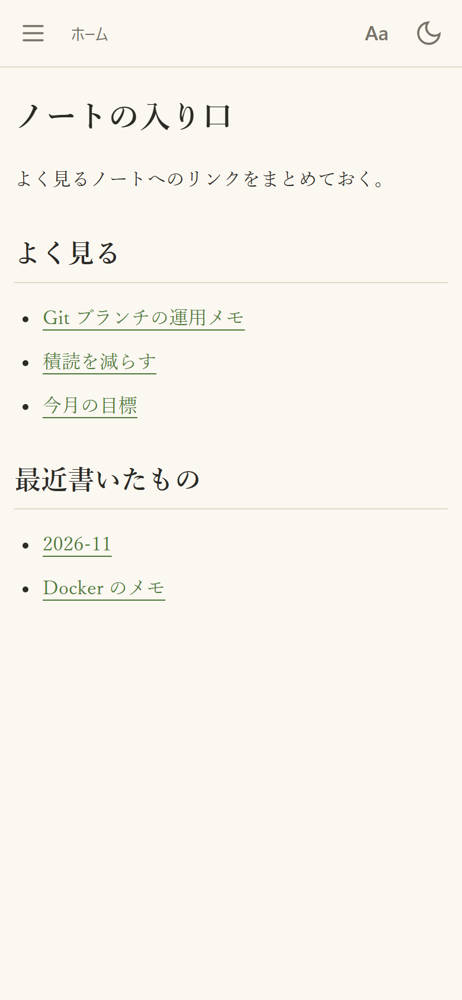 |
| index.md がない | 見出し「ノート」、案内、その下にノートの一覧（スマホ） | 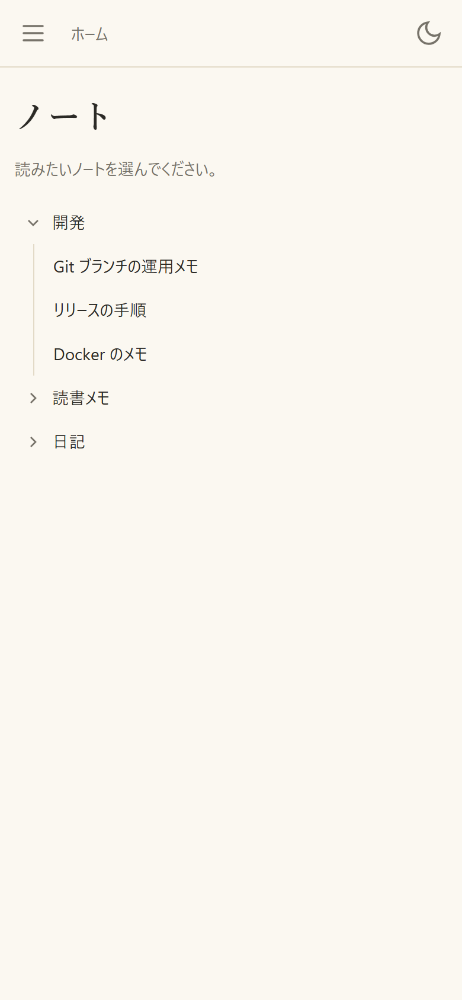 |
| ノートがひとつもない | 中央にフォルダのアイコン、「ノートがまだありません」、説明 | 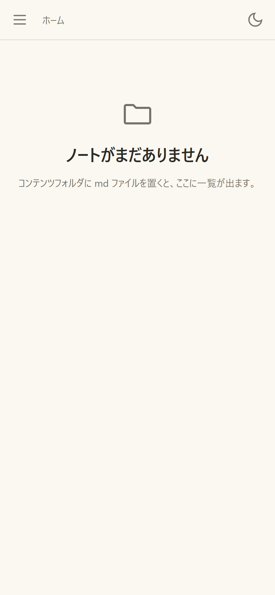 |
| 読み込み中 | 題と段落・リストの形のスケルトン | 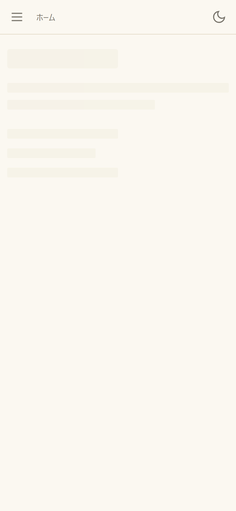 |
| 読み込めなかった | danger の帯「ノートの一覧を読み込めませんでした」と「もう一度読み込む」 | 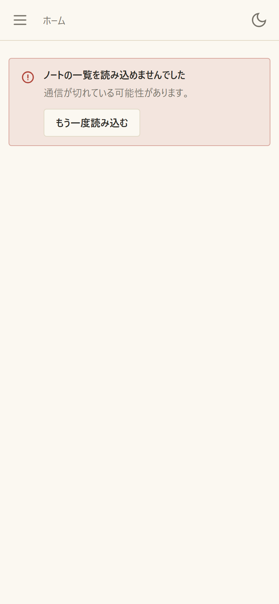 |
| index.md がある（PC） | 左にノートの一覧（「ホーム」を強調）、本文は中央 | 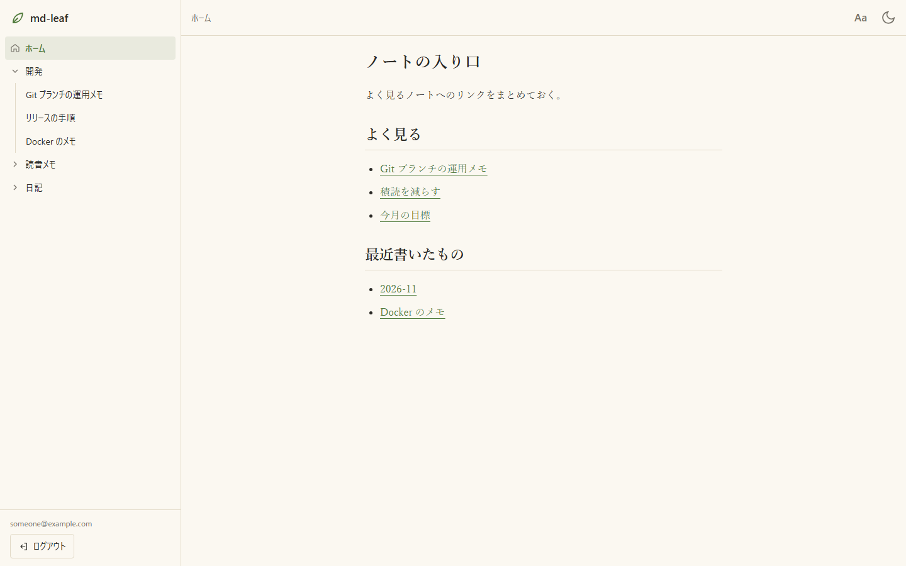 |

### ノート（note）

| 状態 | 表示 | スクリーンショット |
| --- | --- | --- |
| 表示 | 題と本文。上の帯に場所 | 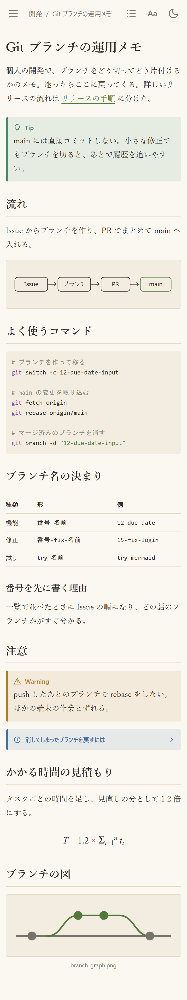 |
| 表示（PC） | 左にノートの一覧（今のノートを強調、そのフォルダを開く） | 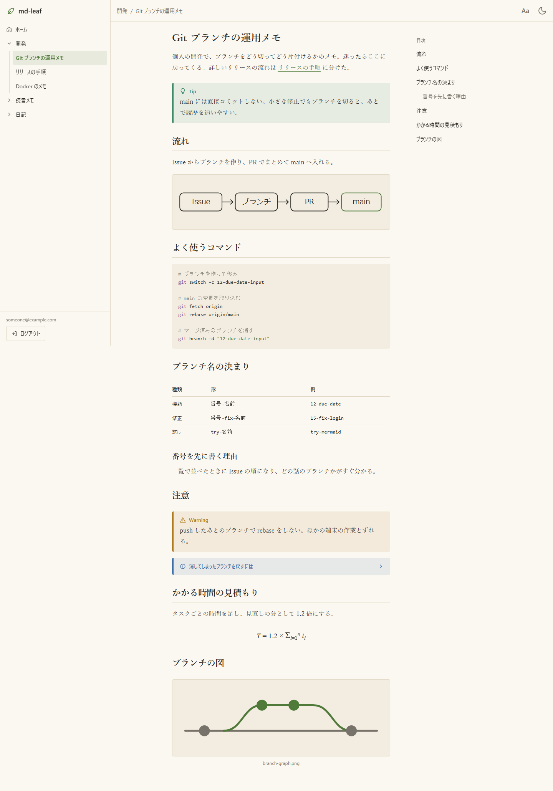 |
| ノートの一覧を開いた | 左から一覧、うしろに幕。いちばん下にアドレスと「ログアウト」 | 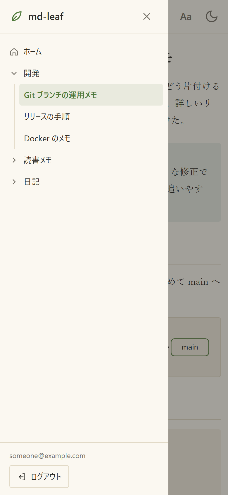 |
| ノートの一覧が多い | 一覧がスクロールする。長い名前は折り返す | 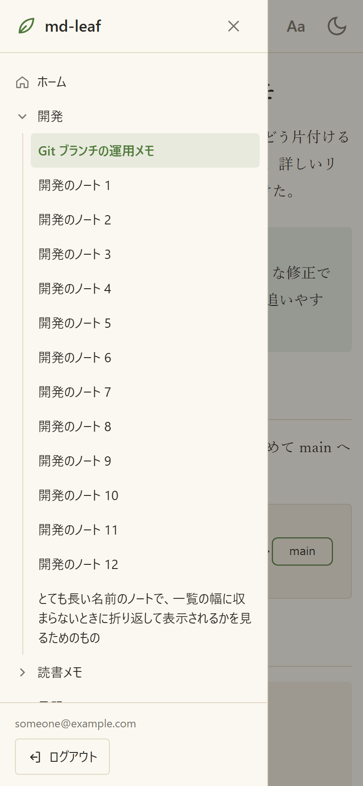 |
| 読み込み中 | 題・段落・見出しの形のスケルトン | 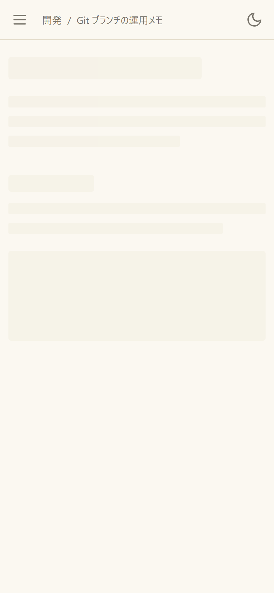 |
| 読み込めなかった | danger の帯「ノートを読み込めませんでした」と「もう一度読み込む」 | 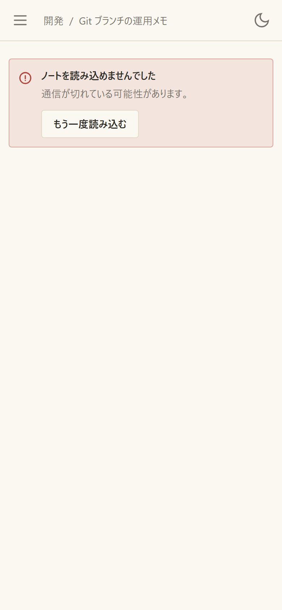 |
| 見つからない | 中央にアイコン、「ノートが見つかりません」、説明、「ホームへ戻る」 | 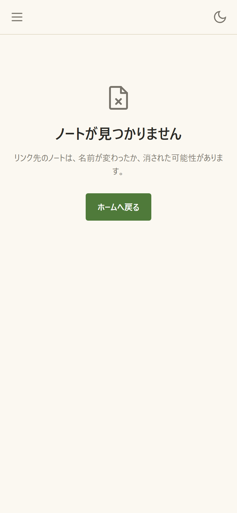 |

### 画像のうち作らないもの

合意した画像は撮り直さずに使う。画像には、ほかの機能の部分も写っている。次のものは、この機能では **作らない**（画像に写っていても作らない）。

| 画像に写っているもの | どうするか | 作る機能 |
| --- | --- | --- |
| 上の帯の右側の、目次のボタン（線の並んだアイコン）・「Aa」・月（ライト/ダーク）のボタン | 置かない。右側は空けておく | #6・#8・#7 |
| PC の本文の右の「目次」 | 出さない。本文は中央に置く | #6 |
| コールアウト（Tip・Warning・折りたたみ）、コードのハイライト、Mermaid の図、表の見た目、数式、画像 | 専用の見た目は付けない。Markdown を HTML にしたままの形で、文字として読めればよい | #5 |
| ノートの中のリンク「リリースの手順」から別のノートへ移ること | 移るようにしない（リンクとしての見た目だけ） | #4 |

- 画像のうち、上の帯の ☰・場所、ノートの一覧、題・段落・見出し・リスト・リンクの見た目、状態ごとの表示（スケルトン・帯・中央の案内）が、この機能で合わせるところ
- `/dev-build` で本番から撮った画像（`docs/specs/screens/`）は、上の表のものがない形になる。それで正しい

## やらないこと

- 目次（#6）、ライト/ダークの切り替え（#7）、文字の大きさ（#8）
- ノートの中の相対リンクから別のノートへ移ること（#4）
- コールアウト・コードのハイライト・表・数式・Mermaid・画像の見た目（#5）
- フォルダを開いたときの、フォルダごとのページ（フォルダは一覧で開閉するだけ）
- 検索、編集（`docs/overview.md` の「やらないこと」）

## 先に要る機能

- #1、#2（どちらも main にある）

## 決まっていないこと

- [x] 上の帯の右側（目次・文字の大きさ・ライト/ダークのボタン）を、この機能でどうする？（推す答え：何も置かない。#6〜#8 でそれぞれ足す） → 何も置かない
  - 何も置かない：押しても動かないボタンが出ない。合意した画像と、右側だけ違う
  - ライト/ダークのボタンだけ先に置く（押しても何もしない）：画像に近いが、動かないボタンが本番に出る
- [x] ない URL（`/notes/ない名前`）を開いたときの「ノートが見つかりません」を、この機能で作る？（推す答え：作る。#4 はリンクを直すことだけにする） → 作る
  - 作る：URL を手で打ったときや、ノートの名前を変えたあとにブックマークを開いたときに、Next.js の素の 404 ではなく合意した画面が出る。#4 が小さくなる
  - #4 で作る：この機能が少し小さくなるが、それまでは素の 404 が出る
- [x] 合意した画像に写っている、ほかの機能の部分（右上のボタン、コールアウト・コードなどの見た目）は、この機能では作らない。この機能のスクリーンショットは、それらを除いた形でプロトタイプから撮り直してよい？（推す答え：撮り直す。本番の画像と比べるときの基準にずれが出ないように） → 撮り直さない。`docs/agreed-screens/` の画像をそのまま使い、作らない部分は「画面」の「画像のうち作らないもの」に書く
  - 撮り直す：仕様と画像が一致し、`/dev-build` が画像に引っ張られてほかの機能を作らない
  - 撮り直さない：手間は減るが、画像と仕様に「作らないもの」の注記が要り、取り違えやすい
- [x] Markdown の変換に入れる unified（remark-parse・remark-gfm・remark-frontmatter・remark-rehype・rehype-stringify）は、最後のリリースが 2023-11〜2025-04 で、decisions スキルの「AIが決めてよいもの」（最後のリリースが1年以内）に当たらない。使ってよい？（推す答え：例外として使う。`/dev-build` で見つかった） → unified のまま使う（例外として認める）
  - unified：Next.js・MDX・Astro の Markdown の定番。API が固まっていてリリースが少なく、下の層（micromark・mdast-util-to-hast など）は今もリリースがある。構文の木で、#4・#5・#6 を同じ仕組みのプラグインで足せる
  - marked と yaml：どちらも条件に合う。構文の木がなく、#4・#5・#6 は描き方の差し替えで作る
  - markdown-it と yaml：本体は条件に合うが、#5 で使うプラグインに古いものが多い

## 技術の確認表

| 項目 | 当てはまるもの | 決めた人 |
| --- | --- | --- |
| 保存するデータ | なし（ノートはリポジトリの `content/` に置き、ビルドのときに読む。`docs/overview.md`） | 人（立ち上げ） |
| 外部サービス | なし | — |
| 認証・権限 | 変えない。ホーム・ノートとも `src/proxy.ts` で守られる（`/notes/` を `matcher` から外さない） | 人（#2） |
| 費用 | なし | — |
| 個人情報 | ノートの中身。リポジトリ（private）の `content/` に置く。ログイン中のアドレスは今と同じ出し方 | 人（立ち上げ） |
| デプロイの環境 | 環境変数 `CONTENT_DIR`（既定 `content/`）を足す。本番では設定しない（既定を使う）。画像を撮るときだけ `e2e/fixtures/content/` を指す | 人（立ち上げ。`docs/design.md`） |
| 新しいライブラリ | Markdown の変換に unified（remark-parse・remark-gfm・remark-frontmatter・remark-rehype・rehype-stringify）、フロントマターの読み取りに yaml。unified は最後のリリースが1年より前なので人が決めた（「決まっていないこと」）。yaml は AI が決めた（下の「AIが決めたこと」） | 人（unified）・AI（yaml） |
| 取り消せない操作 | なし | — |
| 共通の部品・トークン | 上の帯・ノートの一覧・帯（エラー）・スケルトンを、複数の画面で使う部品として作る。トークンは変えない。ログアウトの部品を、ホームのいちばん下からノートの一覧のいちばん下へ移す | 人（立ち上げで合意した画面） |
| `docs/design.md` の決まり | 変えない。「画面の状態は、テスト用のコンテンツフォルダで作る」の前提（`CONTENT_DIR`、`e2e/fixtures/content/`）をこの機能で入れる | — |

## 調べたこと

---

## 設計

### 変えるファイル

| ファイル | 内容 |
| --- | --- |
| `src/lib/notes.ts`（新規） | コンテンツフォルダ（環境変数 `CONTENT_DIR`、既定 `content/`）を読み、ノートの一覧の木（フォルダ・ノート・ホームの有無）と、パスからノート1つ（題・本文の HTML）を返す。URL のパス（`.md` を除いたもの）とファイルの対応もここに置く。React・Next.js に依存しない |
| `src/lib/markdown.ts`（新規） | Markdown を HTML にする（unified）。フロントマターを本文から外して `title` を返す。HTML のタグは文字として出し、`http(s)://` のリンクに `target="_blank" rel="noopener noreferrer"` を付ける |
| `src/app/(reader)/data.ts`（新規） | `src/lib/notes.ts` を `"use cache"` の関数で包む。ビルドのときに読み、ページから呼ぶ |
| `src/app/(reader)/layout.tsx`（新規） | 上の帯とノートの一覧の枠。ログアウト（`src/components/logout.tsx`）を Suspense に入れて、一覧のいちばん下に渡す |
| `src/app/(reader)/page.tsx`（`src/app/page.tsx` から移す） | ホーム。`index.md` の表示、案内、ノートが1つもないとき |
| `src/app/(reader)/notes/[...path]/page.tsx`（新規） | ノート。`generateStaticParams` で全部のノートをビルドのときに HTML にする。`generateMetadata` でページの題。ないノートは `notFound()` |
| `src/app/(reader)/notes/[...path]/not-found.tsx`（新規） | 「ノートが見つかりません」 |
| `src/app/(reader)/loading.tsx`・`notes/[...path]/loading.tsx`（新規） | ホーム・ノートのスケルトン |
| `src/app/(reader)/error.tsx`・`notes/[...path]/error.tsx`（新規） | ホーム・ノートの読み込めなかった帯（`retry` で読み込み直す） |
| `src/components/top-bar.tsx`・`note-tree.tsx`・`tree-drawer.tsx`・`note-body.tsx`・`skeleton.tsx`・`empty-state.tsx`（新規） | 上の帯（場所）、ノートの一覧、スマホの開閉する一覧、本文、スケルトン、中央の案内。今の場所は `usePathname` で決めるので、場所と一覧の強調はクライアントの部品 |
| `src/components/note-body.css`（新規） | 本文（Markdown から作った HTML）の見出し・段落・リスト・リンクの見た目。トークンの `var()` だけを使う |
| `src/components/icons.tsx` | ☰・×・家・矢印・フォルダ・見つからないのアイコンを足す |
| `src/components/logout.tsx` | ホームのいちばん下から、ノートの一覧のいちばん下へ移す（中身は変えない） |
| `content/.gitkeep`（新規） | 空のコンテンツフォルダ |
| `e2e/fixtures/content*/`（新規） | 画面の状態ごとのテスト用のコンテンツフォルダ（下の「テスト用のコンテンツフォルダ」） |
| `playwright.config.ts`・`next.config.ts` | コンテンツフォルダごとにサーバーを分けて起動する |
| `e2e/notes.spec.ts`（新規）・`e2e/login.spec.ts` | 画面を動かすテストと画像。ログアウトのテストを、ノートの一覧から押す形に直す |
| `e2e/home-placeholder.spec.ts`・`docs/specs/screens/home-placeholder.png` | 消す（ホームの画像に置き換える） |

### データ

- 保存するデータはない。ノートの一覧の木は、次の形にする（受け入れ条件の「並び順」「名前」「ホーム」「フォルダの開閉と強調」に要るものだけ）
  - フォルダ：名前、パス（強調のために、開いているノートを含むかを比べる）、子（フォルダが先、ノートがあと。それぞれ `Intl.Collator("ja", { numeric: true })` の順）
  - ノート：名前（`title` か、ファイル名から `.md` を除いたもの）、URL のパス（`/notes/` のあと。`.md` を除いたもの）
  - ホームの有無（一番上に `index.md` があるか）
- URL のパスは、ファイル名・フォルダ名をそのまま使う。`generateStaticParams` は、分けたパス（`["開発", "Git ブランチの運用メモ"]`）を返し、URL にするときの符号化は Next.js に任せる。`src/lib/notes.ts` の `readNote` が、受け取ったパスを `decodeURIComponent` してから探す（Next.js が符号化したまま渡す場合があるため。どちらでも探せるよう、テストで確かめる）
- ノートが1つもないとき、Cache Components では `generateStaticParams` が空の配列を返せない（ビルドが止まる。`node_modules/next/dist/docs/01-app/03-api-reference/04-functions/generate-static-params.md`）。そのときは、ノートにならない値を1つ返し、ページでは `notFound()` にする

### やり方と理由

- ノートは、ビルドのときに読んで HTML にする（`docs/design.md` の前提のまま）。`src/lib/` は React・Next.js に依存させず、`"use cache"` は `src/app/(reader)/data.ts` に置く。理由：`src/lib/` を画面を通さずにテストするため（`docs/design.md` の「全体の構成」）。残す場所：`docs/design.md` の「全体の構成」の表に `data.ts` を足す
- 上の帯とノートの一覧は、ログインの画面以外のページで共通なので、ルートグループ `(reader)` のレイアウトに置く。ログインの画面は、このグループの外のまま。理由：ログインの画面には上の帯と一覧を出さない（`docs/specs/login.md`）。残す場所：`docs/design.md` の「全体の構成」
- 場所（パンくず）と、一覧の強調・フォルダの開閉は、ページから渡さず、一覧の木と `usePathname` からクライアントで決める。理由：レイアウトはページを移っても作り直されないので、今のページはクライアントで知るしかない。木にない URL（見つからない）は、場所が空で、何も強調しない。残す場所：`src/components/note-tree.tsx` のコメント
- スマホの一覧と PC の一覧は、同じ一覧の部品を使い、外側（開閉する引き出しか、左に常に出すか）だけを分ける。ログアウトはサーバーの部品なので、レイアウトで Suspense に入れて、一覧の部品へ子として渡す
- 本文の見た目は、Markdown から作った HTML にクラスを付けられないので、`.note-body` の下の要素の選び方で CSS に書く（`src/components/note-body.css`）。値はトークンの `var()` だけを使う。理由：`[&_h2]:` のような任意の値のクラスは Lint で使えない（`docs/design.md` の「トークンにない値を書かない」）。残す場所：`docs/design.md` の「全体の構成」の表と「トークンにない値を書かない」の当てはまる場所
- ノートの中の HTML のタグは、HTML にせず文字としてそのまま出す（remark-rehype の既定では消えるので、文字にする手当てを入れる）。残す場所：`src/lib/markdown.ts` のコメント
- 読み込めなかったときの帯は、ホームとノートで見出しが違うので、`error.tsx` を2つに分ける。`error.tsx` は同じ階層のレイアウトを包まないので、上の帯と一覧は残る
- 画面の状態ごとに、テスト用のコンテンツフォルダを分け、フォルダごとに別のビルドとサーバーを立てる（下の「テスト用のコンテンツフォルダ」）。理由：ノートはビルドのときに HTML にするので、同じサーバーで中身を差し替えられない（`docs/design.md` の「画面の状態は、テスト用のコンテンツフォルダで作る」）。残す場所：`docs/design.md` の同じ見出しの「前提」を、今の作りに書き直す

### テスト用のコンテンツフォルダ

| フォルダ | 中身 | 撮る画面 |
| --- | --- | --- |
| `e2e/fixtures/content/` | `index.md`（題「ノートの入り口」）、`開発/`（`Git ブランチの運用メモ.md` ほか）、`読書メモ/`、`日記/` | home-index・home-index-pc・note-*（note-tree-many を除く）、ログインの画面のテスト |
| `e2e/fixtures/content-no-index/` | `index.md` なし。フォルダとノートが少し | home-no-index |
| `e2e/fixtures/content-empty/` | md ファイルなし | home-empty |
| `e2e/fixtures/content-many/` | 名前の長いノートと、たくさんのノート | note-tree-many |

- `playwright.config.ts` の `webServer` をフォルダごとに並べ（ポートを分ける）、`projects` をフォルダごとに分ける。ビルドの出力先（`distDir`）は環境変数で分ける（同じ `.next` を上書きし合わないため）。出力先は `.next/` の中に置く（Docker の名前つきボリュームに入れるため。`scripts/playwright-docker.mjs`）
- 読み込み中と読み込めなかったの状態は、ノートの一覧から別の画面へ移るときの通信を、テストの側で `page.route` で止める・壊して作る。アプリにテスト用の入口は作らない

## AIが決めたこと

- ノートの URL は `/notes/<コンテンツフォルダからのパス（.md を除く）>`。理由：`/login`・`/api` と、ノートやフォルダの名前がぶつからない。比べた案：`/<パス>`（`login` という名前のフォルダが置けなくなる）、`.md` を残す（URL が長くなり、#4 のリンクの書き換えで拡張子を扱う手間は変わらない）
- 一覧の並び順は、フォルダが先・ノートがあと、それぞれ名前の順（日本語の順、数字は数の大きさの順）。理由：ファイルを探すときの Obsidian・エクスプローラーの並びに近い。比べた案：フォルダとノートを混ぜて名前の順（フォルダが埋もれる）
- ホームを開いたときは、フォルダをすべて閉じる。理由：今のノートがないので、開く理由のあるフォルダがない。合意した画像（home-no-index）では「開発」が開いているが、表示用のデータでそうなっていただけ
- 一番上以外の階層の `index.md` は、ふつうのノートとして並べる。理由：特別に扱うのはホームだけで足りる
- md ファイルを1つも含まないフォルダは出さない。理由：開いても何もない行は、選ぶときの邪魔になる
- 場所（パンくず）のフォルダは、押しても移らない文字にする。理由：フォルダのページがない（「やらないこと」）
- ノートの中の HTML のタグは動かさない。理由：ノートから画面の作りを壊したり、スクリプトが動いたりしないようにする。比べた案：そのまま動かす（Obsidian の見た目に近いが、安全の確かめが要る）
- 外へのリンク（`http(s)://`）は別のタブで開く。理由：アプリに戻りやすい
- Markdown の変換に unified（remark-parse・remark-gfm・remark-frontmatter・remark-rehype・rehype-stringify）と yaml を入れる（unified は最後のリリースが1年より前なので、人が決めた。「決まっていないこと」）。理由：どれも MIT・ISC で、`src/lib/` の変換の1か所に閉じられる。#5（コードのハイライト・数式・Mermaid）を、同じ仕組みのプラグインで足せる。比べた案：markdown-it（#5 の数式・Mermaid のプラグインの選び方が限られる）、gray-matter（最後のリリースが1年より前）
- `content/` には、ノートを置かずに作る（空のフォルダを残すための `.gitkeep` だけ）。理由：ノートは本人が置く。置くまではホームに「ノートがまだありません」が出る
- ノートの中の HTML のタグは、消さずに文字としてそのまま出す。理由：ノートの中身を失わずに、HTML として動かさない。比べた案：消す（remark-rehype の既定。書いたものが黙って消える）、安全なタグだけ通す（通すタグの一覧を保守する手間がかかる）
- フロントマターの YAML が読めないときは、ビルドを止めずに `title` がないものとして扱う（題はファイル名）。`title` が数（`title: 2024`）なら文字にして使う。段落の外に書かれた HTML のタグは、文字の段落として出す。理由：ノート1つの書き間違いで全体が見られなくならないようにする。比べた案：ビルドを止める（間違いにはすぐ気づくが、直すまで全部のノートが更新されない）
- 本文の見た目は、`.note-body` の下の要素に当てる CSS ファイル（`src/components/note-body.css`、値はトークンの `var()` だけ）で付ける。理由：Markdown から作った HTML にクラスを付けずに済み、Lint の決まりも守れる。比べた案：変換のときに要素ごとにクラスを付ける（変換と見た目が混ざる）、`@tailwindcss/typography`（新しいライブラリが要り、トークンの値に合わせ直す手間がかかる）
- コンテンツフォルダの中で、名前が「.」で始まるファイル・フォルダは読まない。理由：Obsidian の `.trash` には消したノートの md が残り、一覧に出ると消したノートが見える。比べた案：すべて読む（`.obsidian`・`.trash` が一覧に出る）
- 一番上の `index.md` は `/notes/index` では開けない（ないノートと同じ扱い）。理由：ホームと同じ中身のページが2つできないようにする
- 一覧の名前の順は、出す名前（`title` か、ファイル名）で比べる。理由：一覧で見えている名前の順に並ぶ。比べた案：ファイル名で比べる（`title` を付けたノートが、見た目では順が乱れる）
- 画面の状態ごとに、テスト用のコンテンツフォルダと、ビルドしたサーバーを分ける（4つ）。理由：ノートはビルドのときに HTML にするので、状態を変えるには中身を差し替えてビルドし直すしかない。比べた案：テストのときだけ実行のたびにノートを読む作りにする（本番と違う作りを撮ることになる）
- テストをどのコンテンツフォルダのサーバーで動かすかは、テストに付けるタグ（`@content-no-index`・`@content-empty`・`@content-many`。付けなければ `content`）で分け、`playwright.config.ts` の `projects` の `grep` で選ぶ。理由：1つのファイル（`e2e/notes.spec.ts`）の中で、状態ごとのテストを並べて書ける。比べた案：フォルダごとにテストのファイルを分ける（ホームの状態が別々のファイルに散る）
- ビルドの出力先は環境変数 `DIST_DIR`（`next.config.ts` の `distDir`）で `.next/e2e/<フォルダ>/` に分ける。4つとも分け、既定の `.next/` には出さない。理由：`next build` は出力先を消してから作るので、`.next/` に出すと、中に置いたほかの出力先まで消える
- `next build` が出力先ごとの型の場所を `tsconfig.json` の `include` に書き足すので、4つ分を先に書いておく。理由：撮るたびに `tsconfig.json` が書き換わらないようにする。比べた案：テスト用の別の tsconfig を使う（`paths` などを二重に持つことになる）
- テスト用のノートの中身は、合意した画像（home-*・note-*）に写っている名前と本文に合わせる。ただし note-default の「ブランチの図」（画像 `branch-graph.png`）は入れない。理由：ノートの画像の表示は #5 で、今入れると壊れた画像が写る。#5 で画像とあわせて足す
- ノートの一覧で手で開閉したフォルダは、別のページへ移ると、今のノートを含むフォルダだけを開いた形に戻す。理由：受け入れ条件の「今のノートを含むフォルダは開き、ホームではすべて閉じる」を、移るたびに必ず満たす。比べた案：手で開いたフォルダを覚えておく（PC では一覧が残るので便利だが、ホームでフォルダが開いたままになる）
- 既定のコンテンツフォルダは `join(process.cwd(), "content")` と決まった場所で書き、`CONTENT_DIR` は追跡から外し（`turbopackIgnore`）、`next.config.ts` の `outputFileTracingIncludes` で `content/` をサーバーの出力に入れる。理由：一覧にない URL（見つからない）は開いたときに組み立て、そのときにノートを読むので、本番でも `content/` が要る。場所が決まらないとプロジェクト全体が出力に入り（ビルドの警告）、フォルダの中を読む処理は追跡されない。比べた案：警告を残す（ソースや画像まで本番のサーバーに入る）
- ノートの一覧の「ノートがありません」は、「ホーム」もノートもないときだけ出す。理由：`index.md` だけがあるときは、「ホーム」が選べる
- ノートのページは、自分の Suspense（`fallback={null}`）で params を待たず、`notes/[...path]/loading.tsx` の中で待つ。理由：partialPrefetching では、ページの中の Suspense の代わりの表示が App Shell に入るので、`null` のままだとノートへ移るあいだに何も出ず、スケルトンが出ない
- 読み込めなかったときの帯は、ログインの画面の帯（`src/components/banner.tsx`）に、見出しの左のアイコン（丸に「!」）と下のボタンを足して使い、ホームとノートで同じ形（`src/components/load-error.tsx`）にする。理由：合意した画像（home-error・note-error）が同じ形で、見出しだけが違う。比べた案：エラー用の帯を別に作る（帯の地・枠の決まりを2か所に持つことになる）
- 読み込めなかった状態は、移るときの通信を失敗させる（abort・500）のではなく、返事の中のページの中身の行だけを抜いて作る（`e2e/navigation.ts`）。理由：Next.js 16.4 は、移るときの通信が失敗するとページごと読み直し、`error.tsx` が出ない。中身の行を抜くと、通信が途中で切れたときと同じになり、`error.tsx` が出る。ノート・ホームは先読みに中身まで入るので、テストでは移り先の先読み（`__PAGE__`）も失敗させる
- unified が引き込む木の型（`@types/mdast`・`@types/hast`）と `vfile` を、`src/lib/markdown.ts` が直接読むので、`package.json` の devDependencies に明示した。理由：引き込まれたものに頼ると、unified の版の上げ下げで型が消えても気づきにくい。同じ unified の仲間なので、人が決めた unified の範囲として扱う
- 本文は、コードのブロック（`pre`）を横にスクロールさせ、長い行や URL は `overflow-wrap: anywhere` で折り返す（`src/components/note-body.css`）。理由：本文が画面の幅を超えないための最小限の手当て。コードの見た目そのものは #5 で付ける

## 確かめ方

| 受け入れ条件 | 確かめ方 | どこで |
| --- | --- | --- |
| 一覧：md とフォルダを構成そのまま。md 以外・md のないフォルダは出さない | テスト | `src/lib/notes.test.ts` |
| 一覧：並び順（フォルダが先、名前の順、数字は数の順） | テスト | `src/lib/notes.test.ts` |
| 一覧：ノートの名前は `title` かファイル名、フォルダはフォルダ名 | テスト | `src/lib/notes.test.ts` |
| 一覧：一番上の `index.md` は「ホーム」。なければ出さない | テスト | `src/lib/notes.test.ts`（木）、`e2e/notes.spec.ts`（「ホーム」の有無） |
| 一覧：フォルダの開閉、今のノートのフォルダを開いて強調、ホームでは「ホーム」を強調しフォルダは閉じる | テスト | `e2e/notes.spec.ts` |
| 一覧：長い名前は折り返す | 触って確かめる | 画像 note-tree-many |
| 一覧：いちばん下にアドレスと「ログアウト」、押すとログインの画面へ | テスト | `e2e/login.spec.ts` の「ログアウト」 |
| 一覧（スマホ）：☰ で開く、×・幕・Esc で閉じる、ノートを押すと移って閉じる | テスト | `e2e/notes.spec.ts` |
| 一覧（PC）：左に常に出し、☰ を出さない。一覧だけがスクロールする | テスト（☰ がない・一覧が見える）、触って確かめる（スクロール） | `e2e/notes.spec.ts`、画像 home-index-pc・note-default-pc |
| ホーム：`index.md` があれば表示する | テスト | `e2e/notes.spec.ts` |
| ホーム：`index.md` がなければ「ノート」と案内（スマホは下に一覧、PC は案内だけ） | テスト | `e2e/notes.spec.ts`（content-no-index） |
| ホーム：ノートが1つもないとき「ノートがまだありません」、一覧に「ノートがありません」 | テスト | `e2e/notes.spec.ts`（content-empty） |
| ノート：URL は `.md` を除いたパス。日本語のまま | テスト | `src/lib/notes.test.ts`（パスとファイルの対応）、`e2e/notes.spec.ts`（日本語の URL で開ける） |
| ノート：フロントマターを出さない。題は `title` かファイル名 | テスト | `src/lib/markdown.test.ts`・`src/lib/notes.test.ts` |
| ノート：見出し・段落・リスト・リンク・太字・斜体の見た目 | 触って確かめる | 画像 note-default・home-index |
| ノート：`http(s)://` のリンクは別のタブ | テスト | `src/lib/markdown.test.ts` |
| ノート：HTML のタグを動かさない | テスト | `src/lib/markdown.test.ts` |
| ノート：ない URL で「ノートが見つかりません」、場所は空、何も強調しない、「ホームへ戻る」 | テスト | `e2e/notes.spec.ts` |
| 上の帯：上に固定 | 触って確かめる | スマホでノートをスクロールする |
| 上の帯：☰（スマホだけ）と場所。右側は空 | 触って確かめる | 画像 note-default・note-default-pc |
| 上の帯：場所（ホームは「ホーム」、ノートは「フォルダ / ノート」）。押しても移らない。長いと「…」 | テスト（場所の文言）、触って確かめる（「…」） | `e2e/notes.spec.ts` |
| ページの題：ホーム「md-leaf」、ノート「<名前> - md-leaf」 | テスト | `e2e/notes.spec.ts` |
| 読み込み中：スケルトン。上の帯と一覧は残る | テスト | `e2e/notes.spec.ts`（通信を止めて撮る） |
| 読み込めなかった：danger の帯（ホーム・ノートで見出しが違う）、「もう一度読み込む」で読み込み直す | テスト | `e2e/notes.spec.ts`（通信を壊して撮り、押すと出る） |
| ログイン：ログインしていなければホーム・ノート・一覧が見えない | テスト | `e2e/login.spec.ts`（今あるもの。`/notes/` の下の、あるノートでも確かめる） |

## タスク

画面のタスクで合わせるスクリーンショットは `docs/agreed-screens/<名前>`。撮る画像は `docs/specs/screens/<名前>`（「画面」の「画像のうち作らないもの」は作らない）。

- [x] Markdown の変換：unified と yaml を入れ、`src/lib/markdown.ts` がフロントマターの `title` と本文の HTML（HTML のタグは文字、外へのリンクは別のタブ）を返せたら完了。`docs/libraries/` の下書きを書く
- [x] ノートの読み込み：`src/lib/notes.ts` が、`src/lib/markdown.ts` を使い、コンテンツフォルダ（`CONTENT_DIR`）からノートの一覧の木と、パスからノート1つを返せたら完了。`content/.gitkeep` を置く
- [x] テスト用のコンテンツフォルダと撮る仕組み：`e2e/fixtures/content*/` の4つを作り、フォルダごとにビルドしたサーバーで、今ある画面を動かすテスト（ログイン）が通ったら完了
- [x] ノートの表示とホーム（`index.md`）：`(reader)` のレイアウトに上の帯（場所）を置き、ホームで `index.md` を、`/notes/...` でノートを、本文の見た目とページの題つきで出せたら完了。ログアウトは一覧ができるまでレイアウトのいちばん下に置き、`e2e/home-placeholder.spec.ts` と画像を消す。撮る画像：note-default.png・home-index.png
- [x] ノートの一覧：PC では左に常に、スマホでは ☰ から開閉する一覧を出し、強調・フォルダの開閉・ログアウトの移動ができたら完了。撮る画像：note-default.png・note-default-pc.png・home-index.png・home-index-pc.png・note-tree.png・note-tree-many.png
- [x] `index.md` がないホーム・ノートがないとき・見つからない：3つの状態が出せたら完了。撮る画像：home-no-index.png・home-empty.png・note-notfound.png
- [x] 読み込み中・読み込めなかった：スケルトンと danger の帯（「もう一度読み込む」）が出せたら完了。撮る画像：home-loading.png・note-loading.png・home-error.png・note-error.png
