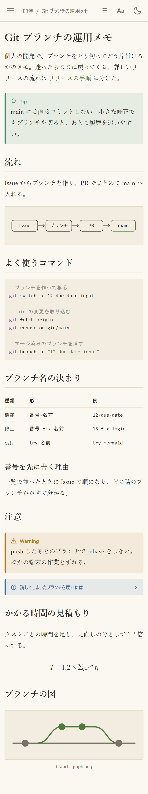
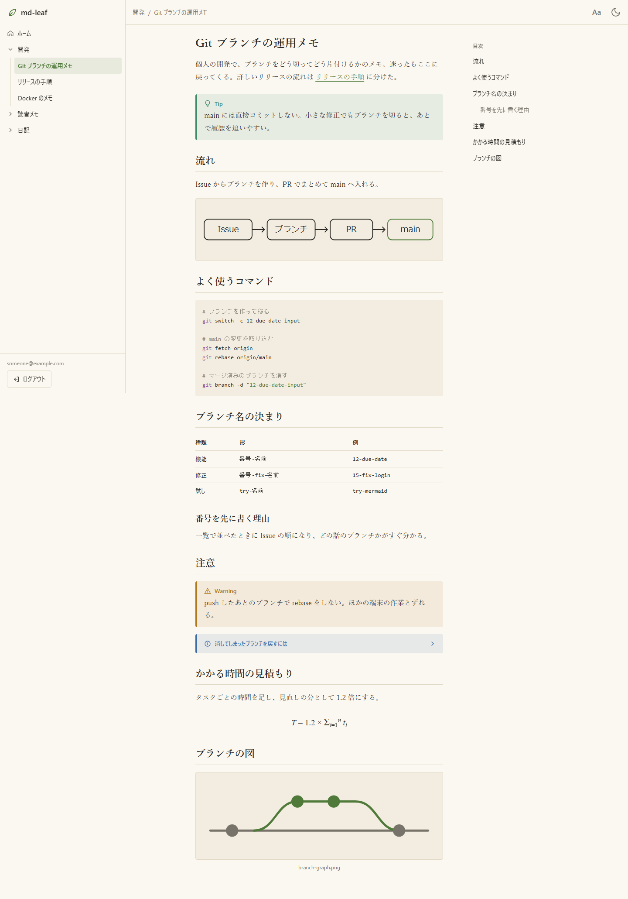
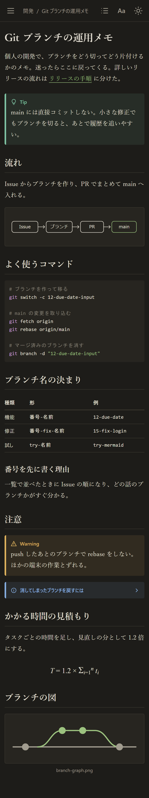

<!--
変更の仕様のひな形。コピーして docs/changes/<年-月-日>-<何をするか>.md を作る（例：2026-09-17-add-due-date.md）。
「なぜ」〜「調べたこと」は、AIが下書きし、人間がプロトタイプを触って直し、合意して決める（/dev-proto）。「画面」のスクリーンショットは、合意したときに足す。
「設計」以降はAIが書いて実装まで進め、人間は機能の PR でレビューする（/dev-build）。
スクリーンショットは、このファイルと同じ名前のフォルダに置く（例：2026-09-17-add-due-date/list-empty.png）。
-->

# ノートの中のコールアウト・コード・表・数式・Mermaid・画像を読みやすく表示できる（#5）

## なぜ

Obsidian で書いたノートには、コールアウト・コード・表・数式・Mermaid の図・画像がよく出てくる。今は Markdown を HTML にしたままなので、コールアウトは `[!tip]` の文字のまま、数式は `$$` のまま、Mermaid はコードのまま、表は線のない文字の並びで出て、スマホでは読めない。Obsidian で見たときに近い形で、狭い画面でも読めるようにする。

## 影響する今の仕様

- 変更：`docs/specs/notes.md` の「ノート」（「コールアウト・コード・表・数式・Mermaid・画像は、Markdown を HTML にしたままの形で出る」を、それぞれの出し方に変える）。ホームの `index.md` も同じ出し方
- 変更：`docs/specs/screens/note-default.png`・`note-default-pc.png`（本文の見た目が変わる）

## 使う場面

1. ノート「開発 / Git ブランチの運用メモ」に `> [!tip]` のコールアウト、`sh` のコード、`mermaid` の流れ図、表、`$$` の数式を書いた人が、スマホでそのノートを開く。コールアウトは緑の太線と電球のアイコンつきの「Tip」の囲みで出る。コードは色分けされ、長い行は枠の中だけ横にスクロールする。図は四角と矢印の図、数式は式の形で出る
2. 同じノートの `> [!info]- 消してしまったブランチを戻すには` は、見出しの行だけが出て閉じている。見出しを押すと中身が開き、もう一度押すと閉じる
3. ノートと同じフォルダに置いた `branch-graph.png` を `` で書くと、本文の幅に収まった画像で出る。画像のファイルがないときは、画像の代わりの文字（「ブランチの図」）が出る

## 受け入れ条件

### コールアウト

- `> [!種類]` で始まる引用を、コールアウトとして出す。左に太線、薄い地、見出しの行にアイコンと題
  - 題は、`> [!tip] 題` のように書いてあればその文字、なければ種類名（「Tip」「Warning」のように、先頭を大文字にした英語）
  - 種類は Obsidian 標準のもの（note・abstract・info・todo・tip・success・question・warning・failure・danger・bug・example・quote と、その別名）。色とアイコンは、種類ごとに note・tip・warning・danger の4色のどれか（下の「画面」の表）
  - 種類の大文字・小文字は区別しない（`[!TIP]` も tip）。知らない種類は note の色とアイコンで、題は書いた種類名
- `> [!種類]-` は、見出しの右に矢印を出し、最初は閉じておく。見出しを押すと開閉する。`> [!種類]+` は、矢印を出し、最初から開いておく。`-`・`+` のないものは開閉しない
- 中身（引用の2行目から）は、ふつうの本文と同じに出す（段落・リスト・コード・リンクなど）。中身がないときは、見出しの行だけを出す
- コールアウトの中にコールアウトを書いても、それぞれコールアウトとして出す
- `[!種類]` で始まらない引用は、今のままの引用で出す

### コード

- ` ```言語 ` で言語を書いたコードは、その言語の書き方で色分けする（キーワード・文字列・コメントの3色）。言語を書かない、または知らない言語のコードは、色分けせずに出す
- 横に長いコードは、枠の中で横にスクロールする。ページ全体は横にスクロールしない。長い行を折り返さない
- 文の中のコード（`` `docker ps` ``）は、薄い地の等幅の文字で出す（色分けしない）

### 表

- 表は、見出しの行と各行の間に線を引き、ゴシックの小さめの文字で出す。列の揃え（`:---:` など）を守る
- 横に長い表は、表の中で横にスクロールする。ページ全体は横にスクロールしない

### 数式

- `$...$` は文の中の数式、`$$...$$` は本文の中央に置く数式として、式の形で出す
- 横に長い数式は、数式の中で横にスクロールする
- 書き方が間違っていて式にできないときは、ビルドを止めず、書いたままの文字を出す
- `$` が1つだけのとき（「100$」など）は、数式にせず文字のまま出す

### Mermaid

- ` ```mermaid ` のコードは、図として描く。図は本文の幅に収め、収まらない大きな図は枠の中で横にスクロールする
- 描けなかったとき（書き方が間違っている）は、元のコードを、色分けなしのコードとしてそのまま出す
- 描き終わるまでのあいだは、元のコードを出しておく（描けたら図に替える）

### 画像

- `` の画像を、ノートのあるフォルダからの相対パスで表示する（`../` で上のフォルダ。空白・日本語のパスも、山かっこ・`%20` の書き方も、#4 のリンクと同じ）。幅は本文の幅に収め、小さい画像は引き延ばさない
- 表示できる画像は、png・jpg（jpeg）・gif・webp・svg
- ファイルがない・コンテンツフォルダの外を指すときは、ブラウザの「画像を表示できない」の形で、代わりの文字を出す。ビルドは止めないが、#4 の切れたリンクと同じく、ビルドのログに警告を出す（ノートのファイル名とパス）
- `http(s)://` の画像は、そのまま外から読み込んで出す
- 画像も、ログインしていなければ見えない（画像の URL を直接開いても、ログインの画面へ移る）
- `![[画像.png]]` の書き方は解釈せず、文字のまま出す（#4 と同じく `[[ ]]` は解釈しない）

### 全体

- スマホでは、コールアウトとコードの枠の内側の余白を狭くする（PC では広く戻す）
- 色はトークンだけを使い、ライトとダークで同じトークン名で切り替わる（ダークの見た目は、#7 で切り替えられるようになってから確かめる）

## 画面

### ノート（note）

| 状態 | 表示 | スクリーンショット |
| --- | --- | --- |
| 表示 | 題と本文。コールアウト・図・コード・表・数式・画像が上の形で出る。折りたたみのコールアウトは閉じている |  |
| 表示（PC） | 左にノートの一覧。本文は同じ |  |
| 表示（ダーク） | 同じ形で、色がダークのトークンになる。撮るのは #7 で切り替えられるようになってから |  |

スクリーンショットについて（合わせるのは本文の中だけ）

- 上の帯の目次・「Aa」・ライト/ダークのボタンと、PC の右の目次は、#6・#7・#8 のもの。この機能では作らない
- 数式はプロトタイプでは見本の文字で描いてある。本番は KaTeX の字の形でよい
- 画像の下の説明は、プロトタイプではファイル名（「branch-graph.png」）だが、本番は代わりの文字（「ブランチの図」）を出す
- 画像の中身（ブランチの図）は見本。画面のテストでは、テスト用のコンテンツフォルダに置いた画像を出す

コールアウトの種類と色・アイコン（色は `docs/ui.md` の note・tip・warning・danger）

| 色 | 種類（別名） | アイコン |
| --- | --- | --- |
| note | note、abstract（summary・tldr）、info、todo、example、quote（cite）、知らない種類 | 丸に「i」 |
| tip | tip（hint・important）、success（check・done） | 電球 |
| warning | warning（caution・attention）、question（help・faq） | 三角に「!」 |
| danger | danger（error）、failure（fail・missing）、bug | 丸に「!」 |

- 見出しの行は、ゴシックの小さめの太字で、その種類の色。中身は本文と同じ明朝
- 表はゴシック（`docs/ui.md` の「文字」）。コードの中の文字と、表の中のコード（`12-due-date` など）は等幅
- 図（Mermaid）の枠は、surface の地に border の枠。図の線と文字は text の色、強調は accent
- 折りたたみ：閉じているときの矢印は右向き。開くと下向きになり、見出しの下に中身が出る
- 画像は角を丸め、border の枠。下に、代わりの文字を muted の小さな文字で、中央に出す。代わりの文字が空なら出さない

## やらないこと

- `![[ ]]` の書き方（埋め込み）の解釈（`docs/overview.md` の「やらないこと」）
- 画像を押して大きく表示すること、画像の大きさの指定（`` の `|300`）
- 動画・音声・PDF の埋め込み
- コードのコピーボタン、行番号
- Mermaid の図の拡大・縮小
- ライトとダークの切り替え（#7）。この機能では、ダークでも見えるように色をトークンで書くだけ

## 先に要る機能

- #3（main にある）
- #4（main にある。画像のパスの決め方を、リンクの決め方とそろえる）

## 決まっていないこと

- [x] ノートの画像を、どうやってブラウザに渡す？（推す答え：コンテンツフォルダの画像ファイルを返す URL（`/files/<コンテンツフォルダからのパス>` の形）を作り、`src/proxy.ts` でログインを確かめてから返す。返すのは、一覧にある画像の拡張子のファイルだけ） → 推す答えのとおり（`/files/...` の URL で返し、`src/proxy.ts` で守る）
  - URL で返す（推す）：画像はノートの HTML に入らず、ページが軽い。ログインはほかのページと同じ `src/proxy.ts` で守られる。ただし、ファイルを返す入口が1つ増える（コンテンツフォルダの外や、ノート以外のファイルを返さない作りが要る）。`docs/design.md` に決まりを足す
  - ビルドのときに `public/` へ写す：作りが単純。ただし、ビルドの手順が増え、写し忘れ・消し忘れが起きる。`public/` も `src/proxy.ts` で守られるが、写したものがリポジトリに混ざらない工夫が要る
  - HTML の中に埋め込む（data URL）：入口が増えない。ただし、画像が多いノートほどページが重くなり、スマホで遅い
- [x] 画像の下に、代わりの文字を説明として出す？（推す答え：代わりの文字を書いたときだけ、画像の下に muted の小さな文字で出す。合意した画面の「branch-graph.png」の位置） → 代わりの文字を書いたときだけ出す
  - 出す（推す）：合意した画面に合う。図に名前を付けて書く人には読みやすい。ただし、Obsidian では出ないので、見え方が少し違う
  - 出さない：Obsidian と同じ。ただし、合意した画面と違う
- [x] 数式の書き方（`$...$`）を読み取るのに、`remark-math` を入れてよい？（推す答え：入れる。式の形にするのは KaTeX を直接使う） → 入れる
  - `remark-math` を入れる（推す）：今使っている remark-gfm と同じ unified の仲間で、使い方が同じ。ただし、最後のリリースが 2023 年で、AIが決めてよいライブラリの条件（1年以内のリリース）に当たらない（書き方が決まりきっていて、直すところがないため）
  - 自分で書く：ライブラリが増えない。ただし、`$` の扱い（「100$」、コードの中の `$`、エスケープ）を正しく読むのは難しく、間違えやすい
- [x] 1つの機能として大きすぎない？（推す答え：分けない。1つの PR の中で、コールアウト／コードと表／数式／Mermaid／画像のタスクに分けて、コミットを順に追えるようにする） → 分けない
  - 分けない（推す）：合意した画面が1枚で、見た目を一度に確かめられる。ただし、PR が大きくなる
  - 画像だけを別の Issue に分ける：PR が小さくなり、画像の入口（上の質問）だけを別に見られる。ただし、合意した画面の「画像」のところが、あとの PR まで本番と合わない

## 技術の確認表

| 項目 | 当てはまるもの | 決めた人 |
| --- | --- | --- |
| 保存するデータ | なし | — |
| 外部サービス | なし（`http(s)://` の画像は、ブラウザが外から読み込む。今の外へのリンクと同じ） | — |
| 認証・権限 | 画像も `src/proxy.ts` でログインを確かめる。画像を返す入口（`/files/...`）が増える。返すのはコンテンツフォルダの中の画像のファイルだけ | 人（「決まっていないこと」） |
| 費用 | なし（Vercel の Hobby の範囲。画像は小さなファイルを返すだけ） | — |
| 個人情報 | なし（ノートの中身の扱いは変えない） | — |
| デプロイの環境 | デプロイ先・環境変数は変えない。画像も `content/` から読むので、サーバーの出力に `content/` の画像も入る（今の `outputFileTracingIncludes` のまま） | AI |
| 新しいライブラリ | highlight.js（コードの色分け）、KaTeX（数式）、mermaid（図）：AIが決めて書く。remark-math（数式の読み取り）：人が入れると決めた | AI・人（「決まっていないこと」） |
| 取り消せない操作 | なし | — |
| 共通の部品・トークン | トークンは変えない（code-keyword・code-string・code-comment、note・tip・warning・danger を使う）。本文の見た目（`src/components/note-body.css`）に足す | AI |
| `docs/design.md` の決まり | 足す：画像を返す入口（`/files/...`）の決まり（コンテンツフォルダの中の画像だけを返す、`src/proxy.ts` の `matcher` から外さない） | 人（「決まっていないこと」） |

## 調べたこと

- ライブラリの最後のリリース（2026-11-11 に npm で確かめた）：highlight.js 11.12.0（2026-08、BSD-3-Clause）、katex 0.19.1（2026-10、MIT）、mermaid 12.3.0（2026-11、MIT）、remark-math 6.0.0（2023-09、MIT）、rehype-katex 7.0.1（2024-08）、rehype-highlight 7.0.2（2025-02）、shiki 4.6.0（2026-11、MIT）
- rehype-katex・rehype-highlight は条件（1年以内のリリース）に当たらないので使わず、KaTeX・highlight.js を直接呼ぶ

---

## 設計

### 変換の流れ（`src/lib/markdown.ts`）

今の unified の流れ（remark-parse → remark-frontmatter → remark-gfm → remark-rehype → rehype-stringify、同期の `processSync`）に、次を足す。ブロックごとの処理は、`src/lib/` の別のファイル（`callouts.ts`・`highlight.ts`・`math.ts`・`note-images.ts` など）に分け、`markdown.ts` は組み立てるだけにする。

| ブロック | どこで | やり方 |
| --- | --- | --- |
| コールアウト | mdast（remark-rehype の前） | 1行目が `[!種類]`（`-`・`+` つきも）で始まる `blockquote` を見つけ、hast の形を `data.hName`・`data.hProperties` で指定する。開閉するものは `details`（`+` は `open`）＋ `summary`、開閉しないものは `div` ＋ 見出しの `div`。見出しには、種類ごとのアイコン（SVG の hast 要素。`src/lib/callouts.ts` に4つ）と題。中身は残りの子をそのまま使う（入れ子も同じ処理が下まで届く）。色は `data-callout="note|tip|warning|danger"` で CSS が決める |
| 数式 | remark-math（mdast）→ hast | remark-math が `$...$`・`$$...$$` を読み、remark-rehype が `code.math-inline`・`code.math-display` にする。rehype の処理で、その中の文字を KaTeX の `renderToString`（`throwOnError: true`、`displayMode` は種類で）で HTML にし、`raw` ノードに置き換える。例外なら、書いたままの文字（`$` を含む）の `span`・`div` にする |
| コード | hast | `pre > code.language-<言語>` で、highlight.js（`highlight.js/lib/common`）が知っている言語なら `highlight` し、結果の HTML を `raw` ノードとして `code` の中に入れる。`mermaid`・`math` は色分けしない。言語なし・知らない言語はそのまま |
| Mermaid | hast（印だけ）＋ブラウザ | `code.language-mermaid` の `pre` に `data-mermaid` を付ける。描くのはブラウザ（下の「本文の部品」） |
| 表 | hast | `table` を `div.table-scroll` で包む（横にスクロールするのは包んだ枠） |
| 画像 | hast | `img` の `src` が相対パスなら、`note-links.ts` と同じ決め方（ノートのフォルダからのパス、`decodeURIComponent`、`posix.join`）でコンテンツフォルダからのパスにし、`/files/<部分ごとに符号化したパス>` に書き換える。外を指すときは、リンクと同じくパス全体を1つの部分として符号化する（どのファイルにも当たらない）。対象の拡張子でない・ファイルがない・外を指すものを「切れた画像」として集める。段落の子が画像1つだけなら、`figure` ＋ `img` ＋（代わりの文字があれば）`figcaption` にする。`http(s)://` と `/` で始まるものはそのまま |

- `raw` ノードを文字列にするため、rehype-stringify に `allowDangerousHtml: true` を付ける。`raw` ノードを作るのは、KaTeX と highlight.js の結果（どちらも中の文字を符号化した HTML）だけ。ノートの中の HTML のタグは、今のとおり remark-rehype の `htmlAsText` で文字にしてあり、`raw` にはならない
  - 残す場所：`markdown.ts` の rehype-stringify の行のコメント
- `RenderedMarkdown` に `brokenImages: string[]` を足す。`NoteLinkContext` に `filePaths: ReadonlySet<string>`（コンテンツフォルダの中の、対象の拡張子の画像のパス）を足す
- 対象の拡張子と Content-Type の一覧（png・jpg・jpeg・gif・webp・svg）は、`src/lib/note-files.ts` の1か所に置き、変換と `/files/` の両方が使う

### ノートの読み込み（`src/lib/notes.ts`）

- `scanFolder` で、md のほかに対象の拡張子の画像のファイルも集め、`filePaths` として変換に渡す。一覧（ツリー）には出さない
- `toNote` で、切れた画像があれば、切れたリンクと同じ形で警告を1行出す（`画像のファイルがありません: <ノートのファイル名> → <パス>, ...`）
- `readContentFile(segments)`（新しい関数）：URL の部分から、一覧で集めた画像のファイルの中だけを探して読み、`{ body, contentType }` を返す。ないときは undefined。ファイルのパスを組み立てない（`readNote` と同じ理由）

### 画像を返す入口（`src/app/files/[...path]/route.ts`）

- `GET` だけ。`readContentFile` を呼び、あればその Content-Type で返し、なければ 404。`X-Content-Type-Options: nosniff` を付ける。svg には、直接開いたときにスクリプトが動かないよう `Content-Security-Policy: sandbox` を付ける
- `src/app/(reader)/` の外に置く（上の帯と一覧が要らないため）。ログインの確かめは `src/proxy.ts`（`matcher` は今のままで `/files/` も入る）
- Cache Components のもとで、ファイルを読む `GET` はリクエストのときに動く（`node_modules/next/dist/docs/01-app/01-getting-started/15-route-handlers.md`）。`content/` は `outputFileTracingIncludes` の `/*` で入る
- 残す場所：`docs/design.md` に「画像を返す入口は、コンテンツフォルダの中の画像だけを返す」を足す（理由・前提・当てはまる場所）。`src/proxy.ts` の `matcher` のコメントにも、`/files/` を外さないことを書く

### 本文の部品（`src/components/`）

- `note-body-content.tsx`：`html` が変わるたびに、本文の中の `pre[data-mermaid]` を探し、あれば `mermaid` を動的に読み込んで（`import("mermaid")`。図のないノートでは読み込まない）、1つずつ描く。描けたら `pre` を、図の SVG を入れた `div.mermaid-figure` に置き換える。描けなければ `pre` を残す。描き終わるまでは `pre`（元のコード）が見えている
  - テーマは `theme: "base"` と、`getComputedStyle` で読んだトークン（`--color-text`・`--color-border`・`--color-surface`・`--color-accent`・`--font-ui`）を `themeVariables` に渡す。`securityLevel` は既定の `strict`
  - 描く処理は `src/components/mermaid.ts` に分け、部品のテストではこれを差し替える
- `note-body.tsx`：KaTeX の CSS（`katex/dist/katex.min.css`）を読み込む
- `note-body.css`：コールアウト（色ごと、開閉の矢印、スマホで内側の余白を狭く）、コード（surface の地、3色、横スクロール、折り返さない）、文の中のコード、表（`.table-scroll` の横スクロール、ゴシックの小さめ、線）、数式（`.katex-display` の横スクロール）、図（surface の地、border の枠、横スクロール）、画像（`max-width: 100%`、角丸、border、`figcaption` は muted の小さな文字で中央）。値はトークンの `var()` だけ

### データ

- 保存するデータはない

## AIが決めたこと

- コードの色分けは highlight.js を直接使う。理由：今の変換は同期（`processSync`）で、highlight.js は同期で動き、キーワード・文字列・コメントの分け方を、トークンの3色にそのまま当てられる。比べた案：shiki（非同期の準備が要り、変換全体を非同期にすることになる）、rehype-highlight（最後のリリースが 2025-02 で条件に当たらない）
- 数式を式の形にするのは KaTeX を直接使う（ビルドのときに HTML にする。ブラウザで計算しない）。比べた案：rehype-katex（条件に当たらない）、MathJax（大きく、ビルドのときに HTML にする作りが重い）
- Mermaid は、ブラウザで mermaid を使って描く。理由：ビルドのときに描くには、ビルドの環境にブラウザが要り、Vercel のビルドでは重い。比べた案：ビルドのときに描く（mermaid-cli。ヘッドレスのブラウザが要る）
- Mermaid の図の色は、mermaid のテーマの値をトークン（text・border・surface・accent）から読んで描く。ダークに切り替えたときに描き直すのは、#7 で切り替えられるようになってから
- コールアウトは、ライブラリを使わず、今の Markdown の変換に処理を足して作る。理由：Obsidian の書き方は単純で、種類と色の対応をこのアプリで決めたいため
- コールアウトの種類と色・アイコンの対応は「画面」の表のとおり。理由：トークンの色は4つなので、Obsidian の種類を意味の近い4つにまとめた
- 折りたたみは、HTML の `details`・`summary` で作る。理由：JavaScript なしで開閉でき、キーボードでも操作できる
- 画像のファイルがないときも、ビルドのログに警告を出す（#4 の切れたリンクの警告と同じ形）
- ダークの見た目のスクリーンショットは、#7 でライトとダークを切り替えられるようになってから撮る（今は切り替えられないので撮れない）
- highlight.js と KaTeX の結果は、hast に組み直さず `raw` ノードとして入れ、rehype-stringify の `allowDangerousHtml` で出す。理由：どちらも HTML の文字列を返し、中の文字は符号化済み。比べた案：HTML を hast に読み直す（hast-util-from-html などのパッケージが増える）、lowlight（highlight.js を hast で返すが、最後のリリースが条件に当たらない）
- highlight.js の分類は、keyword・built_in・literal・type・selector-tag を keyword の色、string・regexp・symbol を string の色、comment・quote を comment の色に当てる。ほかは text の色。理由：トークンは3色なので、意味の近いものにまとめた
- 画像だけの段落を `figure` にし、代わりの文字を `figcaption` で出す。文の途中の画像は `img` のまま（説明を出さない）。理由：説明を出すのは図として置いた画像だけでよく、文の中に説明が入ると読みにくい
- 画像のファイルがあるかは、ノートを読むときに集めた画像のパスの一覧で確かめる（`markdown.ts` はファイルを読まない）。理由：`src/lib/markdown.ts` を同期・ファイルを読まない作りのまま保つため
- 画像を返す入口は、一覧で集めたファイルの中から探す（パスを組み立てない）。名前が「.」で始まるファイル・フォルダは集めないので返さない。理由：`readNote` と同じく、`..` などでコンテンツフォルダの外を読ませないため
- svg を返すときは `Content-Security-Policy: sandbox` を付ける。理由：svg の URL を直接開くとスクリプトが動きうるため（`img` で出すときは動かない）
- 表の中のコードは、薄い地を付けず等幅にするだけ。列の揃えを書いていない見出しは左に寄せる。理由：合意した画面（`note-default.png`）の表に合わせた。表は行の線で区切ってあり、地を付けると細かく見える
- コールアウトの題がないとき、別名（`[!hint]` など）は書いた別名の先頭を大文字にしたもの（「Hint」）を題にし、知らない種類は書いたままの種類名を題にする。理由：受け入れ条件の「書いた種類名」をそのまま守り、知っている種類は Obsidian と同じ出し方にそろえる
- コールアウトの薄い地は、種類の色を bg に 12% 混ぜた色（CSS の `color-mix`）にする。理由：トークンを増やさずに、ライト・ダークのどちらでも「その色を薄くしたもの」（`docs/ui.md`）になる。合意した画面の地の色に合わせて割合を決めた
- 本文の中央に置く数式は、`$$` を段落の外（行の頭）に書いたものだけにする。文の途中の `$$...$$` は、文の中の数式として出す（式にできないときに出す文字は `$...$` の形）。理由：remark-math の既定の読み方のままにし、文の途中で段落を切らないため
- Mermaid の図は縮めずにもとの大きさで描き、本文の幅に収まらなければ枠の中で横にスクロールする（mermaid が返す `width="100%"`・`max-width` を、もとの幅の `width` に替える）。理由：縮めると字が読めなくなり、受け入れ条件の「枠の中で横にスクロール」に合う
- Mermaid の図は、look を classic（mermaid 12 の流れ図の既定は影つきの neo）にし、流れ図の箱は字の幅に合わせ（`minNodeWidth: 0`）、余白と間を詰め、字は画面の部品の小さめの字（`:root` の `--text-sm`）にする。箱の地は bg。理由：既定のままでは箱が大きく、合意した画面の小さな流れ図がスマホの幅に収まらないため。合意した画面に合わせて値を決めた
- `pre[data-mermaid]` の印は、コードの色分けと同じ処理（`src/lib/highlight.ts`）で付ける。理由：同じ `pre > code.language-*` を見る処理で、ファイルを分けるほどの量がないため
- 対象外の拡張子の画像（`` など）も、相対パスなら `/files/` の URL に書き換える（返らないので、代わりの文字が出る）。画像だけのフォルダ（ノートの一覧に出ないフォルダ）の画像も返す。理由：画像の出し方を1通りにし、画像をノートと別のフォルダにまとめる書き方も読めるようにするため

## 確かめ方

| 受け入れ条件 | 確かめ方 |
| --- | --- |
| コールアウト：種類・題・色とアイコンの対応、大文字・小文字、知らない種類、`-`・`+`、中身なし、入れ子、`[!` で始まらない引用 | テスト（`src/lib/callouts.test.ts` か `markdown.test.ts`。種類の別名は代表を色ごとに1つ） |
| コールアウト：見出しを押すと開閉する | テスト（`e2e/notes.spec.ts`） |
| コールアウトの見た目（太線・薄い地・アイコン・ゴシックの見出し） | 触って確かめる（本番の画面の画像 `note-default.png`） |
| コード：言語ありは色分け、言語なし・知らない言語はそのまま、文の中のコードは色分けしない | テスト（`src/lib/highlight.test.ts` か `markdown.test.ts`） |
| コード・表・数式・図：枠の中で横にスクロールし、ページは横にスクロールしない | テスト（`e2e/notes.spec.ts`。スマホの幅で `document.documentElement.scrollWidth` が画面の幅を超えない、長いコードの枠がスクロールできる） |
| 表：線・ゴシック・列の揃え | 触って確かめる（画像）。列の揃えは remark-gfm がそのまま出す |
| 数式：`$...$`・`$$...$$` を式に、間違った書き方は文字のまま、`$` が1つは文字 | テスト（`src/lib/math.test.ts` か `markdown.test.ts`） |
| Mermaid：図に描く | テスト（`e2e/notes.spec.ts`。図の SVG が出る） |
| Mermaid：描けなければ元のコード、描き終わるまで元のコード | テスト（`src/components/note-body-content.test.tsx`。描く処理を差し替えて、失敗・待ちのときに `pre` が残る） |
| 画像：相対パス（`../`・空白・日本語・山かっこ・`%20`）の書き換え、`http(s)://` はそのまま、`![[ ]]` は文字、説明の有無、切れた画像の集め方（ない・外・対象外の拡張子） | テスト（`src/lib/note-images.test.ts` か `markdown.test.ts`） |
| 画像：ビルドのログに警告 | テスト（`src/lib/notes.test.ts`） |
| 画像：`/files/` が対象の画像だけを返し、ない・外・対象外の拡張子・「.」で始まるものは返さない | テスト（`src/lib/notes.test.ts` の `readContentFile`） |
| 画像：本文の幅に収まって出る、ないときは代わりの文字 | テスト（`e2e/notes.spec.ts`。画像が読み込まれる）と、触って確かめる（画像の見た目） |
| 画像：ログインしていなければ見えない | テスト（`e2e/notes.spec.ts`。ログインせずに `/files/...` を開くとログインの画面へ移る） |
| 全体：スマホで余白を狭く、PC で広く | 触って確かめる（`note-default.png`・`note-default-pc.png`） |
| 全体：色はトークンだけ | コードを見て確かめる（`src/components/note-body.css`。`npm run lint` の `check-tokens` でも見つかる） |

## タスク

- [x] コードの色分けと、表・文の中のコードの見た目：言語つきのコードが3色で色分けされ、表とコードが枠の中で横にスクロールし、表・文の中のコードが「画面」の見た目で出る（合わせる画像：`note-default.png`・`note-default-pc.png`。撮り直す）。highlight.js を入れ、`docs/libraries/highlight.js.md` を書く
- [x] コールアウト：`> [!種類]` の引用が、色・アイコン・題つきのコールアウトとして出て、`-`・`+` は開閉できる（合わせる画像：`note-default.png`・`note-default-pc.png`。撮り直す。一覧のうしろに本文が透けて見える `note-tree.png`・`note-tree-many.png` も、本文が変わったら撮り直す（一覧そのものは変えない））
- [x] 数式：`$...$`・`$$...$$` が KaTeX の式で出て、長い式は横にスクロールする（合わせる画像：`note-default.png`・`note-default-pc.png`。撮り直す。一覧のうしろに本文が透けて見える `note-tree.png`・`note-tree-many.png` も、本文が変わったら撮り直す（一覧そのものは変えない））。remark-math・katex を入れ、`docs/libraries/` を書く
- [x] 画像：相対パスの画像が `/files/...` から返って本文に出て、代わりの文字の説明が出て、切れた画像はビルドのログに警告が出て、ログインしていなければ返らない。テスト用のコンテンツフォルダの「Git ブランチの運用メモ」に「ブランチの図」の見出しと `branch-graph.png` を足す（合わせる画像：`note-default.png`・`note-default-pc.png`。撮り直す。一覧のうしろに本文が透けて見える `note-tree.png`・`note-tree-many.png` も、本文が変わったら撮り直す（一覧そのものは変えない））。`docs/design.md` に画像を返す入口の決まりを足す
- [x] Mermaid：` ```mermaid ` のコードがブラウザで図に描かれ、描けなければ元のコードのまま出る（合わせる画像：`note-default.png`・`note-default-pc.png`。撮り直す。一覧のうしろに本文が透けて見える `note-tree.png`・`note-tree-many.png` も、本文が変わったら撮り直す（一覧そのものは変えない）。撮る前に図が出るのを待つ）。mermaid を入れ、`docs/libraries/mermaid.md` を書く
