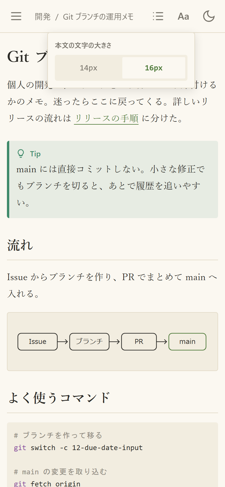
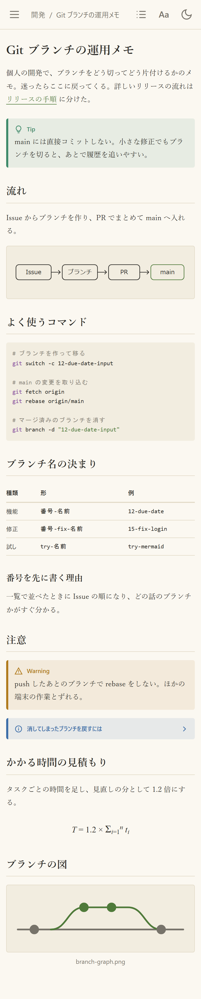

# 本文の文字の大きさを変えられる（#8）

## なぜ

スマホで長いノートを読むとき、端末や読む場面によって、標準の 16px では大きすぎて1画面に入る量が少ないことがある。本文の文字の大きさを、端末ごとに選べるようにする。

## 影響する今の仕様

- 新規の節：`docs/specs/display.md` の「本文の文字の大きさ」
- `docs/specs/notes.md` の「上の帯」（右端のボタンに「Aa」が加わる）

## 使う場面

1. スマホでノート「Git ブランチの運用メモ」を読んでいる人が、上の帯の「Aa」を押すと、小さな枠に「14px」「16px」が出て、16px が選ばれている。「14px」を押すと、すぐ本文・見出し・コード・表の文字が小さくなる。枠の外を押すと枠が閉じる
2. 14px を選んだ人が、別のノートへ移っても、ブラウザを閉じて次の日に開いても、本文は 14px で出る。上の帯やノートの一覧の文字の大きさは、ずっと変わらない
3. ノートが見つからない画面では、上の帯に「Aa」は出ない

## 受け入れ条件

- ノートを表示しているとき（ホームで `index.md` を表示しているときも）、上の帯の右側、ライト/ダークのボタンの左に「Aa」のボタン（読み上げの名前「文字の大きさ」）が出る。スマホでも PC でも出る
- 「Aa」は、ノートが見つからない・読み込み中・読み込めなかった・`index.md` がないホーム・ノートが1つもないホームでは出ない
- 「Aa」を押すと、その下に小さな枠が出る。枠には見出し「本文の文字の大きさ」と、「14px」「16px」の選択肢が横に並ぶ。今の大きさが選ばれた形（地が bg、accent の太字）で出る
- 選択肢を押すと、ページを読み込み直さずに、すぐ本文の文字の大きさが変わる。枠は開いたまま
- 枠は、枠の外を押すか Esc、もう一度「Aa」を押すと閉じる
- 変わるのは本文（ノートの題・見出し・段落・リスト・コールアウト・コード・表・数式・画像の下の文字）だけ。見出し・コード・表などは、本文の大きさに合わせた比率で大きさが変わる。Mermaid の図と、上の帯・ノートの一覧・目次・枠の中の文字は変わらない
- 大きさを変えても、スクロールの位置（ページの上からの位置）はそのまま。読んでいた段落に合わせ直すことはしない
- 選択肢は 14px・16px。一度も選んでいないブラウザでは 16px
- 選んだものは、そのブラウザに覚えておく。別のページへ移っても、ブラウザを閉じて次に開いても、ログアウト・ログインしても、選んだもので出る。別の端末・別のブラウザには引き継がない
- 14px を選んだブラウザでページを開いた瞬間に、16px で出てから 14px に変わることはない
- ブラウザに覚えておけないとき（保存が禁止されている・プライベートブラウズなど）も、その場では変わり、エラーは出ない。次に開いたときは 16px で出る
- ログインしていなければ、これまでどおりログインの画面へ移る（ログインの画面に「Aa」はない）

## 画面

合意済みの画面（立ち上げのプロトタイプ。`docs/agreed-screens/note-font.png`・`note-size-14.png`）から書き起こした。下の表の画像は、合意のときにプロトタイプで撮り直したもの（合意済みの画像と同じ）。

- 「Aa」のボタンは、上の帯のほかのアイコンのボタンと同じ（muted、押すと surface の地）。文字は font-ui の太字
- 枠（popover）：「Aa」の右端にそろえて下に出す。bg の地、border の枠、角丸、影（`shadow-popover`）。見出しは muted の小さな太字。選択肢は surface の地の中に横に並べ、選ばれているものは bg の地で accent の太字、ほかは muted。選択肢の文字は等幅
- 合意済みの画面には目次のボタンが写っているが、目次は #6 で作る。この機能では足さず、「Aa」はライト/ダークのボタンのすぐ左に置く

### ノート（note）

| 状態 | 表示 | スクリーンショット |
| --- | --- | --- |
| 文字の大きさを開いた | 「Aa」の下に枠。16px が選ばれている |  |
| 14px | 本文・見出し・コード・表が小さい。上の帯は変わらない |  |
| 表示（16px） | 今の表示と同じ大きさ。上の帯に「Aa」が加わる | `docs/specs/screens/note-default.png` を撮り直す |

### ホーム（home）

| 状態 | 表示 |
| --- | --- |
| `index.md` がある | ノートと同じく「Aa」が出て、`index.md` の本文の大きさが変わる |
| `index.md` がない・ノートが1つもない・読み込み中・読み込めなかった | 「Aa」は出ない |

## やらないこと

- 14px・16px 以外の大きさ（あとで一覧に値を足せば増やせるようにはしておく）
- 行間・字間・本文の幅・書体を変えること
- Mermaid の図の文字の大きさを変えること
- 大きさを変えたときに、読んでいた位置を保つこと
- 上の帯・ノートの一覧・目次などの画面の部品の文字の大きさを変えること
- 端末の間で設定を引き継ぐこと
- ログインの画面での切り替え

## 先に要る機能

- #3（ノートを読む。閉じていて main に入っている）

## 決まっていないこと

- [x] Mermaid の図の文字も、本文の大きさに合わせて変える？（推す答え：変えない。比べた案：変える＝本文とそろうが、選ぶたびに図を描き直すことになり、図は横にスクロールする作りなので小さくする利点も少ない。変えない＝図は今のまま、ui.md の「図の字は画面の部品の小さめの字」とも合う） → 変えない
- [x] 文字の大きさを変えたとき、読んでいた位置を保つ？（推す答え：何もしない＝ページの上からの位置のまま。比べた案：保つ＝読んでいた段落が画面に残るが、どこを読んでいたかの決め方が要り、作りが増える。何もしない＝枠を開いて選ぶのはたいてい読み始めなので、困る場面が少ない） → 何もしない

## 技術の確認表

| 項目 | 当てはまるもの | 決めた人 |
| --- | --- | --- |
| 保存するデータ | ブラウザ（localStorage）に、選んだ大きさの値だけを保存する。サーバーには保存しない（`docs/overview.md` の状態管理で決まっている） | 人（overview） |
| 外部サービス | なし | AI |
| 認証・権限 | なし（ログインの確かめは今のまま `src/proxy.ts`） | AI |
| 費用 | なし | AI |
| 個人情報 | なし | AI |
| デプロイの環境 | なし | AI |
| 新しいライブラリ | なし | AI |
| 取り消せない操作 | なし | AI |
| 共通の部品・トークン | 上の帯に「Aa」のボタンと枠を足す（上の帯はホームとノートの共通の部品）。トークンの `--reading-size` と `.reading` の倍率は立ち上げで決めてあり、値は変えない。枠の影は今あるトークン `shadow-popover` を使う | 人（Issue と合意済みの画面） |
| `docs/design.md` の決まり | 変えない。ページを開く前に大きさを当てる仕組みは、ライト/ダークと同じやり方にする | AI |

## 調べたこと

---

## 設計

### データ

- 保存するのは、ブラウザの localStorage の1つのキー `md-leaf-reading-size` に、選んだ px の数（`"14"` など）だけ。サーバーには何も保存しない
- 選択肢の一覧（`[14, 16]`）と標準（16）は `src/components/reading-size.ts` の1か所に置く。保存されている値が一覧にないとき（壊れた値・あとで選択肢から外した値）は、標準で出す

### 変えるファイル

| ファイル | 変えること |
| --- | --- |
| `src/components/reading-size.ts`（新規） | 選択肢の一覧・標準・保存のキー。最初に描く前に大きさを当てる関数（`<head>` に埋める文字列も作る）と、選んだ大きさを当てて保存する関数、今の大きさを読む関数 |
| `src/app/layout.tsx` | `<head>` のスクリプトに、大きさを当てるスクリプトを足す |
| `src/components/font-size-menu.tsx`（新規） | 上の帯の「Aa」と枠。外を押す・Esc・「Aa」で閉じる |
| `src/components/top-bar.tsx` | ライト/ダークのボタンの左に「Aa」を置く |
| `src/app/globals.css` | 「本文を表示しているときだけ出す」ための変形（`reading`）を足す |
| `e2e/` | 「Aa」と枠の操作・覚えておくことのテスト、撮る画面（`note-font`・`note-size-14`）を足す |
| `docs/specs/display.md`・`docs/specs/notes.md` | 仕上げで「本文の文字の大きさ」の節と上の帯を直す |

### やり方

- **大きさの当て方**：トークンファイルの `--reading-size`（`:root` で 16px）と、`.reading` の中の文字の倍率は立ち上げで決めてあり、変えない。大きさを変えるときは、`<html>` の style に `--reading-size` を書くだけにする。本文（`src/components/note-body.tsx` の `article.reading`）の題・見出し・コード・表の大きさは、倍率でそろって変わる。上の帯・一覧・目次は `.reading` の外なので変わらない。Mermaid の図の字は `:root` の `--text-sm` から決めている（`src/components/mermaid.ts`）ので変わらない
- **ちらつかせない**：ライト/ダーク（`src/components/theme.ts`）と同じく、`<head>` のインラインのスクリプトで、最初に描く前に保存した大きさを `<html>` に当てる。`<html>` には `suppressHydrationWarning` が付いているので、スクリプトが付けた style も食い違いにならない
- **「Aa」を本文があるときだけ出す**：上の帯は `(reader)` のレイアウトにあり、どのページを出しているかを知らない。本文があるとき（ページに `.reading` があるとき）だけ出るよう、CSS の `:has()` の変形で出し分ける（`@custom-variant reading (&:where(body:has(.reading) *))`）。見つからない・読み込み中・読み込めなかった・`index.md` がないホームは `.reading` を出さないので、「Aa」も出ない。React の状態で出し分けると、レイアウトとページの間で状態を渡す仕組みが要り、つながる前に「Aa」が出たり消えたりする
- **選ばれているもの**：枠は押したあとにしか開かないので、開くときに今の大きさを読んで、React の状態で選ばれた形にする

### 理由と前提を残す場所

- 保存・ちらつかせない仕組みの理由：`src/components/reading-size.ts` のコメント（ライト/ダークと同じやり方であることは `src/components/theme.ts` を指す）
- 「Aa」を `.reading` があるときだけ出す前提（本文は `.reading` の中に出す。本文がない画面で `.reading` を使わない）：`src/components/font-size-menu.tsx` と `src/components/note-body.tsx` のコメント。`docs/design.md` の `globals.css` の行に、`reading` の変形も定義していることを書き足す
- 「Aa」と枠の見た目：仕上げで `docs/ui.md` の「文字の大きさ」と照らし、足りなければ書き足す

## AIが決めたこと

- 枠を閉じるのは、選んだときではなく、外を押す・Esc・「Aa」をもう一度押したときにする。理由：選び比べられるように。合意済みの画面のプロトタイプも同じ動き
- 枠の選択肢は、読み上げではひとまとまりの選択（ラジオボタンの組、名前「本文の文字の大きさ」）として扱う。理由：今どれが選ばれているかが伝わる
- 覚えておけないときは、その場だけ変わり、エラーを出さない。理由：ライト/ダークと同じ扱いにそろえる
- 「Aa」を出し分けるのは CSS の `:has()` にする。理由：サーバーで作る HTML のままで正しく出し分けられ、つながる前後で変わらない。比べた案：レイアウトとページの間で React の Context を使う（ページからレイアウトへ状態を渡す仕組みが要り、つながるまで出し分けられない）
- 保存のキーは `md-leaf-reading-size`、値は px の数の文字列。理由：ライト/ダークのキー `md-leaf-theme` と名前をそろえ、選択肢の一覧の値をそのまま保存できる
- 枠は自分で作り、HTML の `popover` 属性は使わない。理由：`popover` は最上位の層に出るため、「Aa」の下に置くには位置を計算する仕組みが要る。外を押す・Esc で閉じるのは、今ある一覧（`src/components/tree-drawer.tsx`）と同じく自分で書く
- 「Aa」を出す変形は、隠された `.reading` を数えない（`body:has(.reading:not([style*="display: none"] *))`）。理由：画面を移るあいだ、Next.js は前のページを `display: none` で隠して残すので、`body:has(.reading)` だけだと読み込み中・読み込めなかった画面でも「Aa」が出た
- 枠の選択肢は、ラジオボタンの役（`role="radio"`）を付けたボタンで作る。理由：隠した `<input type="radio">` とラベルで作るより、見た目と押す場所が1つの要素にまとまる

## 確かめ方

| 受け入れ条件 | 確かめ方 |
| --- | --- |
| ノート・`index.md` のホームに「Aa」が出る（スマホ・PC） | テスト（画面を動かすテスト。ノートとホーム、スマホと PC の幅） |
| 見つからない・読み込み中・読み込めなかった・`index.md` がない・ノートが1つもないホームでは出ない | テスト（画面を動かすテスト。見つからない・`index.md` がない・ノートが1つもない）。読み込み中・読み込めなかったは、`.reading` を出さないことをコードを見て確かめる（`src/components/skeleton.tsx`・`src/components/load-error.tsx`） |
| 押すと枠が出て、見出し・14px・16px が並び、今の大きさが選ばれている | テスト（画面を動かすテスト）と、画像を比べるテスト（`note-font`） |
| 選ぶとすぐ変わり、枠は開いたまま | テスト（画面を動かすテスト。本文の字の大きさを測る） |
| 外を押す・Esc・「Aa」で閉じる | テスト（画面を動かすテスト） |
| 変わるのは本文だけ。Mermaid・上の帯・一覧・目次・枠は変わらない | テスト（画面を動かすテスト。本文と上の帯・一覧の字の大きさを測る）と、画像を比べるテスト（`note-size-14`） |
| スクロールの位置はそのまま | コードを見て確かめる（大きさを変えるときにスクロールの処理がないこと） |
| 選択肢は 14px・16px、一度も選んでいなければ 16px | テスト（単体のテスト：保存がない・一覧にない値のとき 16px）。選択肢の値はコードを見て確かめる（`src/components/reading-size.ts` の `READING_SIZES`） |
| 別のページ・開き直し・ログアウトのあとも残る。別のブラウザには引き継がない | テスト（画面を動かすテスト：別のページへ移る・開き直す） |
| 開いた瞬間に 16px で出てから変わらない | テスト（画面を動かすテスト：保存してから開き、最初の描画の前に `<html>` に当たっていること） |
| 覚えておけないときも、その場では変わりエラーは出ない | テスト（単体のテスト：localStorage が例外を投げるとき） |
| ログインしていなければログインの画面へ移り、「Aa」はない | テスト（今ある画面を動かすテストのまま）。ログインの画面は `.reading` も上の帯も出さないことをコードを見て確かめる |

## タスク

- [x] 選んだ文字の大きさを覚えておき、ページを開いたとき最初に描く前に本文へ当てられる（`src/components/reading-size.ts` と `src/app/layout.tsx`。画面にボタンはまだ出さない。単体のテストと、保存した値で開いたときの画面を動かすテスト）
- [x] 上の帯の「Aa」から枠を開き、14px・16px を選べる（`src/components/font-size-menu.tsx`・`src/components/top-bar.tsx`・`src/app/globals.css`。合わせる画像：`docs/changes/2026-11-12-add-font-size/note-font.png`・`note-size-14.png`。`docs/specs/screens/note-font.png`・`note-size-14.png` を撮り足し、上の帯が写る今の画像を撮り直す）
