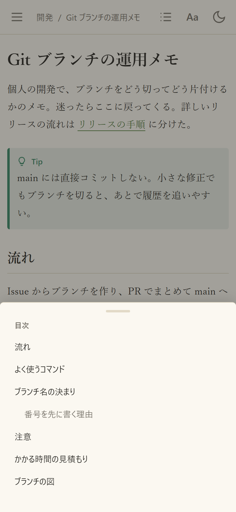
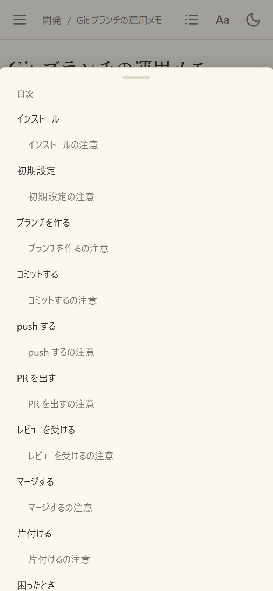
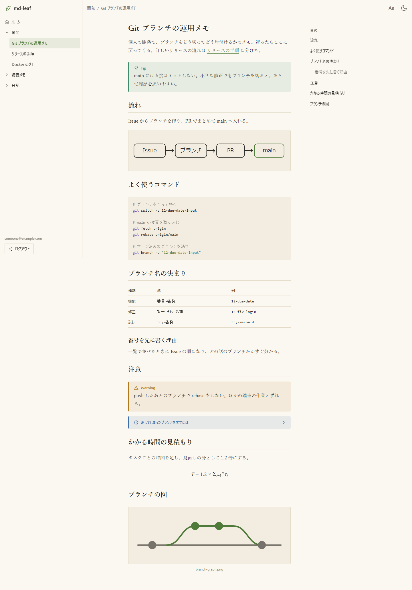

# 目次から見出しへ移れる（#6）

## なぜ

長いノートをスマホで読むと、読みたいところまでスクロールで探すことになり、今どこを読んでいるのかも分かりにくい。ノートの見出しの一覧（目次）を出し、押せばその見出しへ移れるようにする。

## 影響する今の仕様

- `docs/specs/notes.md`
  - 「上の帯」：目次のボタンが加わる
  - 「ノート」：目次の動きと、状態の表（目次を開いた・広い PC・見出しがない）
  - 「ホーム」：`index.md` があるときも、ノートと同じに目次を出す
- `docs/specs/display.md`：変わらない（目次の文字は、本文の文字の大きさで変わらないと、もう書いてある）

## 使う場面

1. スマホで「Git ブランチの運用メモ」を開いた人が、上の帯の目次のボタンを押す。下から目次が出て「流れ」「よく使うコマンド」「ブランチ名の決まり」と、その下に字下げした「番号を先に書く理由」などが並ぶ。「注意」を押すと目次が閉じ、「注意」の見出しが上の帯のすぐ下に来る
2. 幅の広い PC で同じノートを開くと、本文の右に目次が出ている。本文を下までスクロールしても、目次は右に残っていて、「流れ」を押すと上へ戻れる
3. 見出しのない短い日記のノートを開くと、目次のボタンも右の目次も出ない

## 受け入れ条件

目次の中身
- 目次には、ノートの本文の h2 と h3 を、本文の順に出す。h3 は字下げして muted の色。h1・h4 以下と、ノートの題は出さない
- 見出しの文字は、見出しに書いた文字だけを出す（太字・リンク・文の中のコードなどの飾りは付けない）。長い見出しは折り返して全部出す
- コールアウトの中・折りたたみのコールアウトの中に書いた見出しも、本文の見出しとして目次に出す
- 目次の上に、muted の小さな太字で「目次」
- 見出しがひとつもないノートでは、目次のボタンも右の目次も出さない
- ホームの `index.md` も、ノートと同じに目次を出す

見出しへ移る
- 目次の見出しを押すと、その見出しへ移る。見出しは上の帯に隠れず、上の帯のすぐ下に来る
- 折りたたみのコールアウトの中の見出しを押したときは、そのコールアウトを開いてから移る
- 同じ文字の見出しが2つ以上あっても、押したほうの見出しへ移る
- 移ってもページは読み込み直さない。URL には `#見出し` を付けず、ブラウザの「戻る」は目次で移る前のページへ戻る

スマホ・PC（幅 xl 未満）
- 上の帯の、文字の大きさの「Aa」の左に目次のボタン（並ぶアイコンの形）を出す
- 押すと、下から目次が出て、うしろに幕が出る。目次の上に、つまみの形の短い線
- 見出しを押す・幕の外を押す・Esc のどれかで閉じる
- 見出しが多くて画面に収まらないときは、目次は上に幕が少し見える高さまでで止まり、見出しの並びだけがスクロールする（つまみと「目次」は残る）
- `#見出し` を付けたリンク（`#見出し` だけ・`note.md#見出し`）の動きは変えない（これまでどおり）

広い PC（幅 xl 以上）
- 目次を本文の右に常に出し、上の帯の目次のボタンを出さない
- 本文をスクロールしても、目次は上の帯の下に残る。目次が画面の高さより長いときは、目次の中だけがスクロールする

目次のボタンを出さないとき
- 「ノートが見つかりません」・読み込み中・読み込めなかったとき
- `index.md` がないホーム・ノートが1つもないホーム
- ログインしていなければ、これまでどおりログインの画面へ移る（目次は出ない）

## 画面

ノート（`note`）。ホームの `index.md` も同じ。

| 状態 | 表示 | スクリーンショット |
| --- | --- | --- |
| 目次を開いた（スマホ） | 下から目次、うしろに幕。上につまみ、「目次」、h2 と字下げした h3 |  |
| 目次が多い（スマホ） | 目次は上の帯の少し下（上に幕が見える高さ）までで、つまみと「目次」は残り、見出しの並びだけがスクロールする |  |
| 表示（広い PC。幅 1440） | 本文の右に目次。上の帯に目次のボタンはない。本文は、本文と目次を合わせた幅で中央に寄せる |  |
| 見出しがない | 上の帯に目次のボタンがなく、広い PC でも右の目次がない | （画像なし。今の表示から目次のボタンを除いた形） |
| 読み込み中・読み込めなかった・見つからない | 目次のボタンを出さない（今のスクリーンショットのまま） | `docs/specs/screens/note-loading.png` ほか |

見た目（`docs/ui.md` にないもの）
- スマホの目次は、bg の地に、上の角を丸め、上に border の線と shadow-sheet。つまみは border の色の短い線
- 目次の見出しはゴシックの小さめの字（font-ui・text-sm）。押したとき surface の地。「目次」は muted の text-xs の太字
- 広い PC の右の目次は、地も枠も付けず、bg の上にそのまま並べる。本文の上端（題の高さ）にそろえて置き、スクロールしても上の帯のすぐ下に残る
- 画像はプロトタイプで撮ったもの。本文の書体・図・数式の出方は本番と違うことがあり、合わせるのは目次と上の帯・並べ方だけ。`note-toc.png` は立ち上げで合意した `docs/agreed-screens/note-toc.png` と同じ画面（本番の画像に引き継いだら、`docs/agreed-screens/` のほうは消す）
- 目次の項目は、立ち上げで合意した `note-toc.png` のとおり、項目ごとに上下の余白をとった行（押しやすい高さ）にする

## やらないこと

- 読んでいるところの見出しを、目次で強調すること（スクロールに合わせて動く印）
- 目次を開閉して、広い PC で右の目次を隠すこと
- 目次の中の見出しを折りたたむこと
- h4 以下を目次に出すこと
- ノートの中の `#見出し` のリンクで、その見出しへ移れるようにすること（別の Issue にする）

## 先に要る機能

- #3（ノートの一覧から選んで、ノートを読める）：閉じていて、main に入っている

## 決まっていないこと

- [x] ノートの中の `#見出し` だけのリンクや、`note.md#見出し` のリンクで、その見出しへ移れるようにするのも、この機能に含める？（推す答え：含めない。別の Issue にする） → 含めない
  - 含めない：Issue に書かれていない。見出しの印の付け方（URL に出る形）を、まずこの機能で決めて使ってみてから考えられる。悪い点：リンクの `#見出し` は今までどおり先頭へ移るまま
  - 含める：見出しに印を付けるのは同じなので、少しの手間で済む。悪い点：見出しの印が URL の一部になり、ノートの書き手が `#見出し` の書き方を知る必要が出る（Obsidian の書き方とのずれ）。相対リンクの仕様も変わり、範囲が広がる

## 技術の確認表

| 項目 | 当てはまるもの | 決めた人 |
| --- | --- | --- |
| 保存するデータ | なし（目次は、ビルドのときにノートの見出しから作る） | AI |
| 外部サービス | なし | AI |
| 認証・権限 | なし（今のログインの確かめのまま） | AI |
| 費用 | なし | AI |
| 個人情報 | なし | AI |
| デプロイの環境 | なし（変わらない） | AI |
| 新しいライブラリ | なし（見出しの印と一覧は、今の unified の変換に自分で足す） | AI |
| 取り消せない操作 | なし | AI |
| 共通の部品・トークン | 今のトークンだけ（shadow-sheet・radius・overlay）。開閉は、ノートの一覧と同じ作り | AI |
| `docs/design.md` の決まり | 変わらない（変換は `src/lib/`、ビルドのときに HTML にする） | AI |

## 調べたこと

-

---

## 設計

### データ（目次の見出しを作る）

- `src/lib/headings.ts`（新規）：rehype のプラグイン `noteHeadings`。HTML の木を順にたどり（コールアウトの `div`・`details` の中も）、`h2`・`h3` に `data-heading="<番号>"`（0 から本文の順）を付け、`file.data.headings` に `{ id: string; text: string; depth: 2 | 3 }[]` を置く。`id` は付けた番号の文字列
  - `text` は見出しの中の文字だけをつないだもの（太字・リンク・コードなどの要素は中の文字だけ。KaTeX などの `raw` は数えない）。前後の空白は除き、空なら目次に出さない（印も付けない）
  - 印に HTML の `id` 属性を使わない。理由：`id` が見出しの文字だと、ノートの中の `#見出し` のリンクで、ブラウザがその見出しへ移るようになり、「`#見出し` のリンクの動きは変えない」に反する。番号なら同じ文字の見出しも別になる。この理由はコードのコメントに残す（`#見出し` のリンクで移れるようにする別の Issue で見直すため）
- `src/lib/markdown.ts`：`noteHeadings` を数式・コードの色分け・表の変換のあと（`rehypeStringify` の直前）に足し（数式より前だと TeX の文字が目次に入るため。前提は `src/lib/headings.ts` のコメント）、`RenderedMarkdown` に `headings` を足す
- `src/lib/notes.ts`：`Note` に `headings` を足し、`toNote` で渡す。`src/app/(reader)/data.ts` はそのまま（`"use cache"` の戻り値として渡せる、ただのオブジェクトの配列）

### 画面

- `src/components/toc.tsx`（新規、client）
  - `TocProvider`：スマホの目次が開いているか（`open`）と、目次のボタンの ref を持つ React の context。`src/app/(reader)/layout.tsx` で、上の帯と `main` をまとめて包む（上の帯はレイアウトに、目次の中身はページにあるため、開閉だけを共有する）
  - `TocButton`：上の帯の目次のボタン（`aria-label="目次を開く"`、`aria-expanded`）。`src/components/top-bar.tsx` の `FontSizeMenu` の左に置く。出し分けは、「Aa」と同じく CSS の変形で行う：`src/app/globals.css` に `toc` の変形（ページに隠されていない `[data-toc]` があるときだけ）を足し、`hidden toc:block xl:hidden` の形にする。理由は「Aa」と同じ（上の帯はページを知らない。サーバーの HTML のままで正しく出し分け、React がつながる前後で出たり消えたりしない）。この理由は `src/components/font-size-menu.tsx` の説明を参照する1行にする
  - `NoteToc`：ページ（`NoteBody`）が出す目次。見出しが1つ以上のときだけ出し、根の要素に `data-toc` を付ける。中に2つ
    - 広い PC（xl 以上）の右の目次（`nav aria-label="目次"`、xl 未満では `hidden`）
    - スマホ・PC（xl 未満）の下から出る目次（`role="dialog" aria-modal="true" aria-label="目次"`）。開閉の作りは `src/components/tree-drawer.tsx` と同じ（閉じているあいだも消さずに `invisible`・`inert`、幕 `bg-overlay`、Esc と幕の外で閉じ、閉じたらボタンへフォーカスを戻す）。下から滑らせる
  - 見出しの項目は `button`（`a href="#..."` にしない。URL も履歴も変えないため）。押すと：スマホなら閉じる → 押した見出しを、同じ `NoteBody` の中から `[data-heading="<id>"]` で探す（Next.js は前のページを隠して残すので、`document` 全体からは探さない）→ 閉じた `details` の中なら、外側の `details` をすべて開く → `scrollIntoView({ block: "start" })`（滑らかに動かさない）
  - 項目の見た目：font-ui・text-sm・押しやすい上下の余白（`note-toc.png` に合わせる）・押したとき（hover）surface の地・角丸。h3 は字下げして muted。「目次」は muted の text-xs の太字。目次の文字は `.reading` の外に置き、本文の文字の大きさで変わらないようにする
  - スマホの目次：bg の地、上の角を丸め、上に border の線、shadow-sheet。上に border の色のつまみ（短い線）。高さは中身に合わせ、いちばん高くて「画面の高さ − 上の帯と同じくらいの幕が見える分」（`note-toc-many.png`。上に幕が少し見える）。つまみと「目次」は残し、見出しの並びだけをスクロールする
  - 広い PC の右の目次：地も枠もなし。本文の題の高さにそろえ、`sticky` で上の帯の下に残る。高さが画面より長いときは、目次の中だけがスクロールする（最大の高さ＝画面の高さ − 上の帯と上の余白）
  - トークンの値だけでは書けない高さ（`calc(100dvh - ...)`）は、`[` の任意の値を使わず、`note-body.css` と同じ形で CSS ファイル（`src/components/toc.css`）に `var()` だけで書く。クラスは `eslint.config.mjs` の `no-unknown-classes` の `ignore` に足す
- `src/components/note-body.tsx`：`headings` を受け取り、`NoteToc` を出す。xl 以上では本文（`max-w-prose`）と右の目次を横に並べ、2つを合わせた幅で中央に寄せる（`note-default-pc.png`）。xl 未満の並びは今のまま
- `src/components/note-body.css`：本文の `h2`・`h3`（`[data-heading]`）に `scroll-margin-top` を付け、移ったとき見出しが上の帯（h-14）に隠れず、すぐ下に来るようにする（上の帯の高さ＋少しの余白。値は `var(--spacing)` の倍数）
- `src/components/icons.tsx`：目次のアイコン `TocIcon`（点と線が並ぶ形）を足す
- ページ：`src/app/(reader)/notes/[...path]/page.tsx` と `src/app/(reader)/page.tsx`（`index.md` があるとき）で `headings` を `NoteBody` に渡す。見つからない・読み込み中・読み込めなかった・`index.md` がないホーム・ノートが1つもないホームは `NoteBody` を使わないので、目次のボタンは出ない

### テスト用のノート

- 見出しがないノート：今の `e2e/fixtures/content/読書メモ/積読を減らす.md`（見出しなし）を使う
- 折りたたみのコールアウトの中の見出し・同じ文字の見出し：`e2e/fixtures/content/開発/リリースの手順.md` に足す（このノートを撮った画像はない）。スマホの高さで移ったのが分かるよう、本文を長くする
- 目次が多い：`e2e/fixtures/content-many/開発/開発のノート 1.md` に h2・h3 を多く足す（名前は変えないので、一覧の画像は変わらない）

### 残す場所

- 印に `id` を使わない理由：`src/lib/headings.ts` のコメント
- `toc` の変形の前提：`src/app/globals.css` のコメント（`reading` と同じ前提）
- 目次の見た目の決まり：`docs/ui.md` の「部品の使い分け」の「目次」に書き足す
- 動き：`docs/specs/notes.md`（上の帯・ノート・ホーム）

## AIが決めたこと

- 押して移るとき、URL に `#見出し` を付けない。理由：見出しを押すたびにブラウザの履歴が増え、「戻る」で前のノートへ戻れなくなる。比べた案：`#見出し` を付ける（読み込み直しても同じ場所に戻れるが、履歴が増える）
- 見出しへはすぐ移る（滑らかに動かさない）。理由：長いノートで動きを待たされない
- 同じ文字の見出しは、別の見出しとして扱う。見出しの印は、文字ではなく本文の順の番号（`data-heading`）にし、HTML の `id` を使わない。理由：`id` を見出しの文字にすると、ノートの中の `#見出し` のリンクでブラウザがその見出しへ移るようになり、受け入れ条件「`#見出し` のリンクの動きは変えない」に反する。比べた案：見出しの文字から `id` を作り、2つめ以降に番号を付ける（`#見出し` のリンクの別の Issue でそのまま使えるが、今の動きが変わる）
- 目次を開くボタンと目次の中身は、React の context（`TocProvider`）で開閉だけを共有する。理由：上の帯はレイアウトに、見出しはページにある。比べた案：上の帯が本文の見出しを DOM から読む（サーバーの HTML でボタンを出し分けられず、React がつながる前後で出たり消えたりする）
- 文字が空の見出し（`## ` だけ・画像だけ）は目次に出さない
- 目次の見出しの項目は `button` にする（`a href="#..."` にしない）。理由：URL と履歴を変えないため
- 見出しの中の飾り（太字・リンク・コード）は、目次では文字だけにする
- 折りたたみのコールアウトの中の見出しも目次に出し、押したら開いてから移る。比べた案：閉じた中の見出しは出さない（目次から探せなくなる）
- 幅 lg〜xl の PC でも、スマホと同じ下から出る目次にする（立ち上げのプロトタイプのとおり）
- 目次の見出しは、本文の文字の大きさの設定で変えない（`docs/specs/display.md` のとおり）

## 確かめ方

| 受け入れ条件 | 確かめ方 |
| --- | --- |
| h2・h3 を本文の順に出し、h1・h4 以下は出さない | テスト（`src/lib/headings.test.ts`） |
| 見出しの文字だけを出す（飾りなし） | テスト（`src/lib/headings.test.ts`） |
| コールアウト・折りたたみの中の見出しも出す | テスト（`src/lib/headings.test.ts`） |
| h3 は字下げして muted・長い見出しは折り返す・「目次」の見た目 | 触って確かめる（`note-toc.png`・`note-default-pc.png`） |
| 見出しがないノートでは、ボタンも右の目次も出さない | テスト（`e2e/toc.spec.ts`） |
| ホームの `index.md` も目次を出す | テスト（`e2e/toc.spec.ts`） |
| 押すと見出しが上の帯のすぐ下に来る | テスト（`e2e/toc.spec.ts`。見出しの上端の位置） |
| 折りたたみの中の見出しは、開いてから移る | テスト（`e2e/toc.spec.ts`） |
| 同じ文字の見出しでも、押したほうへ移る | テスト（`src/lib/headings.test.ts` で別の番号、`e2e/toc.spec.ts` で2つめへ移る） |
| 読み込み直さず、URL に `#` を付けず、「戻る」で前のページへ | テスト（`e2e/toc.spec.ts`） |
| スマホ：「Aa」の左にボタン、下から目次と幕、つまみ | テスト（`e2e/toc.spec.ts` で開く）＋触って確かめる（`note-toc.png`） |
| 見出し・幕の外・Esc で閉じる | テスト（`e2e/toc.spec.ts`） |
| 見出しが多いと、上に幕が見える高さで止まり、並びだけがスクロールする | テスト（`e2e/toc.spec.ts` @content-many。「目次」が見えたまま並びがスクロールする）＋触って確かめる（`note-toc-many.png`） |
| `#見出し` のリンクの動きは変えない | コードを見て確かめる（`src/lib/headings.ts` で `id` を付けていない） |
| 広い PC：右に常に出し、ボタンを出さない | テスト（`e2e/toc.spec.ts`） |
| 広い PC：スクロールしても残り、長ければ目次の中だけスクロール | テスト（`e2e/toc.spec.ts`。下までスクロールしても目次が見え、押すと上へ戻る）＋触って確かめる |
| ボタンを出さないとき（見つからない・読み込み中・読み込めなかった・index.md がないホーム・0件） | テスト（`e2e/toc.spec.ts` で見つからない・index.md がないホーム）＋触って確かめる（読み込み中・読み込めなかったの画像 `note-loading.png` など） |
| ログインしていなければログインの画面へ | テスト（今の `e2e/login.spec.ts` のまま） |

## タスク

- [x] 見出しの一覧：ノートの変換で h2・h3 に印（`data-heading`）を付け、`Note` に `headings` が入ったら完了（`src/lib/headings.ts`・`headings.test.ts`・`markdown.ts`・`notes.ts`。画面は変えない）
- [x] 目次の画面：スマホの下から出る目次と上の帯のボタン、広い PC の右の目次ができ、押すと見出しへ移る。`e2e/toc.spec.ts` が通り、画像を撮り直したら完了
  - 合わせる画像：`note-toc.png`（スマホ・開いた）、`note-toc-many.png`（@content-many、`開発のノート 1`）、`note-default-pc.png`（広い PC）
  - 撮り直してよい画像（上の帯にボタンが加わる・右に目次が出るため）：`note-default.png`、`note-default-dark.png`、`note-default-pc.png`、`home-index.png`、`home-index-dark.png`、`home-index-pc.png`、`note-font.png`、`note-size-14.png`、`note-tree.png`、`note-tree-many.png`。新しく撮る：`note-toc.png`、`note-toc-many.png`
  - テスト用のノート（設計の「テスト用のノート」）もこのタスクで直す
