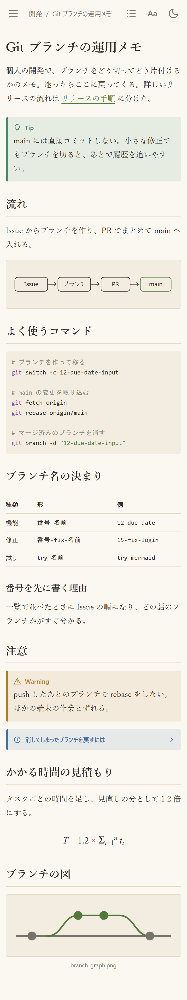
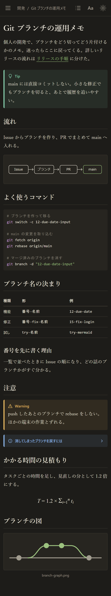
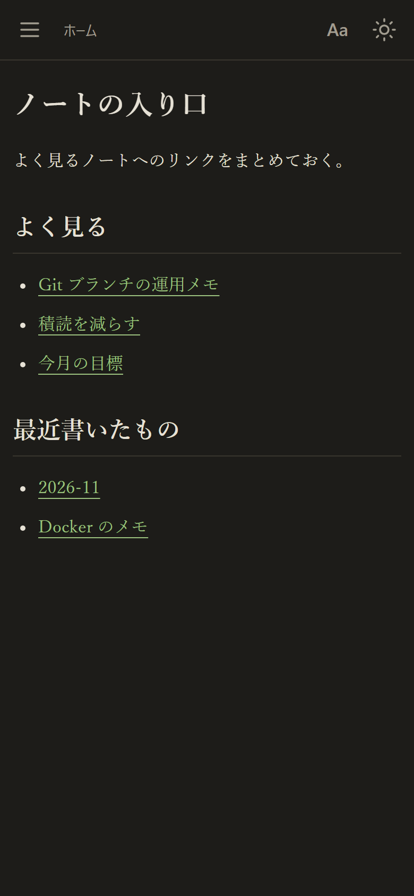
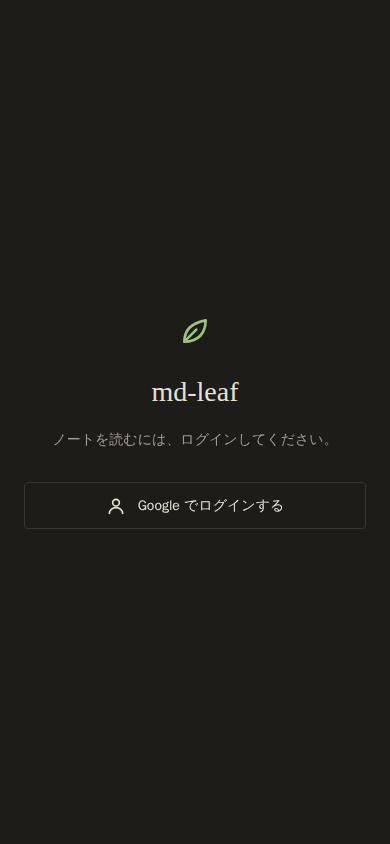

<!--
変更の仕様のひな形。コピーして docs/changes/<年-月-日>-<何をするか>.md を作る（例：2026-09-17-add-due-date.md）。
「なぜ」〜「調べたこと」は、AIが下書きし、人間がプロトタイプを触って直し、合意して決める（/dev-proto）。「画面」のスクリーンショットは、合意したときに足す。
「設計」以降はAIが書いて実装まで進め、人間は機能の PR でレビューする（/dev-build）。
スクリーンショットは、このファイルと同じ名前のフォルダに置く（例：2026-09-17-add-due-date/list-empty.png）。
-->

# ライトとダークを切り替えられる（#7）

## なぜ

夜や暗い部屋でスマホからノートを読むと、生成りの明るい地がまぶしい。上の帯のボタン1つで、暗い地の見た目（ダーク）に切り替えられるようにする。

## 影響する今の仕様

- `docs/specs/notes.md` の「上の帯」（右側に切り替えのボタンを置く）
- `docs/specs/login.md` の「ログインの画面」（覚えておいた設定で表示する）
- 新規：`docs/specs/display.md`（ライト・ダークの切り替え。あとで文字の大きさ（Issue の別の機能）もここに足す想定）

## 使う場面

1. 夜、寝る前にスマホでノート「Git ブランチの運用メモ」を開いた人が、上の帯の右端の月のボタンを押すと、地が暗くなり文字が明るくなる。ボタンは太陽に変わる。コードの色分け・コールアウト・Mermaid の図も暗い地に合った色になる
2. その人が、本文のリンクから「リリースの手順」へ移っても、ダークのまま。翌日スマホのブラウザでアプリを開き直しても、最初からダークで表示され、一瞬ライトになることもない
3. 同じ人が PC のブラウザで開くと、PC では選んでいないのでライトで表示される（設定は端末・ブラウザごと）

## 受け入れ条件

- 上の帯の右端に、ライトのときは月のアイコンのボタン、ダークのときは太陽のアイコンのボタンが出る
  - 月のボタンを押すと、すぐにダークになり、ボタンが太陽に変わる。太陽のボタンを押すと、すぐにライトに戻り、ボタンが月に変わる。ページは読み込み直さない
  - ボタンの読み上げの名前は、ライトのとき「ダークにする」、ダークのとき「ライトにする」
  - ボタンは、上の帯のあるすべての画面に出る（ホームの `index.md` がある・ない・ノートが1つもない・読み込み中・読み込めなかった、ノートの表示・読み込み中・読み込めなかった・見つからない）。スマホでも PC でも出る
- ダークでは、画面の地・文字・枠・リンク・ボタン・ノートの一覧・幕・帯（エラー・許可していないアカウント）・本文のブロック（コールアウト・コード・表・数式・Mermaid の図）が、ダークの色になる
  - Mermaid の図は、切り替えたときに、その場で新しい色で描き直す
  - ノートの画像は、そのままの色で出す（色を反転しない）
- 選んだもの（ライト・ダーク）は、そのブラウザに覚えておく
  - 別のノートやホームへ移っても、ブラウザを閉じて次に開いたときも、選んだもので表示される
  - ログアウトしても、もう一度ログインしても、覚えておいたものは消えない
  - 別の端末・別のブラウザには引き継がない
- 一度も選んでいないブラウザでは、端末の設定（OS のダークモード）に合わせて表示する。端末の設定がダークならダーク、そうでなければライト
- 一度ボタンで選んだあとは、端末の設定を変えても、選んだもので表示する（端末に合わせる動きに戻す手段は作らない）
- ページを開いた瞬間（読み込み直したとき・初めて開いたときを含む）に、ライトで出てからダークに変わる「ちらつき」がない
- ログインの画面には上の帯がないので、切り替えのボタンを出さない。覚えておいたもの（なければ、一度も選んでいないときの決まり）で表示する
- ブラウザに覚えておけない場合（保存が禁止されている・プライベートブラウズなど）でも、切り替えはその場では効く。エラーは出さない。次に開いたときは、一度も選んでいないときの決まりで表示する
- ログインしていなければ、今までどおりログインの画面へ移る（この機能でログインの要る範囲は変えない）

## 画面

切り替えのボタンは、上の帯の右端。muted のアイコンで、押すと surface の地（`docs/ui.md` の「上の帯のアイコンのボタン」）。ダークの色はトークンの2組目（`src/styles/tokens.css` の `.dark`）で、画面ごとにライト・ダークを分けて書かない。

立ち上げで合意した画像には、目次（☰ に似た一覧のアイコン）と文字の大きさ（Aa）のボタンも写っているが、それは別の機能（別の Issue）で、この機能では作らない。この機能のあとの上の帯の右側は、ライト/ダークのボタン1つだけになる。

### ノート（note）

| 状態 | 表示 | スクリーンショット |
| --- | --- | --- |
| 表示（ライト） | 今までどおり。上の帯の右端に月のボタン |  |
| 表示（ダーク） | ダークの色。上の帯の右端に太陽のボタン。コード・コールアウト・表・数式・図もダークの色。画像はそのまま |  |

ノートのほかの状態（読み込み中・読み込めなかった・見つからない・ノートの一覧を開いた）は、上の帯の右端にボタンが増えるだけで、並びは変わらない。

### ホーム（home）

| 状態 | 表示 | スクリーンショット |
| --- | --- | --- |
| `index.md` がある（ダーク） | ダークの色。上の帯の右端に太陽のボタン |  |

ホームのほかの状態も、上の帯の右端にボタンが増えるだけ。

### ログイン（login）

| 状態 | 表示 | スクリーンショット |
| --- | --- | --- |
| ログイン前（ダーク） | ダークの色で同じ並び。切り替えのボタンはない |  |

## やらないこと

- 目次・文字の大きさのボタン（別の機能）
- ライト・ダーク以外の色の組（セピアなど）や、時刻で自動に切り替えること
- 設定を端末の間で同期すること（アカウントに保存しない。データベースを使わない）
- ノートの画像の色を、ダークに合わせて変えること

## 先に要る機能

- #3（上の帯とノートの一覧。main に入っている）

## 決まっていないこと

- [x] 一度も選んでいないブラウザで、最初にどちらで出すか？（推す答え：端末の設定（OS のダークモード）に合わせる） → 端末の設定に合わせる
  - 端末に合わせる：良い点…夜にダークモードのスマホで初めて開いてもまぶしくない。OS で決めている人は押さずに済む。悪い点…人によって最初の見た目が変わる
  - いつもライト：良い点…最初の見た目が1つに決まる（プロトタイプは今この動き）。悪い点…ダークモードの端末でも、まず明るい画面が出る
- [x] 一度選んだあと、端末の設定（OS のダークモード）を変えたら、それに合わせ直すか？（推す答え：合わせ直さない。ボタンで選んだものを優先する。「自動（端末に合わせる）」に戻す手段は作らない） → 合わせ直さない
  - 合わせ直さない：良い点…ボタンが2択のままで分かりやすい。悪い点…一度押すと、端末に合わせる動きには戻れない
  - 3択（ライト・ダーク・自動）にする：良い点…端末に合わせる動きに戻せる。悪い点…合意した画面の月・太陽の2つのボタンと違う見せ方が要る

## 技術の確認表

| 項目 | 当てはまるもの | 決めた人 |
| --- | --- | --- |
| 保存するデータ | ブラウザの中に、ライト・ダークのどちらを選んだかを1つだけ保存する。サーバーには保存しない | 人（`docs/overview.md` の「状態管理」：ダークはブラウザに保存する） |
| 外部サービス | なし | AI |
| 認証・権限 | なし（ログインの要る範囲は変えない。ログインの画面も、覚えておいたもので表示するだけ） | AI |
| 費用 | なし | AI |
| 個人情報 | なし（保存するのはライト・ダークの別だけ） | AI |
| デプロイの環境 | なし（今の Vercel のまま。環境変数も足さない） | AI |
| 新しいライブラリ | なし | AI |
| 取り消せない操作 | なし（もう一度押せば戻る） | AI |
| 共通の部品・トークン | トークンは今の `.dark` の組をそのまま使い、足さない。上の帯のアイコンのボタンを、今の ☰ と同じ見た目で足す。月・太陽のアイコンを `src/components/icons.tsx` に足す | AI（トークンの組は立ち上げで人が合意済み） |
| `docs/design.md` の決まり | 「トークンにない値を書かない」「画面の画像は Docker で撮って比べる」に従う。新しい決まりは作らない | AI |

## 調べたこと

---

## 設計

### 色の切り替えのしくみ

- ダークかどうかは、`<html>` に `.dark` のクラスがあるかだけで決める。色は今のトークンの2組（`src/styles/tokens.css` の `:root` と `.dark`）がそのまま切り替わる。画面ごとのコードは変えない
  - `.dark` に `color-scheme: dark` を足し、ブラウザが描くもの（スクロールバーなど）も暗くする
- 選んだものは、ブラウザの `localStorage` に、キー `md-leaf-theme`、値 `"light"` か `"dark"` で1つだけ保存する。読み書きは try/catch で包み、失敗しても何もしない（エラーを出さない）
  - 理由：Cookie に置いてサーバーで読むと、ルートのレイアウトで開くたびに読むことになり、ビルドのときに HTML にしておけなくなる（`node_modules/next/dist/docs/01-app/02-guides/preventing-flash-before-hydration.md` の「Themes」）。サーバーは選んだものを知らなくてよい
- ちらつきを出さないために、ルートのレイアウト（`src/app/layout.tsx`）の `<head>` に、インラインのスクリプトを置く。HTML を読んでいる途中、最初に描く前に同期で動き、保存したもの（なければ `matchMedia("(prefers-color-scheme: dark)")`）で `.dark` を付ける。`<html>` に `suppressHydrationWarning` を付ける
  - 一度も選んでいないあいだは、同じスクリプトが端末の設定の変化（`matchMedia` の change）も聞き、合わせ直す。一度選んだら合わせ直さない（保存があるかで見分ける）
  - ログインの画面もルートのレイアウトの下なので、同じスクリプトで覚えたもので出る
  - スクリプトの中身は `src/components/theme.ts` の、外の変数を使わない関数1つに書き、`toString()` で文字列にしてレイアウトに埋める（テストで同じ関数をそのまま呼べるように）。キーの名前もそこに1か所だけ置く
- 理由と前提は `src/components/theme.ts` の先頭のコメントに書く（このファイルと `src/app/layout.tsx` にだけ効くため。`docs/design.md` には足さない）

### 切り替えのボタン

- `src/components/theme-toggle.tsx`（クライアントの部品）。上の帯（`src/components/top-bar.tsx`）の右端に置く。見た目は ☰ のボタンと同じ（`size-10`、`rounded-md`、`text-muted`、hover で `bg-surface`）
- 月・太陽のアイコンと読み上げの名前は、両方を描いておき、CSS で `.dark` があるかによってどちらかを隠す（Tailwind の `dark` の変形を、`src/app/globals.css` で `.dark` のクラスに合わせて定義する。`@custom-variant dark (&:where(.dark, .dark *));`）。隠したほう（`display: none`）は読み上げの名前に入らない
  - 理由：サーバーで作る HTML は、どちらが選ばれているかを知らない。React の状態で出し分けると、つながる前に違うアイコンが出たり、つながるときに食い違ったりする。CSS なら、インラインのスクリプトが `.dark` を付けた時点で正しいほうが出る
  - 前提（崩れたら見直す）：ダークかどうかは `<html>` の `.dark` だけで決まる
- 押すと `<html>` の `.dark` を付け外しし、`localStorage` に書く（`src/components/theme.ts` の関数）。ページは読み込み直さない。部品は状態を持たない
  - 押したら `<html>` に `data-theme-chosen` も付ける。インラインのスクリプトが端末の設定の変化で合わせ直すのは、保存がなく、この印もないときだけにする（保存できないブラウザで押したあと、開いているあいだに端末の設定が変わっても、選んだものを上書きしないため）
- 月・太陽のアイコンを `src/components/icons.tsx` に足す

### Mermaid の描き直し

- `src/components/note-body-content.tsx` で、図に替えるときに元のコードを図の要素（`.mermaid-figure`）の `data-mermaid-source` に残す
- `<html>` の `class` の変化を `MutationObserver` で見て、`.dark` があるかが変わったら、本文の図をすべて元のコードから描き直す（`renderMermaid` は描くたびにトークンを読むので、そのままで新しい色になる）。部品が消えるときに見るのをやめる
  - 理由：ボタンと本文の部品をつながなくてよく、端末の設定の変化（選んでいないとき）でも同じように描き直せる

## AIが決めたこと

- ボタンの読み上げの名前を「ダークにする」「ライトにする」にする（押したあとにどうなるかを名前にする）。理由：アイコンだけのボタンで、今の状態ではなく押した結果を伝えるほうが迷わない。プロトタイプと同じ
- Mermaid の図は、切り替えたときに描き直す。理由：図の色は描くときにトークンから読むので、描き直さないとライトの色のまま残る
- ノートの画像は反転・暗くしない。理由：写真や図の色が変わると、元の意味が変わる
- ブラウザに覚えておけないときは、エラーを出さずにその場だけ切り替える。理由：読むだけのアプリで、見た目の設定が残らないことは読む妨げにならない
- ログアウトしても覚えたものを消さない。理由：見た目の設定は端末のもので、アカウントの情報ではない

- 保存は `localStorage`（Cookie にしない）。理由：サーバーで読む必要がなく、Cookie をサーバーで読むとページをビルドのときに HTML にしておけない。比べた案：Cookie をインラインのスクリプトで読む（毎回サーバーへ送られる分が増えるだけで得がない）
- ちらつきを防ぐのは、`<head>` のインラインのスクリプト。比べた案：next-themes などのライブラリ（数十行で済み、仕様に新しいライブラリはない）、React の状態で `useEffect` から付ける（描いたあとに変わるのでちらつく）
- ボタンのアイコンと名前は CSS（`dark` の変形）で出し分ける。比べた案：`useSyncExternalStore` で状態を読む（サーバーで作る HTML と食い違い、つながる前に違うアイコンが出る）
- 一度も選んでいないあいだは、開いているときに端末の設定が変わっても合わせ直す。理由：「端末の設定に合わせる」の自然な続きで、選んだあとは合わせ直さないので受け入れ条件と食い違わない
- `localStorage` のキーは `md-leaf-theme`。理由：同じオリジンのほかの物と重ならない名前にする
- 切り替えは、月のボタン（「ダークにする」）と太陽のボタン（「ライトにする」）の2つを描き、`dark` の変形でどちらかを隠す。理由：読み上げの名前（`aria-label`）は CSS で変えられないので、ボタンごと出し分けると名前とアイコンが必ずそろう

## 確かめ方

| 受け入れ条件 | 確かめ方 |
| --- | --- |
| ライトで月・ダークで太陽のボタンが上の帯の右端に出る | 触って確かめる（画像 `note-default.png`・`note-default-dark.png`・`home-index-dark.png`） |
| 押すとすぐ切り替わり、ボタンが変わる。読み込み直さない | テスト（`e2e/theme.spec.ts`：押すと `.dark` が付き、ボタンの名前が「ライトにする」に変わり、もう一度押すと戻る。読み込み直していない） |
| 読み上げの名前（「ダークにする」「ライトにする」） | テスト（上と同じテストで、名前でボタンを探す） |
| すべての上の帯のある画面に出る（スマホ・PC） | 触って確かめる（上の帯のある画面の画像をすべて撮り直す。ボタンは上の帯の部品にあり、画面ごとの出し分けはない） |
| ダークで地・文字・枠・部品・本文のブロックがダークの色になる | 触って確かめる（画像 `note-default-dark.png`・`home-index-dark.png`・`login-default-dark.png`） |
| Mermaid の図は、切り替えたときに描き直す | テスト（`e2e/theme.spec.ts`：切り替えると、図の線の色がダークの文字の色に変わる） |
| ノートの画像はそのままの色 | コードを見て確かめる（画像に `filter` などを付けていない。`src/components/note-body.css`） |
| 選んだものは、別のページへ移っても、開き直しても残る | テスト（`e2e/theme.spec.ts`：ダークにしてノートへ移る・読み込み直すとダーク） |
| ログアウト・ログインしても消えない | コードを見て確かめる（ログアウトで `localStorage` に触らない。`src/components/logout.tsx`） |
| 別の端末・ブラウザに引き継がない | コードを見て確かめる（保存はブラウザの `localStorage` だけで、サーバーへ送らない。`src/components/theme.ts`） |
| 選んでいないときは端末の設定に合わせる | テスト（`e2e/theme.spec.ts`：端末の設定がダーク・ライトのそれぞれで開く） |
| 選んだあとは端末の設定を変えても選んだもの | テスト（`e2e/theme.spec.ts`：ライトを選んだあと、端末の設定をダークにして開いてもライト） |
| 開いた瞬間のちらつきがない | テスト（`e2e/theme.spec.ts`：ダークを保存して開くと、`<body>` ができた時点で `<html>` に `.dark` がある） |
| ログインの画面にボタンを出さず、覚えたもので出る | テスト（`e2e/theme.spec.ts`：ダークを保存してログインの画面を開くとダークで、ボタンがない）。見た目は画像 `login-default-dark.png` |
| 覚えておけなくても、その場では切り替わり、エラーを出さない | テスト（`e2e/theme.spec.ts`：`localStorage` が例外を投げるようにして押すと切り替わり、ページのエラーが出ない） |
| ログインしていなければログインの画面へ移る | テスト（今の `e2e/login.spec.ts` の「ログインしているかでの移動」がそのまま通る） |

## タスク

- [x] 保存したもの・端末の設定に合わせて、開いた瞬間からライト/ダークで出る（`src/components/theme.ts`、`src/app/layout.tsx`、`src/styles/tokens.css` の `color-scheme`。`e2e/theme.spec.ts` の、端末の設定・選んだあと・ちらつき・ログインの画面のテスト。`e2e/login.spec.ts` の「ログイン前（ダーク）」を、クラスを直接付けるのでなく保存したもので開くように直す。画面は `login-default-dark.png`（見た目は変わらない））ができたら完了
- [x] 上の帯の切り替えのボタンで、ライト/ダークを切り替えて覚えておける（`src/components/theme-toggle.tsx`、`src/components/icons.tsx`、`src/components/top-bar.tsx`、`src/app/globals.css` の `dark` の変形。`e2e/theme.spec.ts` の、押す・移る・読み込み直す・覚えておけないときのテスト。合わせるスクリーンショット：`note-default.png`、`note-default-dark.png`、`home-index-dark.png`。上の帯のある画面の画像をすべて撮り直し、`note-default-dark.png`・`home-index-dark.png` を新しく撮る）ができたら完了
- [x] 切り替えたとき、Mermaid の図をその場で新しい色で描き直す（`src/components/note-body-content.tsx`。`e2e/theme.spec.ts` の図のテスト）ができたら完了
