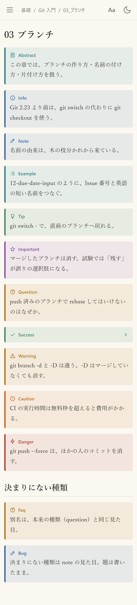
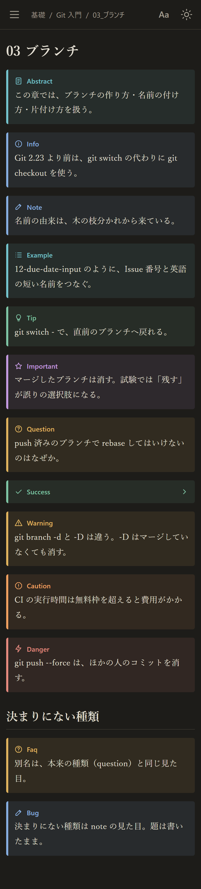

<!--
「なぜ」〜「調べたこと」は /dev-proto で合意して決める。「設計」以降は /dev-build で書く。
-->

# コールアウトを種類ごとに見分けられる（#4）

## なぜ

保管庫の書き方の決まり（`learning-vault/.claude/rules/writing.md`）で、コールアウトを Obsidian 標準の11種類（abstract・info・note・example・tip・important・question・success・warning・caution・danger）に決め、意味を分けて使うことにした。今のアプリは種類を4色・4アイコンにまとめているので、abstract と info、tip と important、warning と caution などが同じ見た目になり、読むときに意味の違いが分からない。

## 影響する今の仕様

- `docs/specs/notes.md` の「本文のブロック」のコールアウト（種類と見た目の対応の表）
- `docs/ui.md` の「トークン」（コールアウトの色）と「部品」のコールアウト（「4色にまとめる」決まり）

## 使う場面

1. 試験の教材の章を開くと、見出しの直後の `[!abstract]` の概要と、途中の `[!info]` の補足が、色とアイコンの違いで別のものだと分かる
2. `[!tip]`（便利なこと）と `[!important]`（試験に出る）が並んでいても、important だけが別の色とアイコンで目に入り、覚えるべきところを拾える
3. `[!warning]`（ひっかけ）と `[!caution]`（費用がかかる操作）が、色とアイコンで見分けられる

## 受け入れ条件

- 11種類（abstract・info・note・example・tip・important・question・success・warning・caution・danger）のそれぞれに、ほかと違うアイコンが出る
- 決まりで意味を分けた組（abstract と info、tip と important、warning と caution）は、色も違う
- 題を書いていないコールアウトは、今と同じく種類名（英語、頭だけ大文字。例：「Important」）を題にする
- 折りたたみ（`-`・`+`）、題・中身の出し方、文字の大きさ・ダークへの追従は今のまま
- 決まりにない種類（別名・知らない種類）の出し方は「決まっていないこと」の答えのとおり
- ライト・ダークのどちらでも、各色の題の文字が地に対して読める

## 画面

### ノート（note）

| 状態 | 表示 | スクリーンショット |
| --- | --- | --- |
| 11種類 | 11種類のコールアウトを並べた本文。種類ごとのアイコンと色。下に別名（faq）と知らない種類（bug）の見本 |  |
| 11種類（ダーク） | 同じものをダークの色で |  |

- 色とアイコンの対応（合意済み）。見た目の形（左の太線・薄い地・題の文字の大きさ）は今のコールアウトのまま、色だけを種類ごとに変える

| 種類 | 色 | アイコン |
| --- | --- | --- |
| abstract | abstract（新・青緑） | 横線を並べた紙 |
| info | note（青） | 丸に「i」 |
| note | note（青） | 鉛筆 |
| example | abstract（新・青緑） | リスト |
| tip | tip（緑） | 電球 |
| important | important（新・紫） | 星 |
| question | warning（黄） | 丸に「?」 |
| success | tip（緑） | チェック |
| warning | warning（黄） | 三角に「!」 |
| caution | caution（新・橙） | 八角形に「!」 |
| danger | danger（赤） | 稲妻 |

- 足すトークン（ライト / ダーク）：abstract `#2f8590` / `#74c3cc`、important `#8a52a8` / `#c49ae0`、caution `#c9681f` / `#f0a060`。今の4色（note・tip・warning・danger）の値は変えない
- アイコンの形（24 の枠、線の太さ 2、角は丸）：紙＝角の丸い縦長の四角に横線3本（最後は短い）／鉛筆＝斜めの鉛筆の輪郭と、先の近くの区切り線／リスト＝左に点3つ、右に横線3本／星＝五角の星の輪郭／丸に「?」＝丸の中に「?」／チェック＝レ点／八角形に「!」＝八角形の中に「!」／稲妻＝ジグザグの稲妻の輪郭。丸に「i」・電球・三角に「!」は今の形のまま
- 別名は本来の種類と同じ色・アイコン。note の見た目で出す種類は、note の色と鉛筆のアイコン

## やらないこと

- 11種類以外の種類に、専用の色・アイコンを足すこと
- 保管庫の教材の書き換え（保管庫の側で行う）

## 先に要る機能

- なし

## 決まっていないこと

- [x] 見分け方：色を増やす？（推す答え：アイコンを11種類すべて別にし、色はトークンを3つ（abstract・important・caution）足して7色にする。意味を分けた組の色が違えば、一目で分かる。比べた案：色は4色のままアイコンだけ変える＝トークンを変えずに済むが、16px のアイコンだけでは tip と important を見落としやすい／11色すべて別＝最も分かるが、似た色が増えてライト・ダークの両方で見分けを保つのが難しい） → 推す答えのとおり
- [x] 決まりにない種類の出し方（推す答え：Obsidian の別名（summary・tldr→abstract、hint→tip、check・done→success、help・faq→question、attention→warning、error→danger）は本来の種類と同じ見た目。todo・quote・cite・failure・fail・missing・bug と知らない種類は note の見た目（題は書いたまま）。比べた案：別名も note にする＝決まりに寄せられるが、前からある教材の見た目が今より悪くなる） → 推す答えのとおり
- [x] 題がないときの題を日本語にする？（推す答え：しない。英語のまま。Obsidian と同じで、決まりにも題の書き方の指定がない。比べた案：「概要」「重要」などにする＝読みやすいが、Obsidian で書くときと見た目が変わる） → しない（英語のまま）

## 技術の確認表

| 項目 | 当てはまるもの | 決めた人 |
| --- | --- | --- |
| 保存するデータ | なし | AI |
| 外部サービス | なし | AI |
| 認証・権限 | なし | AI |
| 費用 | なし | AI |
| 個人情報 | なし | AI |
| デプロイの環境 | なし | AI |
| 新しいライブラリ | なし | AI |
| 取り消せない操作 | なし | AI |
| 共通の部品・トークン | コールアウトの色のトークンを3つ足す（abstract・important・caution） | 人 |
| `docs/design.md` の決まり | なし（`docs/ui.md` の「4色にまとめる」決まりを7色に変える） | 人 |

## 調べたこと

- なし

---

## 設計

- 変えるファイル
  - `src/styles/tokens.css`：`--c-abstract`・`--c-important`・`--c-caution`（ライト・ダーク）と `--color-abstract`・`--color-important`・`--color-caution` を足す。今の4色は変えない
  - `src/lib/callouts.ts`：種類（別名を含む）を「本来の種類」（11種類＋知らないものは note）に直す表と、本来の種類から色（7色）を引く表に分ける。アイコンは本来の種類ごとに11個（丸に「i」・電球・三角に「!」は今の形）。`data-callout` には色の名前（7つ）を入れる（今と同じく色を CSS が決める）
  - `src/components/note-body.css`：`data-callout` の abstract・important・caution の3つを足す
  - `src/lib/callouts.test.ts`：種類ごとの色と、11種類のアイコンが互いに違うことのテスト
  - 画面の画像：`e2e/fixtures/content/実践/開発/リリースの手順.md` の最後に、見出しを使わずに（目次のテストを変えないため）11種類と別名（faq）・知らない種類（bug）の見本を足し、`e2e/notes.spec.ts` で見本の範囲だけを `note-callouts.png`・`note-callouts-dark.png` に撮る
  - 文書：`docs/ui.md` の「トークン」と「部品」のコールアウト（4色→7色、種類ごとにアイコン）、`docs/specs/notes.md` の種類と色・アイコンの表
- データの変更：なし
- 理由：色（トークン）とアイコン（種類）は数が違うので、表を分ける。理由は `docs/ui.md` のコールアウトと、`callouts.ts` の表のコメントに残す

## AIが決めたこと

- 見本は新しいノートではなく今の「リリースの手順」の最後に足す。新しいノートを足すと、ノートの一覧が写る画像（home-index・note-tree など）がすべて変わるため。比べた案：新しいノート／新しいテスト用のフォルダ（サーバーが1つ増える）

- アイコンは今と同じく、24 の枠に線で描く形（`src/components/icons.tsx` と同じ）で11個作る
- 新しい色のトークンの名前は、色の名前ではなく種類の名前（abstract・important・caution）にする。今の note・tip などと同じ付け方

## 確かめ方

| 受け入れ条件 | 確かめ方 |
| --- | --- |
| 11種類それぞれに違うアイコン | テスト（`src/lib/callouts.test.ts`）と画像（`note-callouts.png`） |
| 意味を分けた組は色も違う | テスト（`callouts.test.ts` の種類ごとの `data-callout`） |
| 題がないときは種類名 | テスト（`callouts.test.ts`） |
| 折りたたみ・題・中身・文字の大きさ・ダークは今のまま | テスト（今の `callouts.test.ts`・`e2e/` のテストと画像がそのまま通る） |
| 決まりにない種類の出し方 | テスト（`callouts.test.ts` の別名と知らない種類） |
| ライト・ダークで題の文字が読める | 触って確かめる（`note-callouts.png`・`note-callouts-dark.png` を見る）＋コードを見て確かめる（`src/styles/tokens.css` の値が仕様のとおり） |

## タスク

- [x] 種類ごとの色とアイコン：トークン3つ・`callouts.ts`・`note-body.css`・単体テスト・`docs/ui.md`・`docs/specs/notes.md` が仕様の対応表のとおりになったら完了
- [x] 見本の画面：フィクスチャに見本を足し、`note-callouts.png`・`note-callouts-dark.png`（合わせる画像は仕様と同じ名前のフォルダの2枚）を撮り、`docs/specs/notes.md` の画面の表に足したら完了
