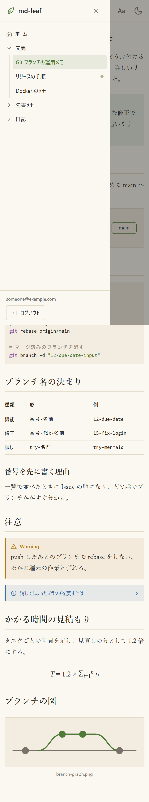
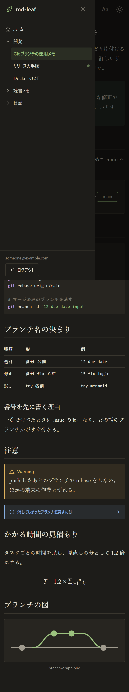

# ノートの一覧で押したノートに、読み込み中の印を出す（#26）

## なぜ

ノートの一覧でノートを押してから画面が切り替わるまで、何も変わらない間があり、押せたのか分からず不安になる。開くまでの骨組みの表示（`loading.tsx`）はあるが、出るまでの間や、先読みが終わっておらず待つ間には、押した手応えがない。スマホでは押すとすぐ一覧が閉じるので、閉じたあと前のノートがしばらく見えたままになる。

## 影響する今の仕様

- `docs/specs/notes.md` の「ノートの一覧」（押したときの動き）と、ノートの状態の表
- `docs/ui.md` の「部品の使い分け」の「ノートの一覧」と「状態の見せ方」の「読み込み中」

## 使う場面

1. スマホで「基礎 / ネットワーク」のノートを読んでいる人が、☰ で一覧を開き「02_TCP と UDP」を押す。一覧は開いたまま、「02_TCP と UDP」の行の右に小さな点がゆっくり点滅し、ノートが切り替わると一覧が閉じて新しいノートが出る
2. PC で左の一覧から別のノートを押すと、切り替わるまでの間、押した行の右で点が点滅する。切り替わると点は消え、その行が今のノートとして強調される
3. 押したノートを先読みし終えていてすぐ切り替わるときは、点は出ないか、一瞬で消える

## 受け入れ条件

- ノートの一覧のノート・「ホーム」を押すと、ページが切り替わるまでの間、押した行の右に読み込み中の印（小さな点がゆっくり点滅する）が出る。ほかの行には出ない
- ページが切り替わると印は消え、押した行が今のノートとして強調される
- 待つ間に別の行を押すと、印は最後に押した行だけに出る
- スマホでは、押しても一覧はすぐには閉じず、ページが切り替わってから閉じる
- 印はライトとダークのどちらでも見える
- 動きを減らす設定（`prefers-reduced-motion`）のときは、点を点滅させずに出したままにする
- 印は行の高さや文字の位置を動かさない（名前が長く折り返す行でも）
- 印は読み上げでは「読み込み中」と伝わる

## 画面

### ノートの一覧（スマホの引き出し・PC の左の欄）

| 状態 | 表示 | スクリーンショット |
| --- | --- | --- |
| 押して読み込み中 | 押した行の右端に、accent の小さな丸い点。ゆっくり点滅する（スケルトンと同じ速さ）。行の地と文字はそのまま。スマホでは一覧は開いたまま |  |
| 押して読み込み中（ダーク） | 同じものをダークの色で |  |

- 新しい見た目の決まり：押したリンクの読み込み中は、行の右端に accent の小さな点を点滅させる（`docs/ui.md` の「状態の見せ方」へ移す）

## やらないこと

- 本文の中のノートへのリンクと目次のリンク（本文のリンクは変換した HTML の `<a>` で、一覧のリンクとは作りが違うので、別に考える）
- 画面の上の、進み具合の帯
- 骨組みの表示（`loading.tsx`）の作り直し
- 先読みのやり方を変えて、待ち時間そのものを縮めること

## 先に要る機能

- なし

## 決まっていないこと

- [x] スマホで、押したあと一覧をいつ閉じる？（推す答え：切り替わってから閉じる。比べた案：今どおりすぐ閉じる → 一覧の印は閉じた引き出しの中で見えず、スマホでは手応えが増えない。代わりに画面の上の帯などが要り、範囲が広がる） → 切り替わってから閉じる
- [x] 印の形は？（推す答え：行の右端の、accent の小さな点の点滅。比べた案：行の名前を薄くする → 動きがなく静かだが、「押せていない」ように見えやすい／行の地をスケルトンのように点滅させる → 目立つが、今のノートの強調と見分けにくい） → 行の右端の、accent の小さな点の点滅

## 技術の確認表

| 項目 | 当てはまるもの | 決めた人 |
| --- | --- | --- |
| 保存するデータ | なし | AI |
| 外部サービス | なし | AI |
| 認証・権限 | なし（ログインの確かめは今のまま `src/proxy.ts`） | AI |
| 費用 | なし | AI |
| 個人情報 | なし | AI |
| デプロイの環境 | なし（今の Vercel のまま） | AI |
| 新しいライブラリ | なし（Next.js 16 の `next/link` にある `useLinkStatus` を使う） | AI |
| 取り消せない操作 | なし | AI |
| 共通の部品・トークン | 今のトークン（accent）と、スケルトンの点滅の動きを使う。新しいトークンは足さない | AI |
| `docs/design.md` の決まり | 変えない | AI |

## 調べたこと

- Next.js 16 の `useLinkStatus`（`node_modules/next/dist/docs/01-app/03-api-reference/04-functions/use-link-status.md`）：`<Link>` の中の部品で、そのリンクの移動を待つ間 `pending` が true になる。先読みし終えたリンクでは待ちがないので `pending` にならない。続けて押すと、最後のリンクだけが `pending` になる
- 今は一覧の `onClick`（`onNavigate`）で、押すとすぐスマホの引き出しを閉じている（`src/components/note-tree.tsx`）

---

## 設計

### 変えるファイル

- `src/components/note-tree.tsx`：一覧のノート・「ホーム」の `<Link>` の中に、印の部品 `PendingDot` を置く。`PendingDot` は `useLinkStatus` の `pending` が true のときだけ、行の右端に accent の小さな丸い点を出す
  - 行の高さと文字の位置を動かさないため、行の `<Link>` を `relative` にし、点（`size-1.5`）を `absolute` で行の右の余白（`px-2` の中）の1行目の高さに置く。名前の折り返しの幅を取らない。印の枠は待っていないときも置いたままにし、点の見え方（`opacity`）だけを切り替える
  - 点滅は今のスケルトンと同じ `animate-pulse` を `motion-safe:` で付ける（動きを減らす設定では点を出したまま）
  - 読み上げ：待つ間だけ `role="status"`＋`aria-label="読み込み中"`（スケルトンの枠と同じ伝え方）。待っていないときは `aria-hidden`
  - `onClick={onNavigate}` を外し、`onNavigate` は「ページが切り替わったとき」に呼ぶ意味に変える（名前は `onNavigated`）。`CurrentTree` は URL ごとに作り直しているので、`usePathname` が前の値から変わったときに `useEffect` で呼ぶ（初めの表示では呼ばない）
- `src/components/tree-drawer.tsx`：`onNavigated` で引き出しを閉じる（押した時点では閉じない）
- `docs/specs/notes.md`：押したときの動き（印・スマホは切り替わってから閉じる）と、状態の表に「押して読み込み中」を足す
- `docs/ui.md`：「ノートの一覧」と「状態の見せ方」の「読み込み中」に、押したリンクの印の決まりを足す

### データの変更

- なし

### 理由と残す場所

- 印は `<Link>` の子でしか `useLinkStatus` を使えないので、行の中の部品にする（理由は `PendingDot` のコメント）
- 閉じるのを「URL が変わったとき」にするのは、押したときに閉じると引き出しの中の印が見えないため（仕様の答え。`tree-drawer.tsx` のコメント）
- 待つ間に別の行を押したときに最後の行だけに出るのは、`useLinkStatus` の動き（`docs/specs/notes.md` に動きとして書く）

## AIが決めたこと

- 印を出す仕組みに `useLinkStatus` を使う。理由：Next.js にあり、押したリンクだけの待ちが分かる。比べた案：`usePathname` の変わり目を自分で見る（押したリンクがどれか分からない）
- 印の点滅の速さは、スケルトンと同じにする。理由：「読み込み中」の見せ方をそろえる
- 「ホーム」の行にも同じ印を出す。理由：一覧の中で動きをそろえる
- 印の読み上げは「読み込み中」
- 引き出しを閉じる合図は、一覧の部品が URL の変わり目で呼ぶ `onNavigated` にする。理由：一覧はもう URL ごとに作り直していて、ほかに `usePathname` を Suspense で包む場所を増やさずに済む。比べた案：`tree-drawer.tsx` で `usePathname` を見る（Suspense をもう1つ足す要がある）
- 印の画面の画像は撮らない（`docs/specs/screens/` に足さない）。理由：待つ間はほんの一瞬で、画像を比べるテストで安定して撮れない。見た目は触って確かめる

## 確かめ方

- 押した行だけに印が出る・切り替わると消える・最後に押した行だけ：テスト（部品のテストで `useLinkStatus` を差し替え、pending の行だけに「読み込み中」が出ることを確かめる。最後の行だけになるのは Next.js の動き）＋ 触って確かめる（`npm run dev` で一覧のノートを押す）
- 切り替わると押した行が強調される：テスト（今ある画面を動かすテスト）
- スマホでは切り替わってから閉じる：テスト（画面を動かすテストで、ノートを押すと移った先で引き出しが閉じる。部品のテストで、押しただけでは `onNavigated` を呼ばない）
- ライト・ダークで見える：触って確かめる
- 動きを減らす設定で点滅しない：コードを見て確かめる（`motion-safe:animate-pulse`）
- 行の高さや文字の位置を動かさない：テスト（部品のテストで、待っていないときも印の枠が置かれていること）＋ 触って確かめる
- 読み上げで「読み込み中」：テスト（部品のテストで `role="status"` の名前）

## タスク

- [ ] 一覧のノート・「ホーム」を押すと、待つ間だけ押した行の右に読み込み中の点が出る（合わせる画像：`note-pending.png`・`note-pending-dark.png`）
- [ ] スマホの一覧が、押したときではなくページが切り替わってから閉じ、`docs/specs/notes.md`・`docs/ui.md` が今の動きになっている
