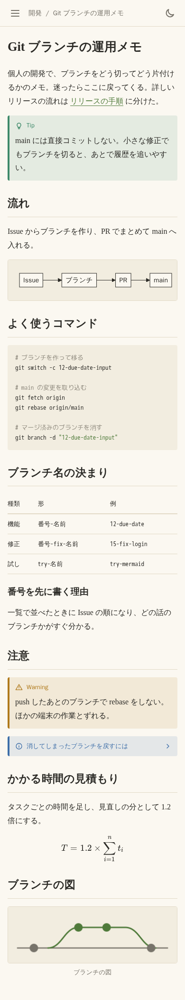
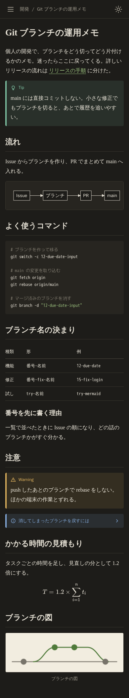
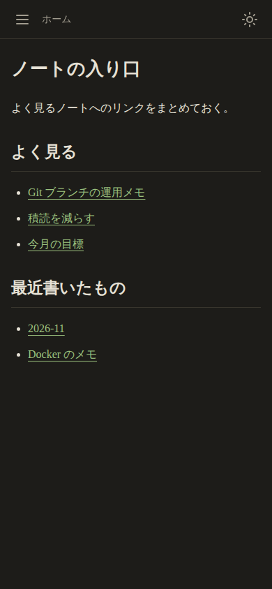
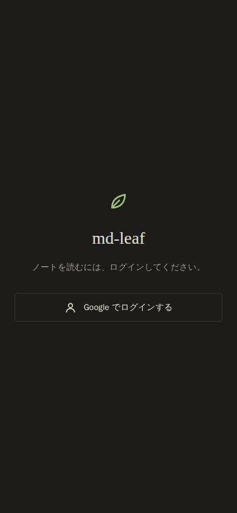

# 表示の設定

## ライト・ダーク

- 上の帯の右端に、ライトのときは月のボタン（読み上げの名前「ダークにする」）、ダークのときは太陽のボタン（「ライトにする」）が出る。上の帯のあるすべての画面（ホーム・ノートのすべての状態）に、スマホでも PC でも出る
- 押すと、ページを読み込み直さずにすぐ切り替わり、ボタンも変わる
- ダークでは、画面の地・文字・枠・リンク・ボタン・ノートの一覧・幕・帯・本文のブロック（コールアウト・コード・表・数式・Mermaid の図）が、ダークの色になる。Mermaid の図は、切り替えたときにその場で新しい色で描き直す。ノートの画像は、そのままの色で出す
- 選んだものは、そのブラウザに覚えておく。別のページへ移っても、ブラウザを閉じて次に開いても、ログアウト・ログインしても、選んだもので出る。別の端末・別のブラウザには引き継がない
- 一度も選んでいないブラウザでは、端末の設定（OS のダークモード）に合わせる。開いているあいだに端末の設定が変わったら、それに合わせ直す
- 一度ボタンで選んだあとは、端末の設定を変えても、選んだもので出る。端末に合わせる動きに戻す手段はない
- ページを開いた瞬間に、ライトで出てからダークに変わることはない
- ログインの画面には切り替えのボタンがなく、覚えておいたもの（なければ端末の設定）で出る
- ブラウザに覚えておけないとき（保存が禁止されている・プライベートブラウズなど）も、その場では切り替わり、エラーは出ない。次に開いたときは、端末の設定に合わせて出る

| 状態 | 表示 | スクリーンショット |
| --- | --- | --- |
| ノート（ライト） | 上の帯の右端に月のボタン |  |
| ノート（ダーク） | ダークの色。上の帯の右端に太陽のボタン |  |
| ホーム（ダーク） | ダークの色。上の帯の右端に太陽のボタン |  |
| ログイン前（ダーク） | ダークの色。切り替えのボタンはない |  |
