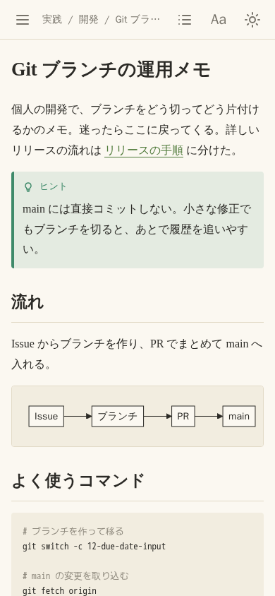
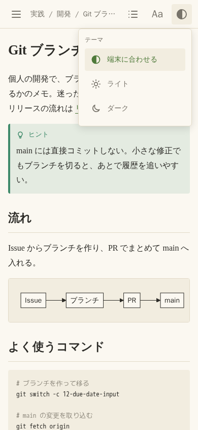
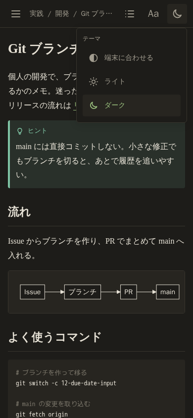
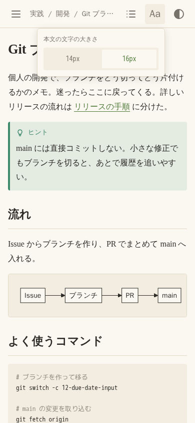
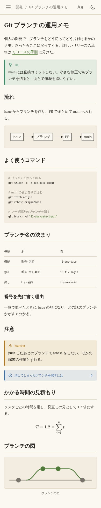

# 表示の設定

## ライト・ダーク

- 「端末に合わせる」「ライト」「ダーク」の3つから選べる
- 上の帯の右端（「Aa」の右）に、テーマのボタン（読み上げの名前「テーマ」）が出る。上の帯のあるすべての画面（ホーム・ノートのすべての状態）に、スマホでも PC でも出る。アイコンは選んでいるものを表す（「端末に合わせる」は半分を塗った丸、「ライト」は太陽、「ダーク」は月）
- ボタンを押すと、ボタンの右端にそろえて下に枠が開く。見出し「テーマ」と、「端末に合わせる」「ライト」「ダーク」がアイコンつきで縦に並び、今選んでいるものが選ばれた形（surface の地に accent の太字）で出る
- 選ぶと、ページを読み込み直さずにすぐその色になり、ボタンのアイコンも変わる。枠は開いたまま。枠の外を押すか Esc、もう一度ボタンを押すと閉じる。Esc で閉じたときは、ボタンにフォーカスが戻る
- 「端末に合わせる」では、端末の設定（OS のダークモード）に合わせて出す。開いているあいだに端末の設定が変わったら、それに合わせ直す
- 「ライト」「ダーク」では、端末の設定が変わっても、選んだもので出る
- 一度も選んでいないブラウザでは「端末に合わせる」
- ダークでは、画面の地・文字・枠・リンク・ボタン・ノートの一覧・幕・帯・本文のブロック（コールアウト・コード・表・数式・Mermaid の図）が、ダークの色になる。Mermaid の図は、選んだときも、「端末に合わせる」で端末の設定が変わったときも、その場で新しい色で描き直す。ノートの画像は、そのままの色で出す
- 選んだものは、そのブラウザに覚えておく。別のページへ移っても、ブラウザを閉じて次に開いても、ログアウト・ログインしても、選んだもので出る。別の端末・別のブラウザには引き継がない
- ページを開いた瞬間に、ライトで出てからダークに変わる（またはその逆の）ことはない
- ログインの画面には切り替えのボタンがなく、覚えておいたもの（なければ端末の設定）で出る
- ブラウザに覚えておけないとき（保存が禁止されている・プライベートブラウズなど）も、その場では選んだ色に切り替わり、エラーは出ない。次に開いたときは「端末に合わせる」で出る

| 状態 | 表示 | スクリーンショット |
| --- | --- | --- |
| 端末に合わせる（ライト） | 上の帯の右端に半分を塗った丸のボタン |  |
| ライトを選んでいる | 上の帯の右端に太陽のボタン |  |
| ダークを選んでいる | ダークの色。上の帯の右端に月のボタン |  |
| 枠を開いた（ライト） | ボタンの下に枠。見出し「テーマ」と3つ。「端末に合わせる」が選ばれた形 |  |
| 枠を開いた（ダーク） | 同じものをダークの色で。「ダーク」が選ばれた形 |  |
| ホーム（ダーク） | ダークの色。上の帯の右端に月のボタン |  |
| ログイン前（ダーク） | ダークの色。切り替えのボタンはない |  |

## 本文の文字の大きさ

- ノートを表示しているとき（ホームで `index.md` を表示しているときも）、上の帯のテーマのボタンの左に「Aa」のボタン（読み上げの名前「文字の大きさ」）が出る。スマホでも PC でも出る。見つからない・読み込み中・読み込めなかった・`index.md` がないホーム・ノートが1つもないホームでは出ない
- 「Aa」を押すと、その下に枠が出る。見出し「本文の文字の大きさ」と、「14px」「16px」が横に並び、今の大きさが選ばれた形（bg の地に accent の太字）で出る
- 選ぶと、ページを読み込み直さずに、すぐ本文の文字の大きさが変わる。枠は開いたまま。枠の外を押すか Esc、もう一度「Aa」を押すと閉じる
- 変わるのは本文（ノートの題・見出し・段落・リスト・コールアウト・コード・表・数式・画像の下の文字）だけで、見出し・コード・表などは本文の大きさに合わせた比率で変わる。Mermaid の図と、上の帯・ノートの一覧・目次・枠の中の文字は変わらない
- 大きさを変えても、スクロールの位置（ページの上からの位置）はそのまま
- 一度も選んでいないブラウザでは 16px
- 選んだものは、そのブラウザに覚えておく。別のページへ移っても、ブラウザを閉じて次に開いても、ログアウト・ログインしても、選んだもので出る。別の端末・別のブラウザには引き継がない
- ページを開いた瞬間に、16px で出てから選んだ大きさに変わることはない
- ブラウザに覚えておけないときも、その場では変わり、エラーは出ない。次に開いたときは 16px で出る
- ログインの画面には「Aa」はない

| 状態 | 表示 | スクリーンショット |
| --- | --- | --- |
| 文字の大きさを開いた | 「Aa」の下に枠。16px が選ばれている |  |
| 14px | 本文・見出し・コード・表が小さい。上の帯は変わらない |  |
