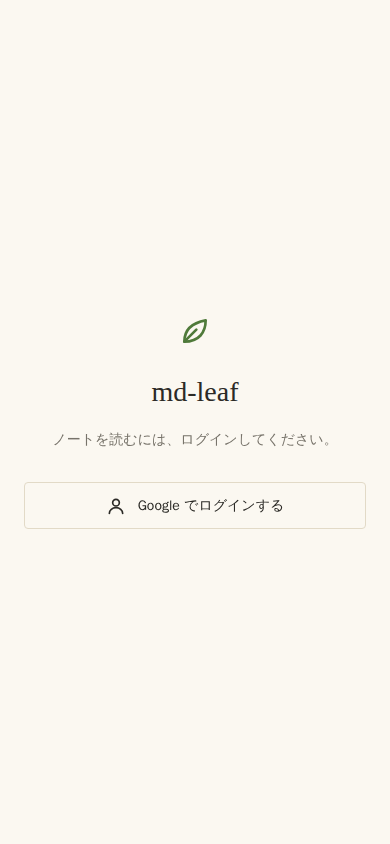
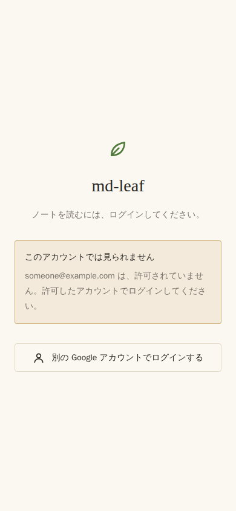
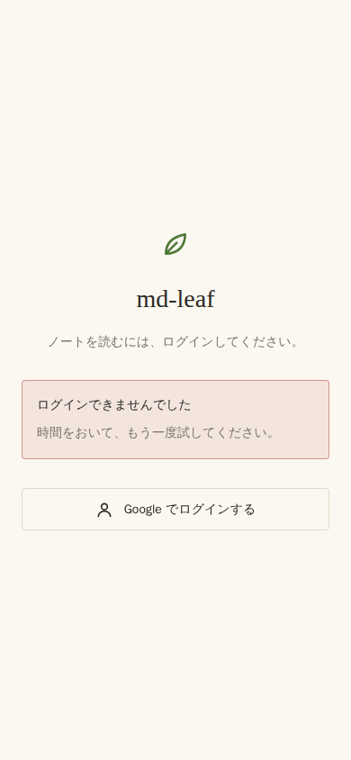
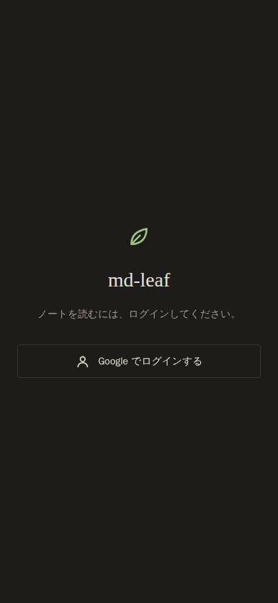
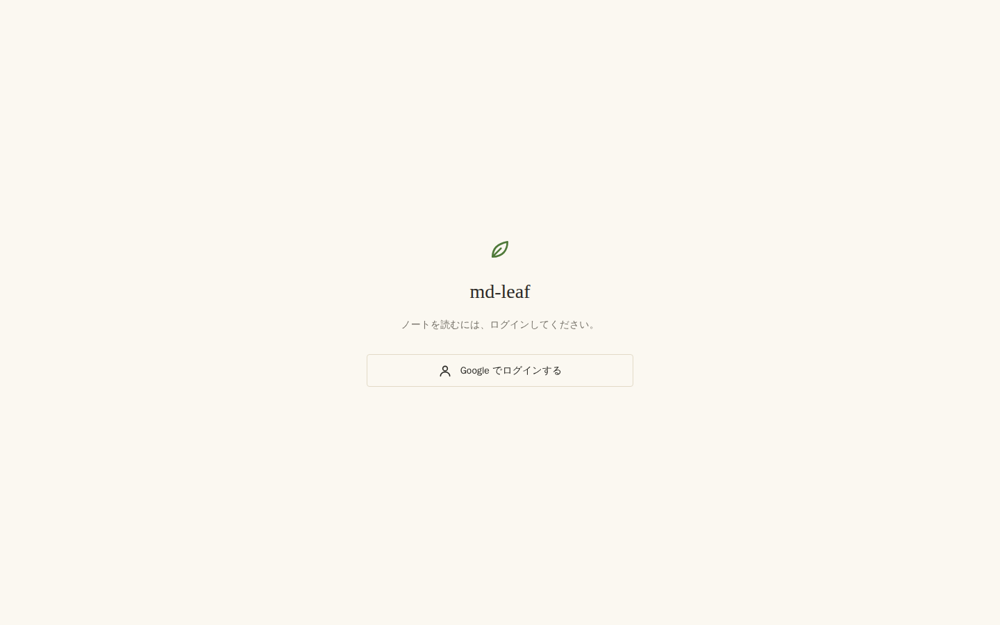
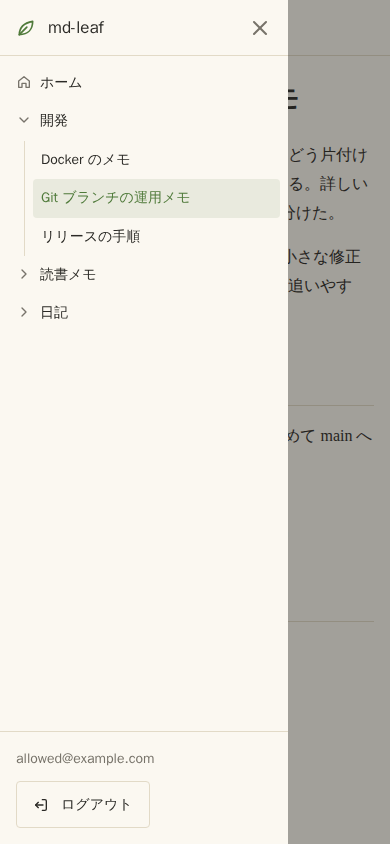

# ログイン・ログアウト

## ログインが要る範囲

- ログインしていなければ、どの URL（ホーム、ノート、まだない URL）を開いても、ログインの画面（`/login`）に移る。ノートの中身や一覧は、HTML にも出ない
- ホーム以外の URL から移ったときは、ログインのあとにその URL へ戻る
- ログイン中にログインの画面を開くと、ホームへ移る
- ログインできるのは、環境変数 `ALLOWED_EMAILS`（カンマ区切り）に入っていて、Google でメールアドレスを確かめ済みのアカウントだけ。大文字・小文字は区別しない。1つも設定されていなければ、だれもログインできない
- 開くたびに、ログイン中のアドレスが今の `ALLOWED_EMAILS` に入っているかを確かめる。外して再デプロイすると、そのアドレスでログイン中の人も、次に開いたときにログインの画面に移る
- ログインの状態は、ブラウザを閉じても続く。最後に開いてから30日たつと、もう一度ログインが要る
- ログインできるのは、本番の URL と手元（localhost）だけ。Vercel のプレビューは、ログインの画面までしか見られない（Google のリダイレクト URI と環境変数の設定による。手順は `README.md`）

## ログインの画面

- アプリの名前「md-leaf」、「ノートを読むには、ログインしてください。」、ボタンを、画面の中央に縦に並べる。上の帯とノートの一覧は出さない
- ボタンを押すと、Google のログインに進む

| 状態 | 表示 | スクリーンショット |
| --- | --- | --- |
| ログイン前 | 帯なし。ボタンは「Google でログインする」 |  |
| 許可していないアカウント | warning の帯：見出し「このアカウントでは見られません」、本文「<アドレス> は、許可されていません。許可したアカウントでログインしてください。」。ボタンは「別の Google アカウントでログインする」で、押すと Google のアカウントを選ぶ画面が出る |  |
| ログインに失敗（途中でやめたときも） | danger の帯：見出し「ログインできませんでした」、本文「時間をおいて、もう一度試してください。」。ボタンは「Google でログインする」 |  |
| ログイン前（ダーク） | ダークの色で同じ並び |  |
| ログイン前（PC） | 同じ並びを狭い幅で中央に |  |

## ログアウト

- ノートの一覧のいちばん下に、区切り線と、ログイン中のメールアドレスと「ログアウト」ボタンが出る（スマホでは ☰ で開いた一覧の中。`docs/specs/notes.md`）
- 押すと確認なしにログアウトし、ログインの画面へ移る

| 状態 | 表示 | スクリーンショット |
| --- | --- | --- |
| ノートの一覧を開いた | 一覧のいちばん下に、アドレスと「ログアウト」 |  |
