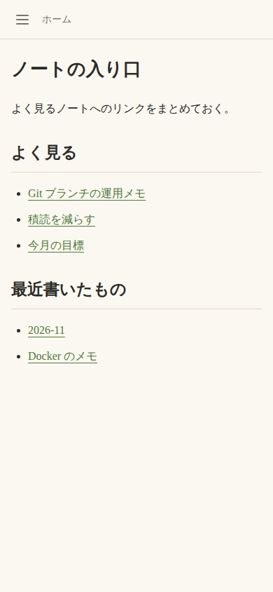
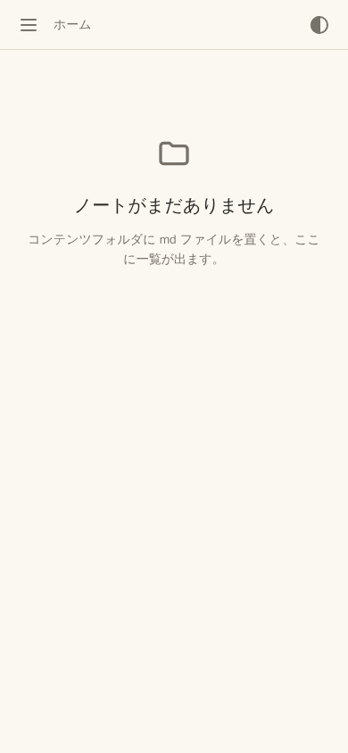
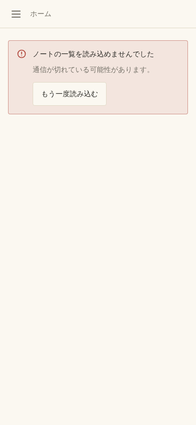
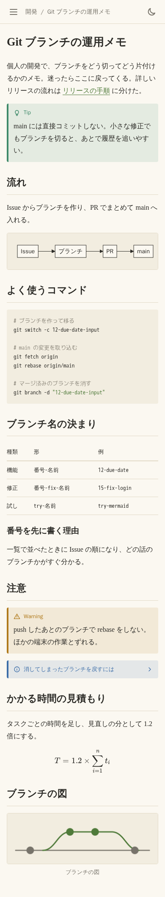
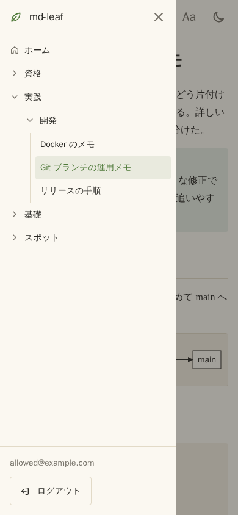
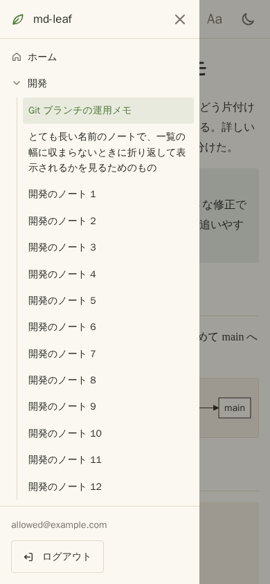
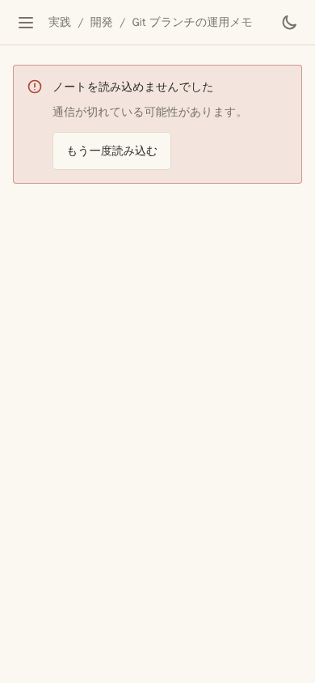

# ノートを読む

## コンテンツフォルダ

- ノートは、リポジトリの `content/` に置いた md ファイル。ビルドのときに読み、全部のノートを HTML にする。ノートを足す・変えるには、置き直してデプロイする
- 名前が「.」で始まるファイル・フォルダ（`.trash` など）は読まない

## ノートの一覧

- コンテンツフォルダの中の md ファイルとフォルダを、構成そのままのツリーで出す。md 以外のファイルと、md ファイルを1つも含まないフォルダは出さない
- 同じ階層では、フォルダを先に、ノートをあとに並べ、それぞれ出す名前の順（日本語の順。数字は数の大きさの順）
- ノートの名前は、フロントマターの `title` があればそれ、なければファイル名（拡張子なし）。フォルダの名前はフォルダ名
- 一番上の `index.md` は、ノートとしては並べず、いちばん上に家のアイコンつきの「ホーム」として出す。`index.md` がなければ「ホーム」は出さない。一番上以外の `index.md` は、ふつうのノート
- フォルダは矢印つきで、押すと開閉する。今開いているノートを含むフォルダは開き、そのノートを強調する（accent の薄い地と太字）。ホームを開いているときは「ホーム」を強調し、フォルダはすべて閉じる。手で開閉したフォルダは、別のページへ移ると、今のノートを含むフォルダだけを開いた形に戻る
- 名前が長いときは、折り返して全部出す
- いちばん下に、区切り線と、ログイン中のメールアドレスと「ログアウト」（`docs/specs/login.md`）
- 「ホーム」もノートもないときは、「ノートがありません」と出す
- スマホ（幅 lg 未満）：上の帯の ☰ を押すと、左から一覧が出て、うしろに幕が出る。上にアプリの印と ×。×、幕の外、Esc のどれかで閉じる。ノート（または「ホーム」）を押すと、そこへ移って一覧を閉じる
- PC（幅 lg 以上）：一覧を左に常に出し、☰ を出さない。一覧の上にアプリの印。一覧が長いときは、一覧だけがスクロールする

## 上の帯

- 画面の上に固定し、スクロールしても残る。左から ☰（スマホだけ）、場所（パンくず）。右側には何も置かない
- 場所：ホームでは「ホーム」。ノートでは、フォルダの名前とノートの名前を「 / 」でつなぐ。押しても移らない。長いときは1行に収め、はみ出す分を「…」にする。見つからないときは空
- ページの題（ブラウザのタブ）：ホームは「md-leaf」、ノートは「<ノートの名前> - md-leaf」

## ホーム（`/`）

| 状態 | 表示 | スクリーンショット |
| --- | --- | --- |
| `index.md` がある | `index.md` を、ノートと同じ出し方で表示する |  |
| `index.md` がある（PC） | 左にノートの一覧（「ホーム」を強調） |  |
| `index.md` がない | 見出し「ノート」。スマホでは案内「読みたいノートを選んでください。」の下にノートの一覧（「ホーム」・ログアウトなし）。PC では案内「左の一覧から、読みたいノートを選んでください。」だけ |  |
| ノートが1つもない | 中央にフォルダのアイコン、「ノートがまだありません」、「コンテンツフォルダに md ファイルを置くと、ここに一覧が出ます。」 |  |
| 読み込み中 | 題と段落・リストの形のスケルトンがゆっくり点滅する。上の帯と一覧は残る |  |
| 読み込めなかった | danger の帯：見出し「ノートの一覧を読み込めませんでした」、本文「通信が切れている可能性があります。」、ボタン「もう一度読み込む」（押すと読み込み直す） |  |

## ノート（`/notes/<フォルダ>/<ファイル名>`）

- URL は、コンテンツフォルダからのパスで、拡張子 `.md` を除いたもの。日本語は日本語のまま使う。一番上の `index.md` は `/notes/index` では開けない（ホームで開く）
- フロントマターは本文に出さない。題（`title` か、ファイル名）を本文の上に出す
- 見出し・段落・リスト・リンク・太字・斜体は `docs/ui.md` の「文字」の見た目。コールアウト・コード・表・数式・Mermaid・画像は、Markdown を HTML にしたままの形で出る
- `.md` で終わる相対リンク（`[表示名](../folder/note.md)`）を押すと、同じタブでそのノートへ移る。ホームの `index.md` の中のリンクも同じ
  - リンク先は、リンクを書いたノートのあるフォルダからの相対パスで決める（`../` で上のフォルダ、`./` や何も付けないと同じフォルダ）。大文字・小文字は区別する。ファイル名だけで別のフォルダのノートを探すことはしない
  - 一番上の `index.md` へのリンクはホーム（`/`）へ移る
  - パスに空白や日本語があってもよい（`<開発/Docker のメモ.md>` の山かっこの書き方も、`%20` の符号化した書き方も）
  - `note.md#見出し` のように `#` が付いていても、そのノートの先頭へ移る
  - ページを読み込み直さずに移り、移ったあとの画面は URL を直接開いたときと同じ。ブラウザの「戻る」で元のページへ戻る
  - リンク先のノートがないとき（名前が変わった・消された、コンテンツフォルダの外を指す）は「見つからない」の画面を出す。リンクの見た目は、リンク先があるかどうかで変えない
  - `/` で始まるリンク、`#見出し` だけのリンク、`.md` 以外へのリンク、`mailto:` などは、書いたままのリンクとして動く。`[[ ]]` は文字のまま出す
- ビルドのとき、リンク先のノートがないリンクがあれば、ノートごとにビルドのログへ警告を1行出す（`リンク先のノートがありません: <ノートのファイル名> → <リンク先>, ...`）。ビルドは止めない
- `http(s)://` で始まるリンクは別のタブで開く
- ノートの中に書いた HTML のタグは、文字としてそのまま出る

| 状態 | 表示 | スクリーンショット |
| --- | --- | --- |
| 表示 | 題と本文。上の帯に場所 |  |
| 表示（PC） | 左にノートの一覧（今のノートを強調、そのフォルダを開く） |  |
| ノートの一覧を開いた | 左から一覧、うしろに幕。いちばん下にアドレスと「ログアウト」 |  |
| ノートの一覧が多い | 一覧がスクロールする。長い名前は折り返す |  |
| 読み込み中 | 題・段落・見出しの形のスケルトン |  |
| 読み込めなかった | danger の帯：見出し「ノートを読み込めませんでした」、本文「通信が切れている可能性があります。」、ボタン「もう一度読み込む」 |  |
| 見つからない | 中央にアイコン、「ノートが見つかりません」、「リンク先のノートは、名前が変わったか、消された可能性があります。」、主なボタン「ホームへ戻る」。場所は空、一覧では何も強調しない |  |
