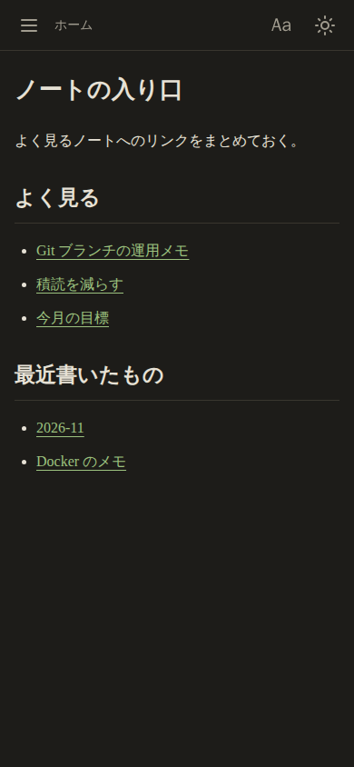
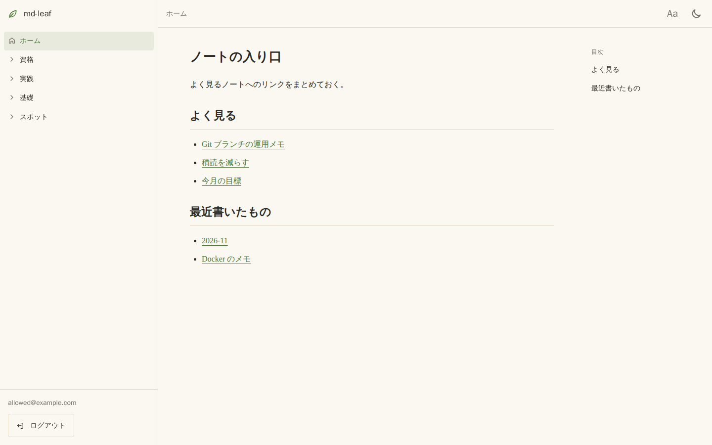
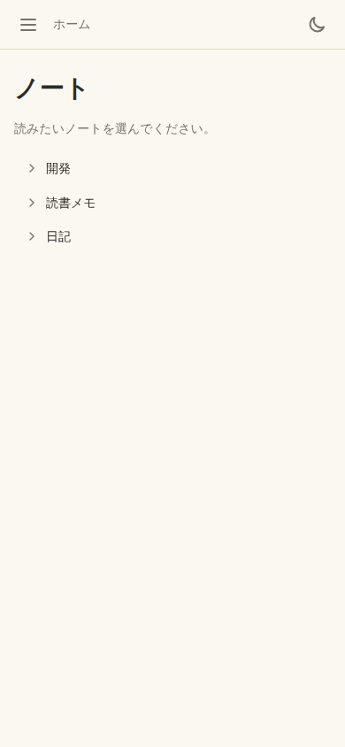
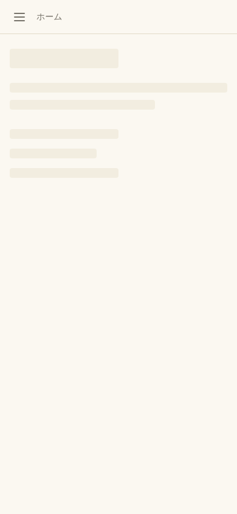
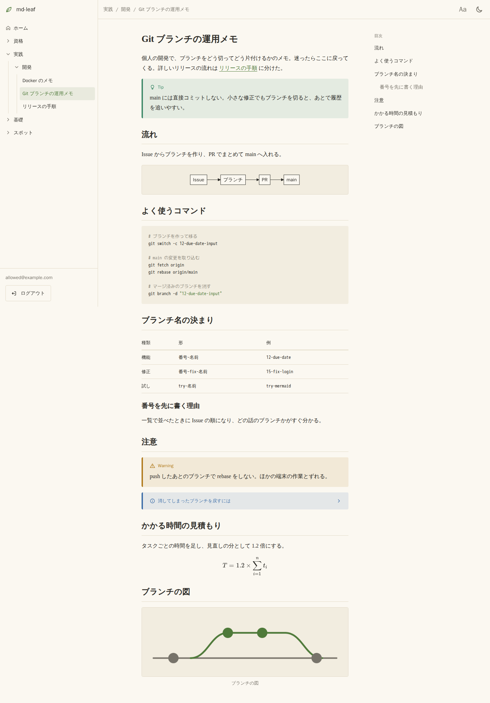
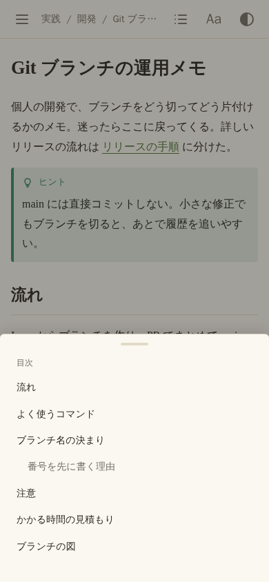
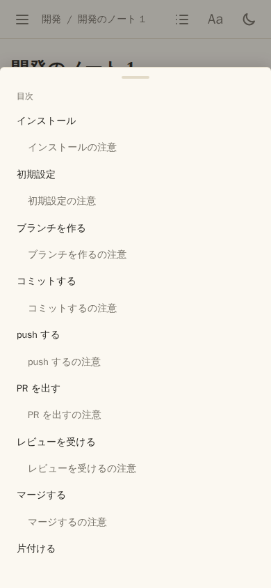
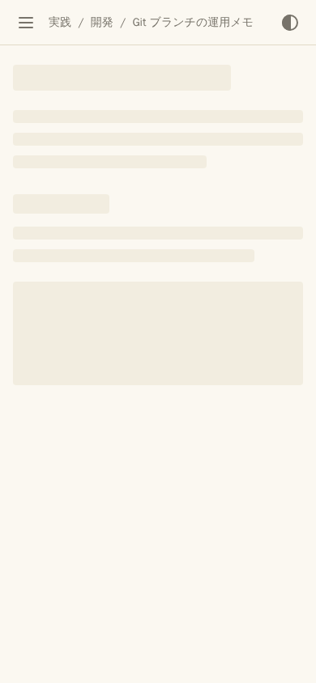
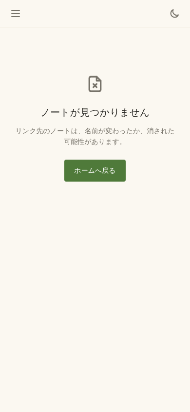

# ノートを読む

## コンテンツフォルダ

- ノートは、リポジトリの `content/` に置いた md ファイル。ビルドのときに読み、全部のノートを HTML にする。ノートを足す・変えるには、置き直してデプロイする
- ノートに出す画像のファイル（png・jpg・jpeg・gif・webp・svg）も、コンテンツフォルダに置く（「本文のブロック」の「画像」）
- 名前が「.」で始まるファイル・フォルダ（`.trash` など）は読まない

## ノートの一覧

- コンテンツフォルダの中の md ファイルとフォルダを、構成そのままのツリーで出す。md 以外のファイルと、md ファイルを1つも含まないフォルダは出さない
- 同じ階層では、フォルダを先に、ノートをあとに並べ、それぞれ出す名前の順（日本語の順。数字は数の大きさの順）
- ノートの名前は、フロントマターの `title` があればそれ、なければファイル名（拡張子なし）。フォルダの名前はフォルダ名
- 一番上の `index.md` は、ノートとしては並べず、いちばん上に家のアイコンつきの「ホーム」として出す。`index.md` がなければ「ホーム」は出さない。一番上以外の `index.md` は、ふつうのノート
- フォルダは矢印つきで、押すと開閉する。今開いているノートを含むフォルダは開き、そのノートを強調する（accent の薄い地と太字）。ホームを開いているときは「ホーム」を強調し、フォルダはすべて閉じる。手で開閉したフォルダは、別のページへ移ると、今のノートを含むフォルダだけを開いた形に戻る
- 名前が長いときは、折り返して全部出す
- いちばん下に、区切り線と、ログイン中のメールアドレスと「ログアウト」（`docs/specs/login.md`）
- 「ホーム」もノートもないときは、「ノートがありません」と出す
- スマホ（幅 lg 未満）：上の帯の ☰ を押すと、左から一覧が出て、うしろに幕が出る。上にアプリの印と ×。×、幕の外、Esc のどれかで閉じる。ノート（または「ホーム」）を押すと、そこへ移って一覧を閉じる
- PC（幅 lg 以上）：一覧を左に常に出し、☰ を出さない。一覧の上にアプリの印。一覧が長いときは、一覧だけがスクロールする

## 上の帯

- 画面の上に固定し、スクロールしても残る。左から ☰（スマホだけ）、場所（パンくず）。右端に、目次のボタン（見出しのあるノートを表示していて、幅 xl 未満のときだけ。「ノート」の「目次」）、文字の大きさの「Aa」（ノートを表示しているときだけ）と、ライト/ダークの切り替えのボタン（どちらも `docs/specs/display.md`）
- 場所：ホームでは「ホーム」。ノートでは、フォルダの名前とノートの名前を「 / 」でつなぐ。押しても移らない。長いときは1行に収め、はみ出す分を「…」にする。見つからないときは空
- ページの題（ブラウザのタブ）：ホームは「md-leaf」、ノートは「<ノートの名前> - md-leaf」

## ホーム（`/`）

| 状態 | 表示 | スクリーンショット |
| --- | --- | --- |
| `index.md` がある | `index.md` を、ノートと同じ出し方で表示する（目次も同じ） |  |
| `index.md` がある（ダーク） | ダークの色。上の帯の右端に太陽のボタン |  |
| `index.md` がある（PC） | 左にノートの一覧（「ホーム」を強調） |  |
| `index.md` がない | 見出し「ノート」。スマホでは案内「読みたいノートを選んでください。」の下にノートの一覧（「ホーム」・ログアウトなし）。PC では案内「左の一覧から、読みたいノートを選んでください。」だけ |  |
| ノートが1つもない | 中央にフォルダのアイコン、「ノートがまだありません」、「コンテンツフォルダに md ファイルを置くと、ここに一覧が出ます。」 |  |
| 読み込み中 | 題と段落・リストの形のスケルトンがゆっくり点滅する。上の帯と一覧は残る |  |
| 読み込めなかった | danger の帯：見出し「ノートの一覧を読み込めませんでした」、本文「通信が切れている可能性があります。」、ボタン「もう一度読み込む」（押すと読み込み直す） |  |

## ノート（`/notes/<フォルダ>/<ファイル名>`）

- URL は、コンテンツフォルダからのパスで、拡張子 `.md` を除いたもの。日本語は日本語のまま使う。一番上の `index.md` は `/notes/index` では開けない（ホームで開く）
- フロントマターは本文に出さない。題（`title` か、ファイル名）を本文の上に出す
- 見出し・段落・リスト・リンク・太字・斜体は `docs/ui.md` の「文字」の見た目。コールアウト・コード・表・数式・Mermaid・画像は、下の「本文のブロック」の形で出る。ホームの `index.md` も同じ
- `.md` で終わる相対リンク（`[表示名](../folder/note.md)`）を押すと、同じタブでそのノートへ移る。ホームの `index.md` の中のリンクも同じ
  - リンク先は、リンクを書いたノートのあるフォルダからの相対パスで決める（`../` で上のフォルダ、`./` や何も付けないと同じフォルダ）。大文字・小文字は区別する。ファイル名だけで別のフォルダのノートを探すことはしない
  - 一番上の `index.md` へのリンクはホーム（`/`）へ移る
  - パスに空白や日本語があってもよい（`<開発/Docker のメモ.md>` の山かっこの書き方も、`%20` の符号化した書き方も）
  - `note.md#見出し` のように `#` が付いていても、そのノートの先頭へ移る
  - ページを読み込み直さずに移り、移ったあとの画面は URL を直接開いたときと同じ。ブラウザの「戻る」で元のページへ戻る
  - リンク先のノートがないとき（名前が変わった・消された、コンテンツフォルダの外を指す）は「見つからない」の画面を出す。リンクの見た目は、リンク先があるかどうかで変えない
  - `/` で始まるリンク、`#見出し` だけのリンク、`.md` 以外へのリンク、`mailto:` などは、書いたままのリンクとして動く。`[[ ]]` は文字のまま出す
- ビルドのとき、リンク先のノートがないリンクがあれば、ノートごとにビルドのログへ警告を1行出す（`リンク先のノートがありません: <ノートのファイル名> → <リンク先>, ...`）。ビルドは止めない
- ビルドのとき、切れた画像（ファイルがない・コンテンツフォルダの外を指す・対象外の拡張子）があれば、ノートごとにビルドのログへ警告を1行出す（`画像のファイルがありません: <ノートのファイル名> → <パス>, ...`）。ビルドは止めない
- `http(s)://` で始まるリンクは別のタブで開く
- ノートの中に書いた HTML のタグは、文字としてそのまま出る

| 状態 | 表示 | スクリーンショット |
| --- | --- | --- |
| 表示 | 題と本文。上の帯に場所。コールアウト・図・コード・表・数式・画像が「本文のブロック」の形で出る。折りたたみのコールアウトは閉じている |  |
| 表示（ダーク） | ダークの色。コールアウト・図・コード・表・数式もダークの色。画像はそのままの色 |  |
| 表示（PC） | 左にノートの一覧（今のノートを強調、そのフォルダを開く）。広い PC（幅 1440）では本文の右に目次、上の帯に目次のボタンはない |  |
| 目次を開いた | 下から目次、うしろに幕。上につまみ、「目次」、h2 と字下げした h3 |  |
| 目次が多い | 上に幕が少し見える高さで止まり、つまみと「目次」は残り、見出しの並びだけがスクロールする |  |
| 見出しがない | 上の帯に目次のボタンがなく、広い PC でも右の目次がない | （「表示」から目次のボタンを除いた形） |
| ノートの一覧を開いた | 左から一覧、うしろに幕。いちばん下にアドレスと「ログアウト」 |  |
| ノートの一覧が多い | 一覧がスクロールする。長い名前は折り返す |  |
| 読み込み中 | 題・段落・見出しの形のスケルトン |  |
| 読み込めなかった | danger の帯：見出し「ノートを読み込めませんでした」、本文「通信が切れている可能性があります。」、ボタン「もう一度読み込む」 |  |
| 見つからない | 中央にアイコン、「ノートが見つかりません」、「リンク先のノートは、名前が変わったか、消された可能性があります。」、主なボタン「ホームへ戻る」。場所は空、一覧では何も強調しない。HTTP のステータスは 404 |  |

### 目次

- 本文の h2 と h3 を、本文の順に出す。h3 は字下げする。h1・h4 以下とノートの題は出さない。コールアウトの中（折りたたみの中も）の見出しも出す
- 見出しの文字だけを出す（太字・リンク・文の中のコードなどの飾りは付けない）。長い見出しは折り返して全部出す。文字が空の見出しは出さない
- 上に「目次」
- 見出しを押すと、その見出しへすぐ移り、見出しが上の帯のすぐ下に来る。折りたたみのコールアウトの中の見出しは、コールアウトを開いてから移る。同じ文字の見出しが2つ以上あっても、押したほうへ移る
- 移ってもページは読み込み直さず、URL は変わらない（`#見出し` は付かない）。ブラウザの「戻る」は、目次で移る前のページへ戻る
- ノートの中の `#見出し` のリンクの動きは、目次と関係なく、上の相対リンクの決まりのとおり
- スマホ・PC（幅 xl 未満）：上の帯の目次のボタンを押すと、下から目次が出て、うしろに幕が出る。上につまみ。見出しを押す・幕の外を押す・Esc のどれかで閉じる。見出しが多いときは、上に幕が少し見える高さで止まり、見出しの並びだけがスクロールする
- 広い PC（幅 xl 以上）：目次を本文の右に常に出し、上の帯の目次のボタンを出さない。スクロールしても上の帯の下に残り、画面の高さより長いときは目次の中だけがスクロールする
- 見出しがひとつもないノートでは、目次のボタンも右の目次も出さない。見つからない・読み込み中・読み込めなかったときも出さない
- 目次の文字は、本文の文字の大きさで変わらない（`docs/specs/display.md`）

### 本文のブロック

コールアウト
- `> [!種類]` で始まる引用は、コールアウトとして出す。左に種類の色の太線、その色を薄くした地、見出しの行にアイコンと題（ゴシックの小さめの太字で、種類の色）。中身は本文と同じ明朝
  - 題は、`> [!tip] 題` のように書いてあればその文字。なければ書いた種類名の先頭を大文字にしたもの（「Tip」「Hint」）。知らない種類は書いたままの種類名
  - 種類の大文字・小文字は区別しない（`[!TIP]` も tip）
  - 種類と色・アイコン

    | 色 | 種類（別名） | アイコン |
    | --- | --- | --- |
    | note | note、abstract（summary・tldr）、info、todo、example、quote（cite）、知らない種類 | 丸に「i」 |
    | tip | tip（hint・important）、success（check・done） | 電球 |
    | warning | warning（caution・attention）、question（help・faq） | 三角に「!」 |
    | danger | danger（error）、failure（fail・missing）、bug | 丸に「!」 |

- `> [!種類]-` は、見出しの右に矢印を出し、最初は閉じている。見出しを押すと開閉する（閉じているときの矢印は右向き、開くと下向き）。`> [!種類]+` は、矢印を出し、最初から開いている。`-`・`+` のないものは開閉しない
- 中身（引用の2行目から）は、ふつうの本文と同じに出す（段落・リスト・コード・リンクなど）。中身がないときは、見出しの行だけを出す。コールアウトの中のコールアウトも、コールアウトとして出す
- `[!種類]` で始まらない引用は、ふつうの引用で出す

コード
- ` ```言語 ` で言語を書いたコードは、surface の地の枠に等幅の文字で、その言語の書き方で色分けする（キーワード・文字列・コメントの3色。ほかは text の色）。言語を書かない、または知らない言語のコードは、色分けせずに出す
- 横に長いコードは、枠の中で横にスクロールする。長い行を折り返さない。ページ全体は横にスクロールしない
- 文の中のコード（`` `docker ps` ``）は、薄い地の等幅の文字で出す（色分けしない）

表
- 見出しの行と各行の間に線を引き、ゴシックの小さめの文字で出す。列の揃え（`:---:` など）を守り、揃えを書いていない見出しは左に寄せる
- 表の中のコードは、地を付けずに等幅の文字で出す
- 横に長い表は、表の中で横にスクロールする。ページ全体は横にスクロールしない

数式
- `$...$` は文の中の数式、行の頭に書いた `$$...$$` は本文の中央に置く数式として、KaTeX の式の形で出す。文の途中の `$$...$$` は、文の中の数式として出す
- 横に長い中央の数式は、数式の中で横にスクロールする
- 書き方が間違っていて式にできないときは、ビルドを止めず、書いたままの文字（`$` を含む）を出す
- `$` が1つだけのとき（「100$」など）は、数式にせず文字のまま出す

Mermaid
- ` ```mermaid ` のコードは、ブラウザで図に描く。図は surface の地に border の枠の中に、もとの大きさで出し、本文の幅に収まらない図は枠の中で横にスクロールする。図の線と文字は text の色、強調は accent
- 描き終わるまでのあいだは、元のコードを出しておき、描けたら図に替える。描けなかったとき（書き方が間違っている）は、元のコードを、色分けなしのコードとしてそのまま出す

画像
- `` の画像を、ノートのあるフォルダからの相対パスで表示する。パスの決め方は `.md` の相対リンクと同じ（`../` で上のフォルダ、空白・日本語のパス、山かっこ・`%20` の書き方）
- 画像は `/files/<コンテンツフォルダからのパス>` の URL から返す。返すのは、コンテンツフォルダの中の png・jpg（jpeg）・gif・webp・svg のファイルだけ（拡張子の大文字・小文字は区別しない）。ほかのファイル、コンテンツフォルダの外、名前が「.」で始まるファイル・フォルダの中のものは返さない（404）。ノートの一覧に出ないフォルダ（画像だけのフォルダ）の画像も返す
- `/files/...` も、ログインしていなければ返さず、ログインの画面へ移る
- 画像は本文の幅に収め、小さい画像は引き延ばさない。角を丸め、border の枠
- 画像だけの段落では、代わりの文字を書いたときだけ、画像の下に muted の小さな文字で中央に出す。文の途中の画像には出さない
- ファイルがない・コンテンツフォルダの外を指す・対象外の拡張子のときは、ブラウザの「画像を表示できない」の形で、代わりの文字が出る
- `http(s)://` の画像は、そのまま外から読み込んで出す。`/` で始まる画像は書いたままの URL で出す
- `![[画像.png]]` は文字のまま出す

全体
- スマホでは、コールアウトとコードの枠の内側の余白を狭くする（PC では広く戻す）
- ページ全体は横にスクロールしない
